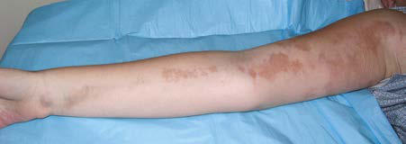

# Chapter 201: Scleroderma and Raynaud Phenomenon — Board-Style Self-Assessment MCQs
**Part XIV: Rheumatic Diseases of Childhood (Connective Tissue Diseases, Collagen Vascular Diseases)** | [📖 Read Wiki Chapter](../chapters/201.md) | [🃏 Chapter Flashcards](../flashcards/201_flashcards.md) | [🏠 Course Master Index](../../index.md)

Total questions: **5** *(Click "Show Answer & Rationale" beneath each question)*

### Question 1 (Clinical Pediatrics Vignette)
A pediatric patient is evaluated for the following clinical and diagnostic profile: Diffuse cutaneous (dc); Skin; Thickness proximal to elbows and knees; Rapid progressive thickening; Topoisomerase (Scl-70); RNA Polymerase III; U3-RNP (fibrillarin); Cardiac; Congestive heart failure; Conduction abnormalities; Renal; Scleroderma rena. Which of the following conditions or syndromes is the most likely diagnosis?

- **A.** ANTIBODY ASSOCIATION
- **B.** Bullous morphea (Scleroderma and Raynaud Phenomenon)
- **C.** Linear scleroderma
- **D.** U1-RNP (Scleroderma and Raynaud Phenomenon)

<b>Show Answer & Rationale</b>

**Correct Answer: A** — ANTIBODY ASSOCIATION

**Rationale:** **ANTIBODY ASSOCIATION** is characterized by: Diffuse cutaneous (dc); Skin; Thickness proximal to elbows and knees; Rapid progressive thickening; Topoisomerase (Scl-70); RNA Polymerase III; U3-RNP (fibrillarin); Cardiac; Congestive heart failure; Conduction abnormalities; Renal; Scleroderma renal crisis; Pulmonary; Interstitial lung disease; Limited cutaneous (lc).

**Why Other Options Are Incorrect:** **Bullous morphea (Scleroderma and Raynaud Phenomenon)** is incorrect (characterized by Bullous lesions that can occur with any of the subtypes of morphea). **Linear scleroderma** is incorrect (characterized by Linear lesions can extend through the dermis, subcutaneous tissue,; and muscle to underlying bone; m). **U1-RNP (Scleroderma and Raynaud Phenomenon)** is incorrect (characterized by Ku; Musculoskeletal; Arthritis; Myositis; Cardiac; Can have any of the dcSSc or lcSSc manifestations).

### Question 2 (Clinical Pediatrics Vignette)
A pediatric patient is evaluated for the following clinical and diagnostic profile: Ku; Musculoskeletal; Arthritis; Myositis; Cardiac; Can have any of the dcSSc or lcSSc manifestations; Additional organ involvement in association with other CTD; feature, such as lupus nephritis; Renal; Pulmonary; Gastrointestinal; CTD, Connective ti. Which of the following conditions or syndromes is the most likely diagnosis?

- **A.** Generalized morphea
- **B.** ANTIBODY ASSOCIATION
- **C.** U1-RNP (Scleroderma and Raynaud Phenomenon)
- **D.** Linear scleroderma

<b>Show Answer & Rationale</b>

**Correct Answer: C** — U1-RNP (Scleroderma and Raynaud Phenomenon)

**Rationale:** **U1-RNP (Scleroderma and Raynaud Phenomenon)** is characterized by: Ku; Musculoskeletal; Arthritis; Myositis; Cardiac; Can have any of the dcSSc or lcSSc manifestations; Additional organ involvement in association with other CTD; feature, such as lupus nephritis; Renal; Pulmonary; Gastrointestinal; CTD, Connective tissue disease; DM, dermatomyositis; PM-Scl, polymyositis-scleroderma an.

**Why Other Options Are Incorrect:** **Generalized morphea** is incorrect (characterized by Involves dermis primarily, occasionally panniculus; Defined as confluence of individual morphea plaq). **ANTIBODY ASSOCIATION** is incorrect (characterized by Diffuse cutaneous (dc); Skin; Thickness proximal to elbows and knees; Rapid progressive thickening; ). **Linear scleroderma** is incorrect (characterized by Linear lesions can extend through the dermis, subcutaneous tissue,; and muscle to underlying bone; m).

### Question 3 (Visual Diagnosis & Clinical Spotter)

A pediatric patient undergoes evaluation for **Scleroderma and Raynaud Phenomenon**, yielding the clinical or diagnostic finding shown below. Which of the following best characterizes the illustrated finding?

- **A.** Systemic Scleroderma SSc is a severe disease in children, starting with an insidious onset fol lowed by a prolonged course characterized by periods of remission and exacerbation, commonly re
- **B.** Pulmonary disease is the most common visceral manifestation of SSc and includes both arterial and interstitial involvement (alveolitis).
- **C.** Inactive linear scleroderma demonstrating hyperpigment ed lesion with areas of normal skin (skip lesions).
- **D.** Localized scleroderma (LS) is much more common than sys temic sclerosis (SSc) in children, by a 10:1 ratio, with linear scleroderma being the most common subtype.

<b>Show Answer & Rationale</b>

**Correct Answer: C** — Inactive linear scleroderma demonstrating hyperpigment ed lesion with areas of normal skin (skip lesions).

**Rationale:** **Fig. 201.2**: Inactive linear scleroderma demonstrating hyperpigment ed lesion with areas of normal skin (skip lesions).

### Question 4 (Differential Diagnosis (Scleroderma and Raynaud Phenomenon))
During a pediatric consultation regarding **Scleroderma and Raynaud Phenomenon**, which clinical entity or concept is described by the following profile? "The etiology of scleroderma is unknown, but the mechanism of dis ease appears to be a combination of a vasculopathy, autoimmunity, immune activation, and fibrosis."

- **A.** Bullous morphea (Scleroderma and Raynaud Phenomenon)
- **B.** Laboratory Findings
- **C.** ETIOLOGY AND PATHOGENESIS
- **D.** TREATMENT

<b>Show Answer & Rationale</b>

**Correct Answer: C** — ETIOLOGY AND PATHOGENESIS

**Rationale:** ETIOLOGY AND PATHOGENESIS The etiology of scleroderma is unknown, but the mechanism of dis ease appears to be a combination of a vasculopathy, autoimmunity, immune activation, and fibrosis.

### Question 5 (Pediatric Board Mastery (Scleroderma and Raynaud Phenomenon))
When formulating an evidence-based diagnostic and management plan for **Scleroderma and Raynaud Phenomenon** (*Part XIV: Rheumatic Diseases of Childhood (Connective Tissue Diseases, Collagen Vascular Diseases)*), which of the following pediatric clinical statements is **ACCURATE**? (Item 1)

- **A.** Diagnostic confirmation relies solely on plain skull radiographs without biochemical, microbiologic, or clinical correlation.
- **B.** Localized scleroderma (LS) is much more common than sys temic sclerosis (SSc) in children, by a 10:1 ratio, with linear scleroderma being the most common subtype.
- **C.** Inheritance is exclusively holandric (Y-linked) with 100% penetrance restricted to male neonates.
- **D.** First-line management relies on immediate high-dose aspirin therapy in febrile infants.

<b>Show Answer & Rationale</b>

**Correct Answer: B** — Localized scleroderma (LS) is much more common than sys temic sclerosis (SSc) in children, by a 10:1 ratio, with linear scleroderma being the most common subtype.

**Rationale:** **Pediatric Clinical Principle (Scleroderma and Raynaud Phenomenon):** Localized scleroderma (LS) is much more common than sys temic sclerosis (SSc) in children, by a 10:1 ratio, with linear scleroderma being the most common subtype.

