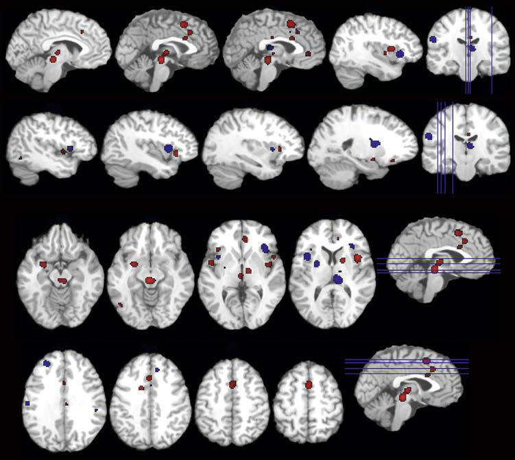

# Chapter 212: Chronic Overlapping Pain Conditions — Board-Style Self-Assessment MCQs
**Part XIV: Rheumatic Diseases of Childhood (Connective Tissue Diseases, Collagen Vascular Diseases)** | [📖 Read Wiki Chapter](../chapters/212.md) | [🃏 Chapter Flashcards](../flashcards/212_flashcards.md) | [🏠 Course Master Index](../../index.md)

Total questions: **5** *(Click "Show Answer & Rationale" beneath each question)*

### Question 1 (Clinical Pediatrics Vignette)
A pediatric patient is evaluated for the following clinical and diagnostic profile: “Thunderclap” rapid-onset headache or the “worst headache of; my life”; Recent worsening in severity or frequency; Change in this pediatric condition; New-onset symptoms consistent with cluster headache. Which of the following conditions or syndromes is the most likely diagnosis?

- **A.** Timing (Chronic Overlapping Pain Conditions)
- **B.** Associated neurologic history
- **C.** Quality (Chronic Overlapping Pain Conditions)
- **D.** Location (Chronic Overlapping Pain Conditions)

<b>Show Answer & Rationale</b>

**Correct Answer: C** — Quality (Chronic Overlapping Pain Conditions)

**Rationale:** **Quality (Chronic Overlapping Pain Conditions)** is characterized by: “Thunderclap” rapid-onset headache or the “worst headache of; my life”; Recent worsening in severity or frequency; Change in quality; New-onset symptoms consistent with cluster headache.

**Why Other Options Are Incorrect:** **Timing (Chronic Overlapping Pain Conditions)** is incorrect (characterized by Awakens from sleep; Occurs in morning or causes morning vomiting; Acute or chronic progressive patte). **Associated neurologic history** is incorrect (characterized by Neurologic dysfunction other than typical aura; Altered sensorium during headache; Sensory deficits ). **Location (Chronic Overlapping Pain Conditions)** is incorrect (characterized by Unilateral without alteration of sides; Chronic or recurrent occipital headache).

### Question 2 (Clinical Pediatrics Vignette)
A pediatric patient is evaluated for the following clinical and diagnostic profile: Unilateral without alteration of sides; Chronic or recurrent occipital headache. Which of the following conditions or syndromes is the most likely diagnosis?

- **A.** Associated neurologic history
- **B.** Neck pain (Chronic Overlapping Pain Conditions)
- **C.** Location (Chronic Overlapping Pain Conditions)
- **D.** Timing (Chronic Overlapping Pain Conditions)

<b>Show Answer & Rationale</b>

**Correct Answer: C** — Location (Chronic Overlapping Pain Conditions)

**Rationale:** **Location (Chronic Overlapping Pain Conditions)** is characterized by: Unilateral without alteration of sides; Chronic or recurrent occipital headache.

**Why Other Options Are Incorrect:** **Associated neurologic history** is incorrect (characterized by Neurologic dysfunction other than typical aura; Altered sensorium during headache; Sensory deficits ). **Neck pain (Chronic Overlapping Pain Conditions)** is incorrect (characterized by Medical comorbidities; History of ventriculoperitoneal shunt; Certain medications; Signs of systemic). **Timing (Chronic Overlapping Pain Conditions)** is incorrect (characterized by Awakens from sleep; Occurs in morning or causes morning vomiting; Acute or chronic progressive patte).

### Question 3 (Visual Diagnosis & Clinical Spotter)

A pediatric patient undergoes evaluation for **Chronic Overlapping Pain Conditions**, yielding the clinical or diagnostic finding shown below. Which of the following best characterizes the illustrated finding?

- **A.** Brain areas demonstrating more (red) or less (blue) activation in ir ritable bowel syndrome compared with healthy control in a meta-analysis of rectal distention. (From Tillisch K, Mayer EA, La b
- **B.** SYMPTOM/DISORDER OVERLAP Diagnostic criteria of many of these disorders overlap with one another, making differentiation between two disorders more of a semantic issue rather than a clinical
- **C.** The chronic pain reduces exercise tolerance, with poorer quality of life and an ever-worsening cycle because exer cise is a key piece of management.
- **D.** Chronic fatigue syndrome (CFS), clinically the most concerning symptom, shares many of the diagnostic criteria with fibromyalgia.

<b>Show Answer & Rationale</b>

**Correct Answer: A** — Brain areas demonstrating more (red) or less (blue) activation in ir ritable bowel syndrome compared with healthy control in a meta-analysis of rectal distention. (From Tillisch K, Mayer EA, La b

**Rationale:** **Fig. 212.1**: Brain areas demonstrating more (red) or less (blue) activation in ir ritable bowel syndrome compared with healthy control in a meta-analysis of rectal distention. (From Tillisch K, Mayer EA, La bus JS. Quantitative meta-analysis identi fies brain regions activated during rectal distension in irritable bowel syndrome. Gastroenterology. 2011;140:91–100, Fig. 3.).

### Question 4 (Differential Diagnosis (Chronic Overlapping Pain Conditions))
During a pediatric consultation regarding **Chronic Overlapping Pain Conditions**, which clinical entity or concept is described by the following profile? "The this pediatric condition of COPCs is unknown depending on which symp tom is being assessed and how much overlap exists across disorders."

- **A.** hypermobility Ehlers-Danlos (hEDS)
- **B.** neutrally mediated hypotension
- **C.** NATURAL HISTORY
- **D.** PREVALENCE

<b>Show Answer & Rationale</b>

**Correct Answer: D** — PREVALENCE

**Rationale:** PREVALENCE The prevalence of COPCs is unknown depending on which symp tom is being assessed and how much overlap exists across disorders.

### Question 5 (Pediatric Board Mastery (Chronic Overlapping Pain Conditions))
When formulating an evidence-based diagnostic and management plan for **Chronic Overlapping Pain Conditions** (*Part XIV: Rheumatic Diseases of Childhood (Connective Tissue Diseases, Collagen Vascular Diseases)*), which of the following pediatric clinical statements is **ACCURATE**? (Item 1)

- **A.** First-line management relies on immediate high-dose aspirin therapy in febrile infants.
- **B.** SYMPTOM/DISORDER OVERLAP Diagnostic criteria of many of these disorders overlap with one another, making differentiation between two disorders more of a semantic issue rather than a clinical differentiatio
- **C.** Systemic tetracyclines and fluoroquinolones are universally required as routine prophylaxis in all healthy newborns.
- **D.** Clinical manifestations are permanently restricted to late adulthood and never present during infancy, childhood, or adolescence.

<b>Show Answer & Rationale</b>

**Correct Answer: B** — SYMPTOM/DISORDER OVERLAP Diagnostic criteria of many of these disorders overlap with one another, making differentiation between two disorders more of a semantic issue rather than a clinical differentiatio

**Rationale:** **Pediatric Clinical Principle (Chronic Overlapping Pain Conditions):** SYMPTOM/DISORDER OVERLAP Diagnostic criteria of many of these disorders overlap with one another, making differentiation between two disorders more of a semantic issue rather than a clinical differentiation.

