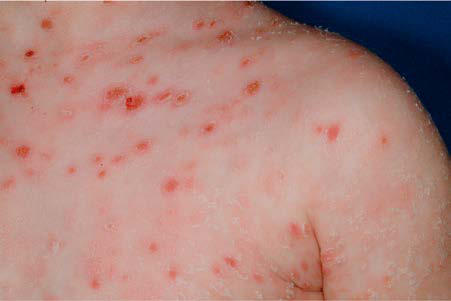

# Chapter 213: Miscellaneous Conditions Associated with Arthritis — Board-Style Self-Assessment MCQs
**Part XIV: Rheumatic Diseases of Childhood (Connective Tissue Diseases, Collagen Vascular Diseases)** | [📖 Read Wiki Chapter](../chapters/213.md) | [🃏 Chapter Flashcards](../flashcards/213_flashcards.md) | [🏠 Course Master Index](../../index.md)

Total questions: **5** *(Click "Show Answer & Rationale" beneath each question)*

### Question 1 (Clinical Pediatrics Vignette)
A pediatric patient is evaluated for the following clinical and diagnostic profile: Typical inflammatory episodes of ear cartilage; Typical inflammatory episodes of nose cartilage; Typical inflammatory episodes of laryngotracheal cartilage. Which of the following conditions or syndromes is the most likely diagnosis?

- **A.** MAJOR CRITERIA (Miscellaneous Conditions Associated with Arthritis)
- **B.** MINOR (Miscellaneous Conditions Associated with Arthritis)
- **C.** MINOR CRITERIA (Miscellaneous Conditions Associated with Arthritis)
- **D.** MAJOR (Miscellaneous Conditions Associated with Arthritis)

<b>Show Answer & Rationale</b>

**Correct Answer: D** — MAJOR (Miscellaneous Conditions Associated with Arthritis)

**Rationale:** **MAJOR (Miscellaneous Conditions Associated with Arthritis)** is characterized by: Typical inflammatory episodes of ear cartilage; Typical inflammatory episodes of nose cartilage; Typical inflammatory episodes of laryngotracheal cartilage.

**Why Other Options Are Incorrect:** **MAJOR CRITERIA (Miscellaneous Conditions Associated with Arthritis)** is incorrect (characterized by Abrupt onset of painful erythematous plaques or nodules; Histopathologic evidence of dense neutrophi). **MINOR (Miscellaneous Conditions Associated with Arthritis)** is incorrect (characterized by Eye inflammation (conjunctivitis, keratitis, episcleritis, uveitis); Hearing loss; Vestibular dysfun). **MINOR CRITERIA (Miscellaneous Conditions Associated with Arthritis)** is incorrect (characterized by Pyrexia >38°C; Association with underlying hematologic or visceral malignancy,; inflammatory disease).

### Question 2 (Clinical Pediatrics Vignette)
A pediatric patient is evaluated for the following clinical and diagnostic profile: Eye inflammation (conjunctivitis, keratitis, episcleritis, uveitis); Hearing loss; Vestibular dysfunction; Seronegative inflammatory arthritis; *The diagnosis is established by the presence of two major or one major and two; this pediatric condition . Which of the following conditions or syndromes is the most likely diagnosis?

- **A.** MAJOR CRITERIA (Miscellaneous Conditions Associated with Arthritis)
- **B.** MINOR (Miscellaneous Conditions Associated with Arthritis)
- **C.** MINOR CRITERIA (Miscellaneous Conditions Associated with Arthritis)
- **D.** MAJOR (Miscellaneous Conditions Associated with Arthritis)

<b>Show Answer & Rationale</b>

**Correct Answer: B** — MINOR (Miscellaneous Conditions Associated with Arthritis)

**Rationale:** **MINOR (Miscellaneous Conditions Associated with Arthritis)** is characterized by: Eye inflammation (conjunctivitis, keratitis, episcleritis, uveitis); Hearing loss; Vestibular dysfunction; Seronegative inflammatory arthritis; *The diagnosis is established by the presence of two major or one major and two; minor criteria. Histologic examination of affected cartilage is required when the; presentation.

**Why Other Options Are Incorrect:** **MAJOR CRITERIA (Miscellaneous Conditions Associated with Arthritis)** is incorrect (characterized by Abrupt onset of painful erythematous plaques or nodules; Histopathologic evidence of dense neutrophi). **MINOR CRITERIA (Miscellaneous Conditions Associated with Arthritis)** is incorrect (characterized by Pyrexia >38°C; Association with underlying hematologic or visceral malignancy,; inflammatory disease). **MAJOR (Miscellaneous Conditions Associated with Arthritis)** is incorrect (characterized by Typical inflammatory episodes of ear cartilage; Typical inflammatory episodes of nose cartilage; Typ).

### Question 3 (Visual Diagnosis & Clinical Spotter)

A pediatric patient undergoes evaluation for **Miscellaneous Conditions Associated with Arthritis**, yielding the clinical or diagnostic finding shown below. Which of the following best characterizes the illustrated finding?

- **A.** One of the nonpharmacologic approaches to pain management, CBT, may also assist the patient in managing and coping with CFS.
- **B.** The diagnostic criterion of 6 months duration of illness should not delay evaluation and symp tom management, because these may be initiated as soon as the child or adolescent presents with
- **C.** Pityriasis lichenoides et varioliformis acuta (PLEVA). Symmet ric, oval and round, reddish brown macular, papular, necrotic, and crusted lesions on the chest of 9-yr-old boy. (From Paller AS, Man
- **D.** MANAGEMENT Management of CFS is based on relief of the core and most disrup tive symptoms in the individual patient.

<b>Show Answer & Rationale</b>

**Correct Answer: C** — Pityriasis lichenoides et varioliformis acuta (PLEVA). Symmet ric, oval and round, reddish brown macular, papular, necrotic, and crusted lesions on the chest of 9-yr-old boy. (From Paller AS, Man

**Rationale:** **Fig. 213.1**: Pityriasis lichenoides et varioliformis acuta (PLEVA). Symmet ric, oval and round, reddish brown macular, papular, necrotic, and crusted lesions on the chest of 9-yr-old boy. (From Paller AS, Mancini AJ, eds. Hur witz Clinical Pediatric Dermatology, 5th ed. Philadelphia: Elsevier; 2016: Fig. 4-33, p. 87.)

### Question 4 (Differential Diagnosis (Miscellaneous Conditions Associated with Arthritis))
During a pediatric consultation regarding **Miscellaneous Conditions Associated with Arthritis**, which clinical entity or concept is described by the following profile? "this pediatric condition of CFS is based on relief of the core and most disrup tive symptoms in the individual patient."

- **A.** PLANT THORN SYNOVITIS
- **B.** MANAGEMENT
- **C.** MAGIC
- **D.** CMV SYNDROME (Cytomegalovirus)

<b>Show Answer & Rationale</b>

**Correct Answer: B** — MANAGEMENT

**Rationale:** MANAGEMENT Management of CFS is based on relief of the core and most disrup tive symptoms in the individual patient.

### Question 5 (Pediatric Board Mastery (Miscellaneous Conditions Associated with Arthritis))
When formulating an evidence-based diagnostic and management plan for **Miscellaneous Conditions Associated with Arthritis** (*Part XIV: Rheumatic Diseases of Childhood (Connective Tissue Diseases, Collagen Vascular Diseases)*), which of the following pediatric clinical statements is **ACCURATE**? (Item 1)

- **A.** Diagnostic confirmation relies solely on plain skull radiographs without biochemical, microbiologic, or clinical correlation.
- **B.** MANAGEMENT Management of CFS is based on relief of the core and most disrup tive symptoms in the individual patient.
- **C.** The condition is an entirely benign physiologic variant that never warrants laboratory or clinical evaluation.
- **D.** Systemic tetracyclines and fluoroquinolones are universally required as routine prophylaxis in all healthy newborns.

<b>Show Answer & Rationale</b>

**Correct Answer: B** — MANAGEMENT Management of CFS is based on relief of the core and most disrup tive symptoms in the individual patient.

**Rationale:** **Pediatric Clinical Principle (Miscellaneous Conditions Associated with Arthritis):** MANAGEMENT Management of CFS is based on relief of the core and most disrup tive symptoms in the individual patient.

