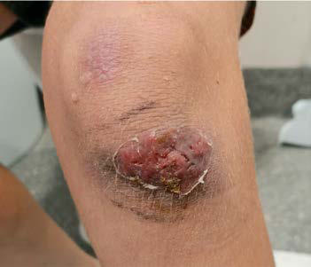

# Chapter 236: Nocardia — Board-Style Self-Assessment MCQs
**Part XV: Infectious Diseases** | [📖 Read Wiki Chapter](../chapters/236.md) | [🃏 Chapter Flashcards](../flashcards/236_flashcards.md) | [🏠 Course Master Index](../../index.md)

Total questions: **5** *(Click "Show Answer & Rationale" beneath each question)*

### Question 1 (Clinical Pediatrics Vignette)
A pediatric patient is evaluated for the following clinical and diagnostic profile: Accordingly, penicillin G is the drug of choice for parenteral therapy, and penicillin V or amoxi cillin is the preferred enteral antibiotic.. Which of the following conditions or syndromes is the most likely diagnosis?

- **A.** TYPE 11 COLLAGEN DISORDERS
- **B.** 250 U (Measles)
- **C.** SYMPTOMS (General Principles of Treatment of Congenital Heart Disease)
- **D.** Nocardia

<b>Show Answer & Rationale</b>

**Correct Answer: D** — Nocardia

**Rationale:** **Nocardia** is characterized by: Accordingly, penicillin G is the drug of choice for parenteral therapy, and penicillin V or amoxi cillin is the preferred enteral antibiotic..

**Why Other Options Are Incorrect:** **TYPE 11 COLLAGEN DISORDERS** is incorrect (characterized by Stickler syndrome). **250 U (Measles)** is incorrect (characterized by 10; 3; Hepatitis A prophylaxis (as Ig):; Contact prophylaxis). **SYMPTOMS (General Principles of Treatment of Congenital Heart Disease)** is incorrect (characterized by Pleuritic or pericarditic chest pain; Intermittent, low-grade fever; >50; ∼50).

### Question 2 (Visual Diagnosis & Clinical Spotter)

A pediatric patient undergoes evaluation for **Nocardia**, yielding the clinical or diagnostic finding shown below. Which of the following best characterizes the illustrated finding?

- **A.** However, in some case series a subset of patients have responded well to medical management alone.
- **B.** A 9-yr-old healthy child with infected knee laceration (A) 10 days after falling onto concrete in his school playground, compli cated by nodular lymphangitis (B). (From Williams PCM, Bartlett AW,
- **C.** Accordingly, penicillin G is the drug of choice for parenteral therapy, and penicillin V or amoxi cillin is the preferred enteral antibiotic.
- **D.** PROGNOSIS The prognosis is excellent with early diagnosis, prompt initiation of antibiotic therapy, adherence to a prolonged course of antibiotics, and adequate surgical debridement, if nece

<b>Show Answer & Rationale</b>

**Correct Answer: B** — A 9-yr-old healthy child with infected knee laceration (A) 10 days after falling onto concrete in his school playground, compli cated by nodular lymphangitis (B). (From Williams PCM, Bartlett AW,

**Rationale:** **Fig. 236.1**: A 9-yr-old healthy child with infected knee laceration (A) 10 days after falling onto concrete in his school playground, compli cated by nodular lymphangitis (B). (From Williams PCM, Bartlett AW, Palasanthiran P, McMullan B. A not so innocuous playground fall: lym phocutaneous nocardiosis in an immunocompetent boy. Arch Dis Child. 2022;107[3]:257–258, Figs. 1 and 2.)

### Question 3 (Differential Diagnosis (Nocardia))
During a pediatric consultation regarding **Nocardia**, which clinical entity or concept is described by the following profile? "Most cases of actinomycosis can be managed with antibiotics, although surgery can be adjunctive and may shorten the duration of antibiotic use."

- **A.** TREATMENT
- **B.** Trimethoprim- sulfamethoxazole (TMP-SMX)
- **C.** AIRWAY (Chronic Respiratory Insufficiency)
- **D.** DIAGNOSIS

<b>Show Answer & Rationale</b>

**Correct Answer: A** — TREATMENT

**Rationale:** TREATMENT Most cases of actinomycosis can be managed with antibiotics, although surgery can be adjunctive and may shorten the duration of antibiotic use.

### Question 4 (Differential Diagnosis (Nocardia))
During a pediatric consultation regarding **Nocardia**, which clinical entity or concept is described by the following profile? "The this pediatric condition is excellent with early diagnosis, prompt initiation of antibiotic therapy, adherence to a prolonged course of antibiotics, and adequate surgical debridement, if necessary."

- **A.** DIAGNOSIS
- **B.** Acute Secondary Peritonitis (Subchapter 419.2)
- **C.** EPIDEMIOLOGY
- **D.** PROGNOSIS

<b>Show Answer & Rationale</b>

**Correct Answer: D** — PROGNOSIS

**Rationale:** PROGNOSIS The prognosis is excellent with early diagnosis, prompt initiation of antibiotic therapy, adherence to a prolonged course of antibiotics, and adequate surgical debridement, if necessary.

### Question 5 (Pediatric Board Mastery (Nocardia))
When formulating an evidence-based diagnostic and management plan for **Nocardia** (*Part XV: Infectious Diseases*), which of the following pediatric clinical statements is **ACCURATE**? (Item 1)

- **A.** Clinical manifestations are permanently restricted to late adulthood and never present during infancy, childhood, or adolescence.
- **B.** Systemic tetracyclines and fluoroquinolones are universally required as routine prophylaxis in all healthy newborns.
- **C.** Diagnostic confirmation relies solely on plain skull radiographs without biochemical, microbiologic, or clinical correlation.
- **D.** Accordingly, penicillin G is the drug of choice for parenteral therapy, and penicillin V or amoxi cillin is the preferred enteral antibiotic.

<b>Show Answer & Rationale</b>

**Correct Answer: D** — Accordingly, penicillin G is the drug of choice for parenteral therapy, and penicillin V or amoxi cillin is the preferred enteral antibiotic.

**Rationale:** **Pediatric Clinical Principle (Nocardia):** Accordingly, penicillin G is the drug of choice for parenteral therapy, and penicillin V or amoxi cillin is the preferred enteral antibiotic.

