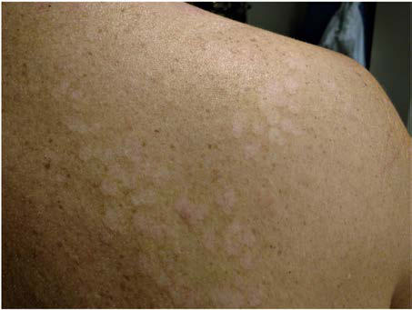

# Chapter 282: Malassezia — Board-Style Self-Assessment MCQs
**Part XV: Infectious Diseases** | [📖 Read Wiki Chapter](../chapters/282.md) | [🃏 Chapter Flashcards](../flashcards/282_flashcards.md) | [🏠 Course Master Index](../../index.md)

Total questions: **5** *(Click "Show Answer & Rationale" beneath each question)*

### Question 1 (Clinical Pediatrics Vignette)
A pediatric patient is evaluated for the following clinical and diagnostic profile: Recent consensus recommendations name liposomal amphotericin B as first-line treatment for systemic this pediatric condition infections, with amphoteri cin B deoxycholate as an alternative.. Which of the following conditions or syndromes is the most likely diagnosis?

- **A.** Malassezia
- **B.** Sexual Exploitation
- **C.** Top Pediatric Liver Transplant Indications
- **D.** CHARACTERISTICS (Movement Disorders)

<b>Show Answer & Rationale</b>

**Correct Answer: A** — Malassezia

**Rationale:** **Malassezia** is characterized by: Recent consensus recommendations name liposomal amphotericin B as first-line treatment for systemic Malassezia infections, with amphoteri cin B deoxycholate as an alternative..

**Why Other Options Are Incorrect:** **Sexual Exploitation** is incorrect (characterized by Prostitution of a child; Production of child sexual exploitation materials (child pornography); Expl). **Top Pediatric Liver Transplant Indications** is incorrect (characterized by 1. Biliary atresia (35–45%), 2. Metabolic/genetic diseases (20%), 3. Pediatric acute liver failure (). **CHARACTERISTICS (Movement Disorders)** is incorrect (characterized by Stereotypies; Involuntary, patterned,; coordinated, repetitive, rhythmic; movements that occur in th).

### Question 2 (Visual Diagnosis & Clinical Spotter)

A pediatric patient undergoes evaluation for **Malassezia**, yielding the clinical or diagnostic finding shown below. Which of the following best characterizes the illustrated finding?

- **A.** Recent consensus recommendations name liposomal amphotericin B as first-line treatment for systemic Malassezia infections, with amphoteri cin B deoxycholate as an alternative.
- **B.** The history of Malassezia nomenclature is complex and can be confusing.
- **C.** Normal physiologic neonatal finding requiring no diagnostic workup or follow-up.
- **D.** A young adult with tinea versicolor. Notice the character istic hypopigmented scaling macules. (Courtesy Ashley M. Maranich, MD.)

<b>Show Answer & Rationale</b>

**Correct Answer: D** — A young adult with tinea versicolor. Notice the character istic hypopigmented scaling macules. (Courtesy Ashley M. Maranich, MD.)

**Rationale:** **Fig. 282.1**: A young adult with tinea versicolor. Notice the character istic hypopigmented scaling macules. (Courtesy Ashley M. Maranich, MD.)

### Question 3 (Pediatric Board Mastery (Malassezia))
When formulating an evidence-based diagnostic and management plan for **Malassezia** (*Part XV: Infectious Diseases*), which of the following pediatric clinical statements is **ACCURATE**? (Item 1)

- **A.** Clinical manifestations are permanently restricted to late adulthood and never present during infancy, childhood, or adolescence.
- **B.** First-line management relies on immediate high-dose aspirin therapy in febrile infants.
- **C.** Diagnostic confirmation relies solely on plain skull radiographs without biochemical, microbiologic, or clinical correlation.
- **D.** Recent consensus recommendations name liposomal amphotericin B as first-line treatment for systemic Malassezia infections, with amphoteri cin B deoxycholate as an alternative.

<b>Show Answer & Rationale</b>

**Correct Answer: D** — Recent consensus recommendations name liposomal amphotericin B as first-line treatment for systemic Malassezia infections, with amphoteri cin B deoxycholate as an alternative.

**Rationale:** **Pediatric Clinical Principle (Malassezia):** Recent consensus recommendations name liposomal amphotericin B as first-line treatment for systemic Malassezia infections, with amphoteri cin B deoxycholate as an alternative.

### Question 4 (Pediatric Board Mastery (Malassezia))
When formulating an evidence-based diagnostic and management plan for **Malassezia** (*Part XV: Infectious Diseases*), which of the following pediatric clinical statements is **ACCURATE**? (Item 2)

- **A.** Diagnostic confirmation relies solely on plain skull radiographs without biochemical, microbiologic, or clinical correlation.
- **B.** The condition is an entirely benign physiologic variant that never warrants laboratory or clinical evaluation.
- **C.** The history of Malassezia nomenclature is complex and can be confusing.
- **D.** First-line management relies on immediate high-dose aspirin therapy in febrile infants.

<b>Show Answer & Rationale</b>

**Correct Answer: C** — The history of Malassezia nomenclature is complex and can be confusing.

**Rationale:** **Pediatric Clinical Principle (Malassezia):** The history of Malassezia nomenclature is complex and can be confusing.

### Question 5 (Pediatric Board Mastery (Malassezia))
When formulating an evidence-based diagnostic and management plan for **Malassezia** (*Part XV: Infectious Diseases*), which of the following pediatric clinical statements is **ACCURATE**? (Item 3)

- **A.** First-line management relies on immediate high-dose aspirin therapy in febrile infants.
- **B.** Inheritance is exclusively holandric (Y-linked) with 100% penetrance restricted to male neonates.
- **C.** Systemic tetracyclines and fluoroquinolones are universally required as routine prophylaxis in all healthy newborns.
- **D.** Recurrence is common and usually responds well to the original treatment regimen.

<b>Show Answer & Rationale</b>

**Correct Answer: D** — Recurrence is common and usually responds well to the original treatment regimen.

**Rationale:** **Pediatric Clinical Principle (Malassezia):** Recurrence is common and usually responds well to the original treatment regimen.

