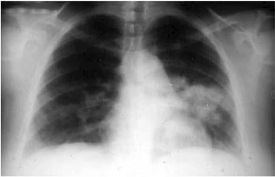

# Chapter 285: Blastomycosis — Board-Style Self-Assessment MCQs
**Part XV: Infectious Diseases** | [📖 Read Wiki Chapter](../chapters/285.md) | [🃏 Chapter Flashcards](../flashcards/285_flashcards.md) | [🏠 Course Master Index](../../index.md)

Total questions: **5** *(Click "Show Answer & Rationale" beneath each question)*

### Question 1 (Clinical Pediatrics Vignette)
A pediatric patient is evaluated for the following clinical and diagnostic profile: Once in tissue, Blastomyces infection results in pyogranulomatous inflammation, which is characterized by neutrophil infiltration and granuloma formation.. Which of the following conditions or syndromes is the most likely diagnosis?

- **A.** Trigeminal Nerve (General Considerations and Evaluation of the Ear)
- **B.** DURATION (Neurologic Evaluation)
- **C.** IL10RA (Eosinophilic Gastroenteritis)
- **D.** Blastomycosis

<b>Show Answer & Rationale</b>

**Correct Answer: D** — Blastomycosis

**Rationale:** **Blastomycosis** (associated with **`BAD1, DRK1`**) is characterized by: Once in tissue, Blastomyces infection results in pyogranulomatous inflammation, which is characterized by neutrophil infiltration and granuloma formation..

**Why Other Options Are Incorrect:** **Trigeminal Nerve (General Considerations and Evaluation of the Ear)** is incorrect (characterized by Dental; Jaw; Temporomandibular joint; Oral cavity (tongue); Infratemporal fossa tumors). **DURATION (Neurologic Evaluation)** is incorrect (characterized by Palmar grasp; 28 wk gestation; 32 wk gestation; 2-3 mo postnatal; Rooting; 32 wk gestation; 36 wk ge). **IL10RA (Eosinophilic Gastroenteritis)** is incorrect (characterized by IL-10-induced STAT3 phosphorylation by flow; cytometry or immunoblotting).

### Question 2 (Pediatric Genetics & Molecular Etiology)
A child is diagnosed with **Blastomycosis** after presenting with Once in tissue, Blastomyces infection results in pyogranulomatous inflammation, which is characterized by neutrophil infiltration and granuloma formation.. Pathogenic variants in which of the following genes are most classically implicated?

- **A.** BAD1
- **B.** HGSNAT
- **C.** MAN2B1
- **D.** BLM

<b>Show Answer & Rationale</b>

**Correct Answer: A** — BAD1

**Rationale:** Pathogenic variants in **`BAD1`** (Infectious Diseases) are associated with **Blastomycosis** (Once in tissue, Blastomyces infection results in pyogranulomatous inflammation, which is characterized by neutrophil infiltration and granuloma formation.).

### Question 3 (Visual Diagnosis & Clinical Spotter)

A pediatric patient undergoes evaluation for **Blastomycosis**, yielding the clinical or diagnostic finding shown below. Which of the following best characterizes the illustrated finding?

- **A.** The most common clinical manifestation of blastomycosis is pneu monia, which can range from acute to chronic.
- **B.** Left lung infection in a patient with symptoms resembling acute bacterial pneumonia. Organisms of Blastomyces in the sputum seen with potassium hydroxide preparation, and subsequent culture confi
- **C.** In North America, B. dermatitidis and B. gilchristii grow in an eco logic niche characterized by forested, sandy soils with an acidic pH that have decaying vegetation and are near water.
- **D.** Once in tissue, Blastomyces infection results in pyogranulomatous inflammation, which is characterized by neutrophil infiltration and granuloma formation.

<b>Show Answer & Rationale</b>

**Correct Answer: B** — Left lung infection in a patient with symptoms resembling acute bacterial pneumonia. Organisms of Blastomyces in the sputum seen with potassium hydroxide preparation, and subsequent culture confi

**Rationale:** **Fig. 285.1**: Left lung infection in a patient with symptoms resembling acute bacterial pneumonia. Organisms of Blastomyces in the sputum seen with potassium hydroxide preparation, and subsequent culture confirmed the diagnosis. (From Bradsher RW Jr. Blastomycoses. In: Bennett JE, Blaser MJ, Dolin R, et al, eds. Mandell, Douglas, and Ben nett’s Principles and Practice of Infectious Diseases, 8th ed, Philadel phia: Saunders; 2015: Fig. 266-5.)

### Question 4 (Differential Diagnosis (Blastomycosis))
During a pediatric consultation regarding **Blastomycosis**, which clinical entity or concept is described by the following profile? "The etiologic agents of blastomycosis belong to a species complex and include *Blastomyces dermatitidis, B."

- **A.** PATHOGENESIS
- **B.** ETIOLOGY
- **C.** SYSTEMIC DISEASE (Ankylosing Spondylitis and Other Spondyloarthritides)
- **D.** CNS blastomycosis

<b>Show Answer & Rationale</b>

**Correct Answer: B** — ETIOLOGY

**Rationale:** ETIOLOGY The etiologic agents of blastomycosis belong to a species complex and include *Blastomyces dermatitidis, B.

### Question 5 (Pediatric Board Mastery (Blastomycosis))
When formulating an evidence-based diagnostic and management plan for **Blastomycosis** (*Part XV: Infectious Diseases*), which of the following pediatric clinical statements is **ACCURATE**? (Item 1)

- **A.** Inheritance is exclusively holandric (Y-linked) with 100% penetrance restricted to male neonates.
- **B.** Once in tissue, Blastomyces infection results in pyogranulomatous inflammation, which is characterized by neutrophil infiltration and granuloma formation.
- **C.** Diagnostic confirmation relies solely on plain skull radiographs without biochemical, microbiologic, or clinical correlation.
- **D.** Systemic tetracyclines and fluoroquinolones are universally required as routine prophylaxis in all healthy newborns.

<b>Show Answer & Rationale</b>

**Correct Answer: B** — Once in tissue, Blastomyces infection results in pyogranulomatous inflammation, which is characterized by neutrophil infiltration and granuloma formation.

**Rationale:** **Pediatric Clinical Principle (Blastomycosis):** Once in tissue, Blastomyces infection results in pyogranulomatous inflammation, which is characterized by neutrophil infiltration and granuloma formation.

