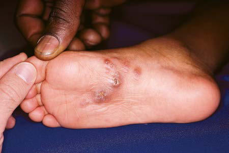

# Chapter 289: Mucormycosis — Board-Style Self-Assessment MCQs
**Part XV: Infectious Diseases** | [📖 Read Wiki Chapter](../chapters/289.md) | [🃏 Chapter Flashcards](../flashcards/289_flashcards.md) | [🏠 Course Master Index](../../index.md)

Total questions: **5** *(Click "Show Answer & Rationale" beneath each question)*

### Question 1 (Clinical Pediatrics Vignette)
A pediatric patient is evaluated for the following clinical and diagnostic profile: The most common form of extracutaneous sporotrichosis involves infection of the bones and joints.. Which of the following conditions or syndromes is the most likely diagnosis?

- **A.** ADAR (Interferonopathies)
- **B.** LATE ADOLESCENCE (Adolescent Physical and Social Development)
- **C.** Mucormycosis
- **D.** CLASSIC ARPKD (Anatomic Abnormalities Associated with Hematuria)

<b>Show Answer & Rationale</b>

**Correct Answer: C** — Mucormycosis

**Rationale:** **Mucormycosis** is characterized by: The most common form of extracutaneous sporotrichosis involves infection of the bones and joints..

**Why Other Options Are Incorrect:** **ADAR (Interferonopathies)** is incorrect (characterized by Deaminates adenosine to; inosine in endogenous dsRNA,; preventing recognition by; MDA5 receptor; AR ). **LATE ADOLESCENCE (Adolescent Physical and Social Development)** is incorrect (characterized by Approximate age range; 10-13 yr; 14-17 yr; 18-21 yr; Sexual maturity rating; 1-2; 3-5; 5; Physical; ). **CLASSIC ARPKD (Anatomic Abnormalities Associated with Hematuria)** is incorrect (characterized by PKHD1, possibly DZIP1L; Bilateral nephromegaly, heterogenous; parenchymal echogenicity with salt and).

### Question 2 (Visual Diagnosis & Clinical Spotter)

A pediatric patient undergoes evaluation for **Mucormycosis**, yielding the clinical or diagnostic finding shown below. Which of the following best characterizes the illustrated finding?

- **A.** Ery thema nodosum is an immunoreactive manifestation.
- **B.** Sporotrichosis. Erythematous papules and nodules on the plantar surface with early lymphangitic (sporotrichoid) spread. (From Paller AS, Mancini AJ. Hurwitz Clinical Pediatric Dermatology, 5th ed
- **C.** DIAGNOSIS Cutaneous and lymphocutaneous sporotrichosis must be differentiated from other causes of nodular lymphangitis, including atypical myco bacterial infection, nocardiosis, leishmanias
- **D.** The most common form of extracutaneous sporotrichosis involves infection of the bones and joints.

<b>Show Answer & Rationale</b>

**Correct Answer: B** — Sporotrichosis. Erythematous papules and nodules on the plantar surface with early lymphangitic (sporotrichoid) spread. (From Paller AS, Mancini AJ. Hurwitz Clinical Pediatric Dermatology, 5th ed

**Rationale:** **Fig. 288.1**: Sporotrichosis. Erythematous papules and nodules on the plantar surface with early lymphangitic (sporotrichoid) spread. (From Paller AS, Mancini AJ. Hurwitz Clinical Pediatric Dermatology, 5th ed. Philadelphia: Elsevier; 2016: Fig. 17.48.)

### Question 3 (Differential Diagnosis (Mucormycosis))
During a pediatric consultation regarding **Mucormycosis**, which clinical entity or concept is described by the following profile? "Although comparative trials and extensive experience in children are not available, itraconazole is the recommended this pediatric condition of choice for infections outside the central nervous system."

- **A.** Gastrointestinal mucormycosis
- **B.** TREATMENT
- **C.** CLINICAL MANIFESTATIONS
- **D.** EPIDEMIOLOGY

<b>Show Answer & Rationale</b>

**Correct Answer: B** — TREATMENT

**Rationale:** TREATMENT Although comparative trials and extensive experience in children are not available, itraconazole is the recommended treatment of choice for infections outside the central nervous system.

### Question 4 (Differential Diagnosis (Mucormycosis))
During a pediatric consultation regarding **Mucormycosis**, which clinical entity or concept is described by the following profile? "12 mg/kg daily (maximum dose, 400-800 mg daily) can be used if other agents are not tolerated."

- **A.** fluconazole
- **B.** CLINICAL MANIFESTATIONS
- **C.** RELEVANCE (Diagnostic Approach to Respiratory Disease)
- **D.** Gastrointestinal mucormycosis

<b>Show Answer & Rationale</b>

**Correct Answer: A** — fluconazole

**Rationale:** fluconazole 12 mg/kg daily (maximum dose, 400-800 mg daily) can be used if other agents are not tolerated.

### Question 5 (Pediatric Board Mastery (Mucormycosis))
When formulating an evidence-based diagnostic and management plan for **Mucormycosis** (*Part XV: Infectious Diseases*), which of the following pediatric clinical statements is **ACCURATE**? (Item 1)

- **A.** First-line management relies on immediate high-dose aspirin therapy in febrile infants.
- **B.** Inheritance is exclusively holandric (Y-linked) with 100% penetrance restricted to male neonates.
- **C.** The condition is an entirely benign physiologic variant that never warrants laboratory or clinical evaluation.
- **D.** The most common form of extracutaneous sporotrichosis involves infection of the bones and joints.

<b>Show Answer & Rationale</b>

**Correct Answer: D** — The most common form of extracutaneous sporotrichosis involves infection of the bones and joints.

**Rationale:** **Pediatric Clinical Principle (Mucormycosis):** The most common form of extracutaneous sporotrichosis involves infection of the bones and joints.

