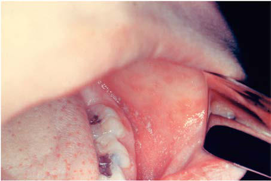

# Chapter 293: Measles — Board-Style Self-Assessment MCQs
**Part XV: Infectious Diseases** | [📖 Read Wiki Chapter](../chapters/293.md) | [🃏 Chapter Flashcards](../flashcards/293_flashcards.md) | [🏠 Course Master Index](../../index.md)

Total questions: **5** *(Click "Show Answer & Rationale" beneath each question)*

### Question 1 (Clinical Pediatrics Vignette)
A pediatric patient is evaluated for the following clinical and diagnostic profile: Any; 19,480 (29.1); 11,883 (41.4); 1,173 (18.1); 2,369 (12.8); 2,656 (29.0); 1,399 (34.4); Death; 177 (0.3); 97 (0.3); 9 (0.1); 18 (0.1); 26 (0.3); 27 (0.7); Diarrhea; 5,482 (8.2); 3,294 (11.5); 408 (6.3); 627 (3.4); 767 (8.4); 386 (9.5); Encephaliti. Which of the following conditions or syndromes is the most likely diagnosis?

- **A.** RECOMMENDATIONS (Measles)
- **B.** 250 U (Measles)
- **C.** (N = 4,069) (Measles)
- **D.** (MO) (Measles)

<b>Show Answer & Rationale</b>

**Correct Answer: C** — (N = 4,069) (Measles)

**Rationale:** **(N = 4,069) (Measles)** is characterized by: Any; 19,480 (29.1); 11,883 (41.4); 1,173 (18.1); 2,369 (12.8); 2,656 (29.0); 1,399 (34.4); Death; 177 (0.3); 97 (0.3); 9 (0.1); 18 (0.1); 26 (0.3); 27 (0.7); Diarrhea; 5,482 (8.2); 3,294 (11.5); 408 (6.3); 627 (3.4); 767 (8.4); 386 (9.5); Encephalitis; 97 (0.1); 43 (0.2); 9 (0.1); 13 (0.1); 21 (0.2); 11 (0.3); Hospital.

**Why Other Options Are Incorrect:** **RECOMMENDATIONS (Measles)** is incorrect (characterized by Unimmunized, no history of; measles (12-15 mo of age); MMR or MMRV vaccine is; recommended at 12-15 ). **250 U (Measles)** is incorrect (characterized by 10; 3; Hepatitis A prophylaxis (as Ig):; Contact prophylaxis). **(MO) (Measles)** is incorrect (characterized by Tetanus (as tetanus Ig)).

### Question 2 (Clinical Pediatrics Vignette)
A pediatric patient is evaluated for the following clinical and diagnostic profile: Unimmunized, no history of; measles (12-15 mo of age); MMR or MMRV vaccine is; recommended at 12-15 mo; of age; a second dose is; recommended at least 28; days after the first dose (or 90; days for MMRV) and usually is; administered at 4 through 6 yr. Which of the following conditions or syndromes is the most likely diagnosis?

- **A.** 250 U (Measles)
- **B.** (MO) (Measles)
- **C.** (N = 4,069) (Measles)
- **D.** RECOMMENDATIONS (Measles)

<b>Show Answer & Rationale</b>

**Correct Answer: D** — RECOMMENDATIONS (Measles)

**Rationale:** **RECOMMENDATIONS (Measles)** is characterized by: Unimmunized, no history of; measles (12-15 mo of age); MMR or MMRV vaccine is; recommended at 12-15 mo; of age; a second dose is; recommended at least 28; days after the first dose (or 90; days for MMRV) and usually is; administered at 4 through 6 yr; of age; Children 6-11 mo of age in; epidemic situations or before; i.

**Why Other Options Are Incorrect:** **250 U (Measles)** is incorrect (characterized by 10; 3; Hepatitis A prophylaxis (as Ig):; Contact prophylaxis). **(MO) (Measles)** is incorrect (characterized by Tetanus (as tetanus Ig)). **(N = 4,069) (Measles)** is incorrect (characterized by Any; 19,480 (29.1); 11,883 (41.4); 1,173 (18.1); 2,369 (12.8); 2,656 (29.0); 1,399 (34.4); Death; 17).

### Question 3 (Visual Diagnosis & Clinical Spotter)

A pediatric patient undergoes evaluation for **Measles**, yielding the clinical or diagnostic finding shown below. Which of the following best characterizes the illustrated finding?

- **A.** Measles disease course (A) and complica tions (B). ADEM, Acute demyelinating encephalomyeli tis; MIBE, measles inclusion body encephalitis; SSPE, subacute sclerosing panencephalitis. (Modified fr
- **B.** EPIDEMIOLOGY The measles vaccine has changed the epidemiology of measles dra matically.
- **C.** Morbidity and mortality associ ated with measles decreased before the introduction of the vaccine as a result of improvements in healthcare and nutrition.
- **D.** Once worldwide in distribution, endemic transmission of measles has been interrupted in many countries where there is wide spread vaccine coverage.

<b>Show Answer & Rationale</b>

**Correct Answer: A** — Measles disease course (A) and complica tions (B). ADEM, Acute demyelinating encephalomyeli tis; MIBE, measles inclusion body encephalitis; SSPE, subacute sclerosing panencephalitis. (Modified fr

**Rationale:** **Fig. 293.2**: Measles disease course (A) and complica tions (B). ADEM, Acute demyelinating encephalomyeli tis; MIBE, measles inclusion body encephalitis; SSPE, subacute sclerosing panencephalitis. (Modified from Moss WJ. Measles. Lancet. 2017;390:2490–2502. Fig. 4.)

### Question 4 (Differential Diagnosis (Measles))
During a pediatric consultation regarding **Measles**, which clinical entity or concept is described by the following profile? "Measles virus is a negative sense single-stranded, lipid-enveloped RNA virus in the family Paramyxoviridae and genus *Morbillivirus."

- **A.** CLINICAL MANIFESTATIONS
- **B.** Vitamin A
- **C.** ETIOLOGY
- **D.** second stage

<b>Show Answer & Rationale</b>

**Correct Answer: C** — ETIOLOGY

**Rationale:** ETIOLOGY Measles virus is a negative sense single-stranded, lipid-enveloped RNA virus in the family Paramyxoviridae and genus *Morbillivirus.

### Question 5 (Pediatric Board Mastery (Measles))
When formulating an evidence-based diagnostic and management plan for **Measles** (*Part XV: Infectious Diseases*), which of the following pediatric clinical statements is **ACCURATE**? (Item 1)

- **A.** Clinical manifestations are permanently restricted to late adulthood and never present during infancy, childhood, or adolescence.
- **B.** Systemic tetracyclines and fluoroquinolones are universally required as routine prophylaxis in all healthy newborns.
- **C.** EPIDEMIOLOGY The measles vaccine has changed the epidemiology of measles dra matically.
- **D.** Inheritance is exclusively holandric (Y-linked) with 100% penetrance restricted to male neonates.

<b>Show Answer & Rationale</b>

**Correct Answer: C** — EPIDEMIOLOGY The measles vaccine has changed the epidemiology of measles dra matically.

**Rationale:** **Pediatric Clinical Principle (Measles):** EPIDEMIOLOGY The measles vaccine has changed the epidemiology of measles dra matically.

