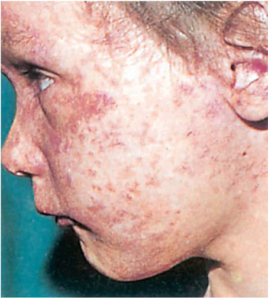

# Chapter 294: Rubella — Board-Style Self-Assessment MCQs
**Part XV: Infectious Diseases** | [📖 Read Wiki Chapter](../chapters/294.md) | [🃏 Chapter Flashcards](../flashcards/294_flashcards.md) | [🏠 Course Master Index](../../index.md)

Total questions: **5** *(Click "Show Answer & Rationale" beneath each question)*

### Question 1 (Clinical Pediatrics Vignette)
A pediatric patient is evaluated for the following clinical and diagnostic profile: Cardiovascular; Patent ductus arteriosus; Pulmonary artery stenosis; Ventriculoseptal defect; Myocarditis; Central nervous system; Chronic meningitis; Parenchymal necrosis; Vasculitis with calcification; Eye; Microphthalmia; Cataract; Iridocyclitis; . Which of the following conditions or syndromes is the most likely diagnosis?

- **A.** OLIGURIA/ANURIA (Maintenance and Replacement Therapy)
- **B.** RATE (%) (Rubella)
- **C.** ABERRANT RIGHT SUBCLAVIAN
- **D.** PATHOLOGIC FINDINGS

<b>Show Answer & Rationale</b>

**Correct Answer: D** — PATHOLOGIC FINDINGS

**Rationale:** **PATHOLOGIC FINDINGS** is characterized by: Cardiovascular; Patent ductus arteriosus; Pulmonary artery stenosis; Ventriculoseptal defect; Myocarditis; Central nervous system; Chronic meningitis; Parenchymal necrosis; Vasculitis with calcification; Eye; Microphthalmia; Cataract; Iridocyclitis; Ciliary body necrosis; Glaucoma; Retinopathy; Ear; Cochlear hemorrhage.

**Why Other Options Are Incorrect:** **OLIGURIA/ANURIA (Maintenance and Replacement Therapy)** is incorrect (characterized by Replacement of insensible fluid losses (25–40% of maintenance) with). **RATE (%) (Rubella)** is incorrect (characterized by Deafness; 67; Ocular; 71; Cataracts; 29; Retinopathy; 39; Heart disease†; 48; Patent ductus arterios). **ABERRANT RIGHT SUBCLAVIAN** is incorrect (characterized by Occasional; swallowing; dysfunction; Normal; AP—oblique defect; upward to right; Lat.—small defect; ).

### Question 2 (Clinical Pediatrics Vignette)
A pediatric patient is evaluated for the following clinical and diagnostic profile: Deafness; 67; Ocular; 71; Cataracts; 29; Retinopathy; 39; Heart disease†; 48; Patent ductus arteriosus; 78; Right pulmonary artery stenosis; 70; Left pulmonary artery stenosis; 56; Valvular pulmonic stenosis; 40; Low birthweight; 60; Psychomotor dela. Which of the following conditions or syndromes is the most likely diagnosis?

- **A.** GLI3 (Development and Developmental Anomalies of the Teeth)
- **B.** RATE (%) (Rubella)
- **C.** C4A, C4B (Systemic Lupus Erythematosus)
- **D.** PATHOLOGIC FINDINGS

<b>Show Answer & Rationale</b>

**Correct Answer: B** — RATE (%) (Rubella)

**Rationale:** **RATE (%) (Rubella)** is characterized by: Deafness; 67; Ocular; 71; Cataracts; 29; Retinopathy; 39; Heart disease†; 48; Patent ductus arteriosus; 78; Right pulmonary artery stenosis; 70; Left pulmonary artery stenosis; 56; Valvular pulmonic stenosis; 40; Low birthweight; 60; Psychomotor delay; 45; Neonatal purpura; 23; Death; 35; *Other findings: hepatitis, li.

**Why Other Options Are Incorrect:** **GLI3 (Development and Developmental Anomalies of the Teeth)** is incorrect (characterized by >13 cases to date; 8:5 male to female; Wiedemann-Rautenstrauch; Endocrine dysfunction, aged facies, ). **C4A, C4B (Systemic Lupus Erythematosus)** is incorrect (characterized by Autosomal recessive; Complement; deficiency; 1:1; SLE (severe photosensitive; rash, renal, ANA, Ro),). **PATHOLOGIC FINDINGS** is incorrect (characterized by Cardiovascular; Patent ductus arteriosus; Pulmonary artery stenosis; Ventriculoseptal defect; Myocar).

### Question 3 (Visual Diagnosis & Clinical Spotter)

A pediatric patient undergoes evaluation for **Rubella**, yielding the clinical or diagnostic finding shown below. Which of the following best characterizes the illustrated finding?

- **A.** Rubella elimination has been verified in 93 (48%) of 194 countries, with 70% of infants globally receiving a rubella vaccine in 2020.
- **B.** Accelerated global vaccine efforts have resulted in declines of rubella cases worldwide from 94,277 in 2012 to 10,194 in 2020.
- **C.** After introduction of the rubella vaccine in 1969 in the United States, the incidence of rubella fell 78% and CRS cases fell 69% by 1976.
- **D.** Pathophysiologic events in postnatally acquired rubella virus infection. *Possible complications in clude arthralgia and/or arthritis, throm bocytopenic purpura, and encepha litis. CF, Complement

<b>Show Answer & Rationale</b>

**Correct Answer: D** — Pathophysiologic events in postnatally acquired rubella virus infection. *Possible complications in clude arthralgia and/or arthritis, throm bocytopenic purpura, and encepha litis. CF, Complement

**Rationale:** **Fig. 294.2**: Pathophysiologic events in postnatally acquired rubella virus infection. *Possible complications in clude arthralgia and/or arthritis, throm bocytopenic purpura, and encepha litis. CF, Complement fixation titer; HI, hemagglutination-inhibition titer. (From Lamprecht CL. Rubella virus. In: Beshe RB, ed. Textbook of Human Virology, 2nd ed. Littleton, MA: PSG Publishing; 1990:685.) Days Mo Yr 16 14 12 10 8 6 4 2 0 2 4 6 1 2 3 4 1 2 3 4 5 6

### Question 4 (Differential Diagnosis (Rubella))
During a pediatric consultation regarding **Rubella**, which clinical entity or concept is described by the following profile? "Rubella virus is a member of the family Togaviridae and is the only spe cies of the genus *Rubivirus."

- **A.** DIAGNOSES
- **B.** PATHOLOGY
- **C.** ETIOLOGY
- **D.** PREVENTION

<b>Show Answer & Rationale</b>

**Correct Answer: C** — ETIOLOGY

**Rationale:** ETIOLOGY Rubella virus is a member of the family Togaviridae and is the only spe cies of the genus *Rubivirus.

### Question 5 (Pediatric Board Mastery (Rubella))
When formulating an evidence-based diagnostic and management plan for **Rubella** (*Part XV: Infectious Diseases*), which of the following pediatric clinical statements is **ACCURATE**? (Item 1)

- **A.** Inheritance is exclusively holandric (Y-linked) with 100% penetrance restricted to male neonates.
- **B.** Diagnostic confirmation relies solely on plain skull radiographs without biochemical, microbiologic, or clinical correlation.
- **C.** After introduction of the rubella vaccine in 1969 in the United States, the incidence of rubella fell 78% and CRS cases fell 69% by 1976.
- **D.** The condition is an entirely benign physiologic variant that never warrants laboratory or clinical evaluation.

<b>Show Answer & Rationale</b>

**Correct Answer: C** — After introduction of the rubella vaccine in 1969 in the United States, the incidence of rubella fell 78% and CRS cases fell 69% by 1976.

**Rationale:** **Pediatric Clinical Principle (Rubella):** After introduction of the rubella vaccine in 1969 in the United States, the incidence of rubella fell 78% and CRS cases fell 69% by 1976.

