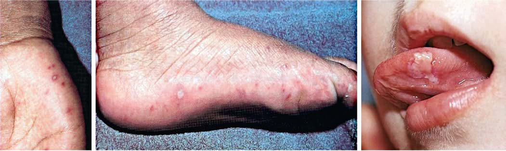

# Chapter 297: Nonpolio Enteroviruses — Board-Style Self-Assessment MCQs
**Part XV: Infectious Diseases** | [📖 Read Wiki Chapter](../chapters/297.md) | [🃏 Chapter Flashcards](../flashcards/297_flashcards.md) | [🏠 Course Master Index](../../index.md)

Total questions: **5** *(Click "Show Answer & Rationale" beneath each question)*

### Question 1 (Clinical Pediatrics Vignette)
A pediatric patient is evaluated for the following clinical and diagnostic profile: Nonspecific febrile illness; Streptococcus pneumoniae,; Haemophilus influenzae type b,; Neisseria meningitidis; Influenza viruses, human; herpesviruses 6 and 7, human; parechoviruses; Rheumatologic disorders,; oncologic diseases, drug; reaction; Exan. Which of the following conditions or syndromes is the most likely diagnosis?

- **A.** CORE BEREAVEMENT ITEMS (CBI)
- **B.** NEPHROGENIC DIABETES INSIPIDUS
- **C.** NONINFECTIOUS (Nonpolio Enteroviruses)
- **D.** GROWTH FACTORS (Feeding Healthy Infants, Children, and Adolescents)

<b>Show Answer & Rationale</b>

**Correct Answer: C** — NONINFECTIOUS (Nonpolio Enteroviruses)

**Rationale:** **NONINFECTIOUS (Nonpolio Enteroviruses)** is characterized by: Nonspecific febrile illness; Streptococcus pneumoniae,; Haemophilus influenzae type b,; Neisseria meningitidis; Influenza viruses, human; herpesviruses 6 and 7, human; parechoviruses; Rheumatologic disorders,; oncologic diseases, drug; reaction; Exanthems/enanthems; Group A Streptococcus,; Staphylococcus aureus, N.; me.

**Why Other Options Are Incorrect:** **CORE BEREAVEMENT ITEMS (CBI)** is incorrect (characterized by Do you experience images of the events surrounding your loved one’s; death? Do thoughts of your love). **NEPHROGENIC DIABETES INSIPIDUS** is incorrect (characterized by Congenital (X-linked recessive, AVP V2 receptor pathogenic variants,; autosomal recessive or dominan). **GROWTH FACTORS (Feeding Healthy Infants, Children, and Adolescents)** is incorrect (characterized by Epidermal growth factor; Luminal surveillance, repair of intestine; Transforming growth; factor (TGF).

### Question 2 (Clinical Pediatrics Vignette)
A pediatric patient is evaluated for the following clinical and diagnostic profile: Given the ongoing spread of cVDPVs, alternative stable novel Sabin vaccine strains that do not revert to neurovirulence (nOPVs) were developed for all three strains (Bio Farma, Indonesia) and have been shown to be immunogenic, stable, and safe.. Which of the following conditions or syndromes is the most likely diagnosis?

- **A.** Nonpolio Enteroviruses
- **B.** ATM (AR) (Hyperpigmented Lesions)
- **C.** NONINFECTIOUS (Nonpolio Enteroviruses)
- **D.** INTRAUTERINE AND NEONATAL INFECTIONS

<b>Show Answer & Rationale</b>

**Correct Answer: A** — Nonpolio Enteroviruses

**Rationale:** **Nonpolio Enteroviruses** is characterized by: Given the ongoing spread of cVDPVs, alternative stable novel Sabin vaccine strains that do not revert to neurovirulence (nOPVs) were developed for all three strains (Bio Farma, Indonesia) and have been shown to be immunogenic, stable, and safe..

**Why Other Options Are Incorrect:** **ATM (AR) (Hyperpigmented Lesions)** is incorrect (characterized by Progeric changes in skin and hair, hypopigmented; macules, progressive neurologic impairment,; cereb). **NONINFECTIOUS (Nonpolio Enteroviruses)** is incorrect (characterized by Nonspecific febrile illness; Streptococcus pneumoniae,; Haemophilus influenzae type b,; Neisseria me). **INTRAUTERINE AND NEONATAL INFECTIONS** is incorrect (characterized by Chorioamnionitis; ++; ++; −; Preterm delivery; ++; +; ++; Postpartum fever; ++; +++).

### Question 3 (Visual Diagnosis & Clinical Spotter)

A pediatric patient undergoes evaluation for **Nonpolio Enteroviruses**, yielding the clinical or diagnostic finding shown below. Which of the following best characterizes the illustrated finding?

- **A.** Enterovirus myocarditis is characterized by perivascular and inter stitial mixed inflammatory infiltrates and myocyte damage, possi bly mediated by viral cytolytic (e.g., cleavage of dystrop
- **B.** Given the ongoing spread of cVDPVs, alternative stable novel Sabin vaccine strains that do not revert to neurovirulence (nOPVs) were developed for all three strains (Bio Farma, Indonesia) an
- **C.** A, Oval blisters of the palms in a child with hand-foot-and-mouth disease (coxsackievirus A16 infection). B, Oval blisters on the feet of a child with hand-foot-and-mouth disease. C, Erosion of t
- **D.** In utero infections are characterized by placentitis and infection of multiple fetal organs such as heart, lung, and brain.

<b>Show Answer & Rationale</b>

**Correct Answer: C** — A, Oval blisters of the palms in a child with hand-foot-and-mouth disease (coxsackievirus A16 infection). B, Oval blisters on the feet of a child with hand-foot-and-mouth disease. C, Erosion of t

**Rationale:** **Fig. 297.1**: A, Oval blisters of the palms in a child with hand-foot-and-mouth disease (coxsackievirus A16 infection). B, Oval blisters on the feet of a child with hand-foot-and-mouth disease. C, Erosion of the tongue in a child with hand-foot-and-mouth disease. (From Weston WL, Lane AT, Morelli JG. Color Textbook of Pediatric Dermatology, 3rd ed. St. Louis: Mosby; 2002:109.)

### Question 4 (Differential Diagnosis (Nonpolio Enteroviruses))
During a pediatric consultation regarding **Nonpolio Enteroviruses**, which clinical entity or concept is described by the following profile? "Enteroviruses are nonenveloped, single-stranded, positive-sense viruses in the Picornaviridae (small RNA virus) family, which also includes the rhinoviruses, hepatitis A virus, and parechoviruses."

- **A.** TREATMENT
- **B.** myocarditis
- **C.** Herpangina
- **D.** ETIOLOGY

<b>Show Answer & Rationale</b>

**Correct Answer: D** — ETIOLOGY

**Rationale:** ETIOLOGY Enteroviruses are nonenveloped, single-stranded, positive-sense viruses in the Picornaviridae (small RNA virus) family, which also includes the rhinoviruses, hepatitis A virus, and parechoviruses.

### Question 5 (Pediatric Board Mastery (Nonpolio Enteroviruses))
When formulating an evidence-based diagnostic and management plan for **Nonpolio Enteroviruses** (*Part XV: Infectious Diseases*), which of the following pediatric clinical statements is **ACCURATE**? (Item 1)

- **A.** Systemic tetracyclines and fluoroquinolones are universally required as routine prophylaxis in all healthy newborns.
- **B.** First-line management relies on immediate high-dose aspirin therapy in febrile infants.
- **C.** Diagnostic confirmation relies solely on plain skull radiographs without biochemical, microbiologic, or clinical correlation.
- **D.** Given the ongoing spread of cVDPVs, alternative stable novel Sabin vaccine strains that do not revert to neurovirulence (nOPVs) were developed for all three strains (Bio Farma, Indonesia) and have been sho

<b>Show Answer & Rationale</b>

**Correct Answer: D** — Given the ongoing spread of cVDPVs, alternative stable novel Sabin vaccine strains that do not revert to neurovirulence (nOPVs) were developed for all three strains (Bio Farma, Indonesia) and have been sho

**Rationale:** **Pediatric Clinical Principle (Nonpolio Enteroviruses):** Given the ongoing spread of cVDPVs, alternative stable novel Sabin vaccine strains that do not revert to neurovirulence (nOPVs) were developed for all three strains (Bio Farma, Indonesia) and have been shown to be immunogenic, stable, and safe.

