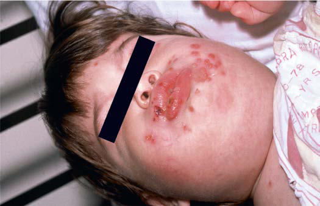

# Chapter 299: Herpes Simplex Virus — Board-Style Self-Assessment MCQs
**Part XV: Infectious Diseases** | [📖 Read Wiki Chapter](../chapters/299.md) | [🃏 Chapter Flashcards](../flashcards/299_flashcards.md) | [🏠 Course Master Index](../../index.md)

Total questions: **5** *(Click "Show Answer & Rationale" beneath each question)*

### Question 1 (Clinical Pediatrics Vignette)
A pediatric patient is evaluated for the following clinical and diagnostic profile: Human Bocavirus Respiratory illness and wheezing caused by HBoV1 cannot be dif ferentiated clinically from other common viral respiratory infections, especially respiratory syncytial virus, human metapneumovirus, rhino viruses, enterovirus D68, and p. Which of the following conditions or syndromes is the most likely diagnosis?

- **A.** DISORDERS WITH PULMONARY CAPILLARITIS
- **B.** Herpes Simplex Virus
- **C.** Symptomatic Cholelithiasis / Choledocholithiasis
- **D.** TYPICAL DISORDERS WHERE PRESENT

<b>Show Answer & Rationale</b>

**Correct Answer: B** — Herpes Simplex Virus

**Rationale:** **Herpes Simplex Virus** (associated with **`DBR1, TLR3, TRAF3`**) is characterized by: Human Bocavirus Respiratory illness and wheezing caused by HBoV1 cannot be dif ferentiated clinically from other common viral respiratory infections, especially respiratory syncytial virus, human metapneumovirus, rhino viruses, enterovirus D68, and parainfluenza viruses..

**Why Other Options Are Incorrect:** **DISORDERS WITH PULMONARY CAPILLARITIS** is incorrect (characterized by Granulomatosis with polyangiitis (Wegener granulomatosis); Microscopic polyangiitis; Systemic lupus ). **Symptomatic Cholelithiasis / Choledocholithiasis** is incorrect (characterized by Laparoscopic cholecystectomy for symptomatic stones or hemolytic disease; ERCP stone extraction for ). **TYPICAL DISORDERS WHERE PRESENT** is incorrect (characterized by Tics; Sudden rapid, recurrent, nonrhythmic, stereotyped,; vocalization or motor movement; Transient ).

### Question 2 (Pediatric Genetics & Molecular Etiology)
A child is diagnosed with **Herpes Simplex Virus** after presenting with Human Bocavirus Respiratory illness and wheezing caused by HBoV1 cannot be dif ferentiated clinically from other common viral respiratory infections, especially respiratory syncytial virus, human metapneumoviru. Pathogenic variants in which of the following genes are most classically implicated?

- **A.** MAN2B1
- **B.** KCNQ2
- **C.** DBR1
- **D.** CREBBP

<b>Show Answer & Rationale</b>

**Correct Answer: C** — DBR1

**Rationale:** Pathogenic variants in **`DBR1`** (Infectious Diseases) are associated with **Herpes Simplex Virus** (Human Bocavirus Respiratory illness and wheezing caused by HBoV1 cannot be dif ferentiated clinically from other common viral respiratory infections, especially respiratory syncytial virus, human metapneumovirus, rhino viruses, enterovirus D68, and parainfluenza viruses.).

**Why Other Options Are Incorrect:** **CREBBP** is incorrect (associated with Chromatin Regulatory Disorders).

### Question 3 (Visual Diagnosis & Clinical Spotter)

A pediatric patient undergoes evaluation for **Herpes Simplex Virus**, yielding the clinical or diagnostic finding shown below. Which of the following best characterizes the illustrated finding?

- **A.** PREVENTION Parvovirus B19 Children with erythema infectiosum are not likely to be infectious at presentation because the rash and arthropathy represent immunemediated, postinfectious phenome
- **B.** Human Bocavirus Respiratory illness and wheezing caused by HBoV1 cannot be dif ferentiated clinically from other common viral respiratory infections, especially respiratory syncytial virus,
- **C.** Clustered perioral vesicles and erosions in an infant with primary herpetic gingivostomatitis. (From Schachner LA, Hansen RC, eds. Pediatric Dermatology, 3rd ed. Philadelphia: Mosby; 1988:1078.)
- **D.** For children with wheezing illness spe cifically caused by HBoV1 infection, there are no data examining their response to bronchodilator therapy.

<b>Show Answer & Rationale</b>

**Correct Answer: C** — Clustered perioral vesicles and erosions in an infant with primary herpetic gingivostomatitis. (From Schachner LA, Hansen RC, eds. Pediatric Dermatology, 3rd ed. Philadelphia: Mosby; 1988:1078.)

**Rationale:** **Fig. 299.1**: Clustered perioral vesicles and erosions in an infant with primary herpetic gingivostomatitis. (From Schachner LA, Hansen RC, eds. Pediatric Dermatology, 3rd ed. Philadelphia: Mosby; 1988:1078.)

### Question 4 (Differential Diagnosis (Herpes Simplex Virus))
During a pediatric consultation regarding **Herpes Simplex Virus**, which clinical entity or concept is described by the following profile? "Respiratory illness and wheezing caused by HBoV1 cannot be dif ferentiated clinically from other common viral respiratory infections, especially respiratory syncytial virus, human metapneumovirus, rhino viruses, enterovirus D68, and parainfluenza viruses."

- **A.** Evaluation of the neonate
- **B.** Human Bocavirus
- **C.** LABORATORY FINDINGS
- **D.** Suppressive oral acyclovir therapy

<b>Show Answer & Rationale</b>

**Correct Answer: B** — Human Bocavirus

**Rationale:** Human Bocavirus Respiratory illness and wheezing caused by HBoV1 cannot be dif ferentiated clinically from other common viral respiratory infections, especially respiratory syncytial virus, human metapneumovirus, rhino viruses, enterovirus D68, and parainfluenza viruses.

### Question 5 (Pediatric Board Mastery (Herpes Simplex Virus))
When formulating an evidence-based diagnostic and management plan for **Herpes Simplex Virus** (*Part XV: Infectious Diseases*), which of the following pediatric clinical statements is **ACCURATE**? (Item 1)

- **A.** Inheritance is exclusively holandric (Y-linked) with 100% penetrance restricted to male neonates.
- **B.** The condition is an entirely benign physiologic variant that never warrants laboratory or clinical evaluation.
- **C.** Human Bocavirus Respiratory illness and wheezing caused by HBoV1 cannot be dif ferentiated clinically from other common viral respiratory infections, especially respiratory syncytial virus, human metapneum
- **D.** Systemic tetracyclines and fluoroquinolones are universally required as routine prophylaxis in all healthy newborns.

<b>Show Answer & Rationale</b>

**Correct Answer: C** — Human Bocavirus Respiratory illness and wheezing caused by HBoV1 cannot be dif ferentiated clinically from other common viral respiratory infections, especially respiratory syncytial virus, human metapneum

**Rationale:** **Pediatric Clinical Principle (Herpes Simplex Virus):** Human Bocavirus Respiratory illness and wheezing caused by HBoV1 cannot be dif ferentiated clinically from other common viral respiratory infections, especially respiratory syncytial virus, human metapneumovirus, rhino viruses, enterovirus D68, and parainfluenza viruses.

