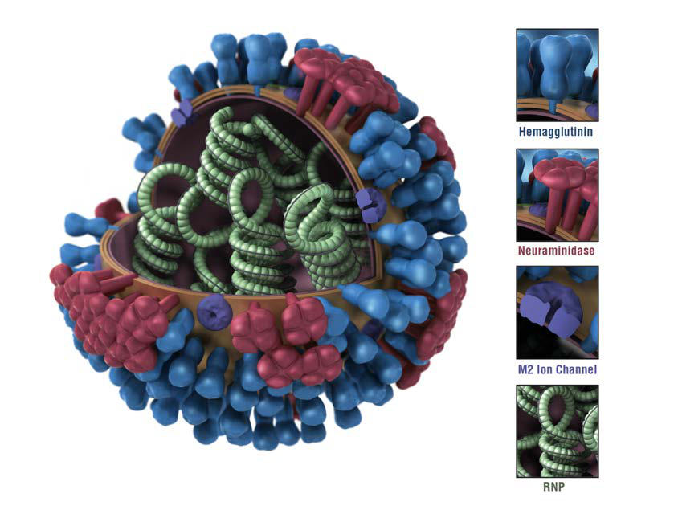

# Chapter 305: Influenza Viruses — Board-Style Self-Assessment MCQs
**Part XV: Infectious Diseases** | [📖 Read Wiki Chapter](../chapters/305.md) | [🃏 Chapter Flashcards](../flashcards/305_flashcards.md) | [🏠 Course Master Index](../../index.md)

Total questions: **5** *(Click "Show Answer & Rationale" beneath each question)*

### Question 1 (Clinical Pediatrics Vignette)
A pediatric patient is evaluated for the following clinical and diagnostic profile: H1N1v, H3N2v; Upper respiratory tract illness. Which of the following conditions or syndromes is the most likely diagnosis?

- **A.** COMMENTS (Influenza Viruses)
- **B.** H5N1 (Influenza Viruses)
- **C.** H7N3, H7N7 (Influenza Viruses)
- **D.** H5N1, H5N6, H7N7 (Influenza Viruses)

<b>Show Answer & Rationale</b>

**Correct Answer: C** — H7N3, H7N7 (Influenza Viruses)

**Rationale:** **H7N3, H7N7 (Influenza Viruses)** is characterized by: H1N1v, H3N2v; Upper respiratory tract illness.

**Why Other Options Are Incorrect:** **COMMENTS (Influenza Viruses)** is incorrect (characterized by Rapid influenza diagnostic tests (antigen; detection); Nasopharyngeal (NP) swab, aspirate; or wash, ). **H5N1 (Influenza Viruses)** is incorrect (characterized by —; Fatal outcomes†). **H5N1, H5N6, H7N7 (Influenza Viruses)** is incorrect (characterized by H1N1v, H1N2v, H3N2v; Lower respiratory tract disease,; pneumonia).

### Question 2 (Clinical Pediatrics Vignette)
A pediatric patient is evaluated for the following clinical and diagnostic profile: H1N1v, H1N2v, H3N2v; Lower respiratory tract disease,; pneumonia. Which of the following conditions or syndromes is the most likely diagnosis?

- **A.** H5N1, H5N6, H7N7, H7N9
- **B.** COMMENTS (Influenza Viruses)
- **C.** ORAL OSELTAMIVIR (Influenza Viruses)
- **D.** H5N1, H5N6, H7N7 (Influenza Viruses)

<b>Show Answer & Rationale</b>

**Correct Answer: D** — H5N1, H5N6, H7N7 (Influenza Viruses)

**Rationale:** **H5N1, H5N6, H7N7 (Influenza Viruses)** is characterized by: H1N1v, H1N2v, H3N2v; Lower respiratory tract disease,; pneumonia.

**Why Other Options Are Incorrect:** **H5N1, H5N6, H7N7, H7N9** is incorrect (characterized by H1N1v, H3N2v; Respiratory failure, acute respiratory; distress syndrome). **COMMENTS (Influenza Viruses)** is incorrect (characterized by Rapid influenza diagnostic tests (antigen; detection); Nasopharyngeal (NP) swab, aspirate; or wash, ). **ORAL OSELTAMIVIR (Influenza Viruses)** is incorrect (characterized by Adults; 75 mg twice daily; 75 mg once daily; Children ≥12 mo; ≤15 kg (≤33 lb); 30 mg twice daily; 30).

### Question 3 (Visual Diagnosis & Clinical Spotter)

A pediatric patient undergoes evaluation for **Influenza Viruses**, yielding the clinical or diagnostic finding shown below. Which of the following best characterizes the illustrated finding?

- **A.** In the United States, seasonal influenza viruses can be detected yearround, but circulating viruses are most common during the fall and winter.
- **B.** For this rea son, the formulation of the influenza vaccine is reviewed each year and updated as needed.
- **C.** Graphical representation of influenza virus. The key at bottom identifies the surface protein constituents: the hemagglutinin, neuraminidase, matrix protein 2 (M2) ion channel, and ribonucleopro
- **D.** Four major global pandemics have occurred since 1900: in 1918 caused by an influenza A(H1N1) virus, 1957 caused by an influenza A(H2N2) virus, 1968 caused by an influenza A(H3N2) virus, and

<b>Show Answer & Rationale</b>

**Correct Answer: C** — Graphical representation of influenza virus. The key at bottom identifies the surface protein constituents: the hemagglutinin, neuraminidase, matrix protein 2 (M2) ion channel, and ribonucleopro

**Rationale:** **Fig. 305.1**: Graphical representation of influenza virus. The key at bottom identifies the surface protein constituents: the hemagglutinin, neuraminidase, matrix protein 2 (M2) ion channel, and ribonucleopro tein (RNP). (From Centers for Disease Control and Prevention Public Health Image Library, Image ID#11822. https://phil.cdc.gov/Details.as px?pid=11822; courtesy CDC/Douglas Jordan and Dan Higgins, 2009.)

### Question 4 (Differential Diagnosis (Influenza Viruses))
During a pediatric consultation regarding **Influenza Viruses**, which clinical entity or concept is described by the following profile? "Influenza viruses are large, single-stranded RNA viruses belonging to the family Orthomyxoviridae, which includes three genera (or types): A, B, and C."

- **A.** ETIOLOGY
- **B.** Chemoprophylaxis
- **C.** Vaccines
- **D.** EPIDEMIOLOGY

<b>Show Answer & Rationale</b>

**Correct Answer: A** — ETIOLOGY

**Rationale:** ETIOLOGY Influenza viruses are large, single-stranded RNA viruses belonging to the family Orthomyxoviridae, which includes three genera (or types): A, B, and C.

### Question 5 (Pediatric Board Mastery (Influenza Viruses))
When formulating an evidence-based diagnostic and management plan for **Influenza Viruses** (*Part XV: Infectious Diseases*), which of the following pediatric clinical statements is **ACCURATE**? (Item 1)

- **A.** Systemic tetracyclines and fluoroquinolones are universally required as routine prophylaxis in all healthy newborns.
- **B.** First-line management relies on immediate high-dose aspirin therapy in febrile infants.
- **C.** The condition is an entirely benign physiologic variant that never warrants laboratory or clinical evaluation.
- **D.** In the United States, seasonal influenza viruses can be detected yearround, but circulating viruses are most common during the fall and winter.

<b>Show Answer & Rationale</b>

**Correct Answer: D** — In the United States, seasonal influenza viruses can be detected yearround, but circulating viruses are most common during the fall and winter.

**Rationale:** **Pediatric Clinical Principle (Influenza Viruses):** In the United States, seasonal influenza viruses can be detected yearround, but circulating viruses are most common during the fall and winter.

