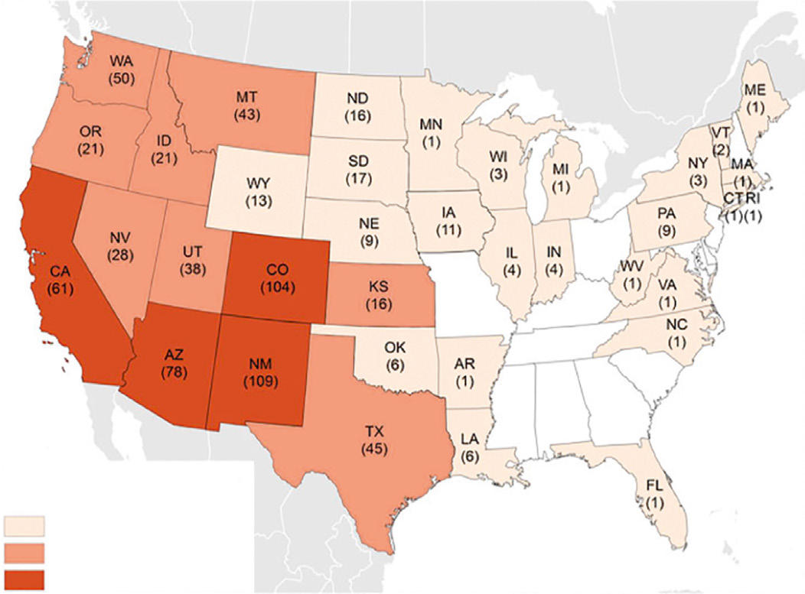

# Chapter 319: Hantavirus Pulmonary Syndrome — Board-Style Self-Assessment MCQs
**Part XV: Infectious Diseases** | [📖 Read Wiki Chapter](../chapters/319.md) | [🃏 Chapter Flashcards](../flashcards/319_flashcards.md) | [🏠 Course Master Index](../../index.md)

Total questions: **5** *(Click "Show Answer & Rationale" beneath each question)*

### Question 1 (Clinical Pediatrics Vignette)
A pediatric patient is evaluated for the following clinical and diagnostic profile: PREVENTION No vaccine exists to prevent LCMV infection.. Which of the following conditions or syndromes is the most likely diagnosis?

- **A.** MRI/CT (Congenital Anomalies)
- **B.** Walled-Off Necrosis (WON)
- **C.** RECOMMENDED (Giardiasis and Balantidiasis)
- **D.** Hantavirus Pulmonary Syndrome

<b>Show Answer & Rationale</b>

**Correct Answer: D** — Hantavirus Pulmonary Syndrome

**Rationale:** **Hantavirus Pulmonary Syndrome** is characterized by: PREVENTION No vaccine exists to prevent LCMV infection..

**Why Other Options Are Incorrect:** **MRI/CT (Congenital Anomalies)** is incorrect (characterized by Surgery; Vascular anomaly; Infants to adults; Dyspnea, stridor, cough (infants); Dysphagia (adults);). **Walled-Off Necrosis (WON)** is incorrect (characterized by ≥4 weeks encapsulated pancreatic/peripancreatic necrosis; managed via step-up endoscopic translumina). **RECOMMENDED (Giardiasis and Balantidiasis)** is incorrect (characterized by Tinidazole; 2 g once; >3 yr: 50 mg/kg once; Nitazoxanide; 500 mg bid for 3; days; 1-3 yr: 100 mg (5 ).

### Question 2 (Visual Diagnosis & Clinical Spotter)

A pediatric patient undergoes evaluation for **Hantavirus Pulmonary Syndrome**, yielding the clinical or diagnostic finding shown below. Which of the following best characterizes the illustrated finding?

- **A.** Hantavirus pulmonary syndrome (HPS) is caused by multiple closely related hantaviruses that have been identified from the western United States, with sporadic cases reported from the eastern
- **B.** Total number of confirmed cases of hantavirus pulmonary syndrome, by state reporting, United States, 1993-2016. N = 728 as of January 2017. (From Viral Special Pathogens Branch, Centers for Disea
- **C.** PREVENTION No vaccine exists to prevent LCMV infection.
- **D.** HPS is characterized by a febrile prodrome followed by the rapid onset of noncardiogenic pulmonary edema and hypotension or shock.

<b>Show Answer & Rationale</b>

**Correct Answer: B** — Total number of confirmed cases of hantavirus pulmonary syndrome, by state reporting, United States, 1993-2016. N = 728 as of January 2017. (From Viral Special Pathogens Branch, Centers for Disea

**Rationale:** **Fig. 319.1**: Total number of confirmed cases of hantavirus pulmonary syndrome, by state reporting, United States, 1993-2016. N = 728 as of January 2017. (From Viral Special Pathogens Branch, Centers for Disease Control and Prevention. http://www.cdc.gov/hantavirus/surveillance/ reporting-state.html)

### Question 3 (Differential Diagnosis (Hantavirus Pulmonary Syndrome))
During a pediatric consultation regarding **Hantavirus Pulmonary Syndrome**, which clinical entity or concept is described by the following profile? "No vaccine exists to prevent LCMV infection."

- **A.** IFIH1 (Systemic Lupus Erythematosus)
- **B.** ETIOLOGY
- **C.** PREVENTION
- **D.** CHLAMYDIA TRACHOMATIS AND NEISSERIA GONORRHOEAE

<b>Show Answer & Rationale</b>

**Correct Answer: C** — PREVENTION

**Rationale:** PREVENTION No vaccine exists to prevent LCMV infection.

### Question 4 (Differential Diagnosis (Hantavirus Pulmonary Syndrome))
During a pediatric consultation regarding **Hantavirus Pulmonary Syndrome**, which clinical entity or concept is described by the following profile? "Hantaviruses are a genus in the family Bunyaviridae, which are lipidenveloped viruses with a negative-sense RNA genome composed of three unique segments."

- **A.** ETIOLOGY
- **B.** PREVENTION
- **C.** EPIDEMIOLOGY
- **D.** SLEEPS (Neonatal Abstinence Syndrome)

<b>Show Answer & Rationale</b>

**Correct Answer: A** — ETIOLOGY

**Rationale:** ETIOLOGY Hantaviruses are a genus in the family Bunyaviridae, which are lipidenveloped viruses with a negative-sense RNA genome composed of three unique segments.

### Question 5 (Pediatric Board Mastery (Hantavirus Pulmonary Syndrome))
When formulating an evidence-based diagnostic and management plan for **Hantavirus Pulmonary Syndrome** (*Part XV: Infectious Diseases*), which of the following pediatric clinical statements is **ACCURATE**? (Item 1)

- **A.** PREVENTION No vaccine exists to prevent LCMV infection.
- **B.** Inheritance is exclusively holandric (Y-linked) with 100% penetrance restricted to male neonates.
- **C.** Systemic tetracyclines and fluoroquinolones are universally required as routine prophylaxis in all healthy newborns.
- **D.** Diagnostic confirmation relies solely on plain skull radiographs without biochemical, microbiologic, or clinical correlation.

<b>Show Answer & Rationale</b>

**Correct Answer: A** — PREVENTION No vaccine exists to prevent LCMV infection.

**Rationale:** **Pediatric Clinical Principle (Hantavirus Pulmonary Syndrome):** PREVENTION No vaccine exists to prevent LCMV infection.

