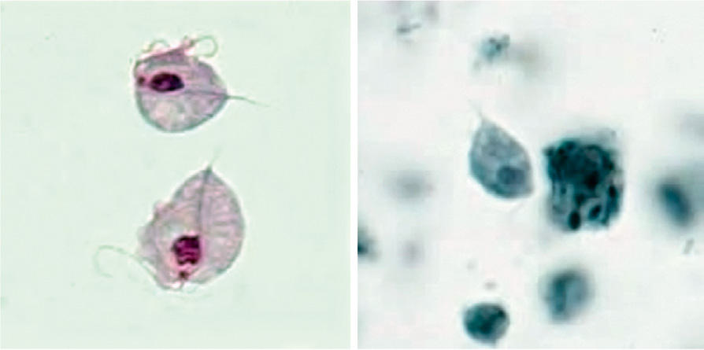

# Chapter 330: Trichomoniasis (Trichomonas vaginalis) — Board-Style Self-Assessment MCQs
**Part XV: Infectious Diseases** | [📖 Read Wiki Chapter](../chapters/330.md) | [🃏 Chapter Flashcards](../flashcards/330_flashcards.md) | [🏠 Course Master Index](../../index.md)

Total questions: **5** *(Click "Show Answer & Rationale" beneath each question)*

### Question 1 (Clinical Pediatrics Vignette)
A pediatric patient is evaluated for the following clinical and diagnostic profile: The Centers for Disease Control and Prevention (CDC) offer a molecular identification of Enterocytozoon bieneusi, Encephalitozoon intestinalis, Encephalitozoon hellem, and Encephalito zoon cuniculi using species-specific PCR assays.. Which of the following conditions or syndromes is the most likely diagnosis?

- **A.** Trichomoniasis (Trichomonas vaginalis)
- **B.** T—Tears in endothelium and
- **C.** Disease-Associated
- **D.** GROUP A STREPTOCOCCAL INFECTION

<b>Show Answer & Rationale</b>

**Correct Answer: A** — Trichomoniasis (Trichomonas vaginalis)

**Rationale:** **Trichomoniasis (Trichomonas vaginalis)** is characterized by: The Centers for Disease Control and Prevention (CDC) offer a molecular identification of Enterocytozoon bieneusi, Encephalitozoon intestinalis, Encephalitozoon hellem, and Encephalito zoon cuniculi using species-specific PCR assays..

**Why Other Options Are Incorrect:** **T—Tears in endothelium and** is incorrect (characterized by Descemet’s membrane; Birth trauma; Unilateral; Diffuse edema; Normal; Possible hyphema,; periorbital). **Disease-Associated** is incorrect (characterized by • Glomerulonephritis (e.g., systemic lupus erythematosus); • Acute allograft rejection; • Tubulointe). **GROUP A STREPTOCOCCAL INFECTION** is incorrect (characterized by Carditis; Polyarthritis; Erythema marginatum; Subcutaneous nodules; Chorea).

### Question 2 (Visual Diagnosis & Clinical Spotter)

A pediatric patient undergoes evaluation for **Trichomoniasis (Trichomonas vaginalis)**, yielding the clinical or diagnostic finding shown below. Which of the following best characterizes the illustrated finding?

- **A.** Trichomonas vaginalis trophozoites stained with Giemsa (A) and iron hematoxylin (B). (From the Centers for Disease Control and Prevention: Laboratory identification of parasites of public health
- **B.** The Centers for Disease Control and Prevention (CDC) offer a molecular identification of Enterocytozoon bieneusi, Encephalitozoon intestinalis, Encephalitozoon hellem, and Encephalito zoon c
- **C.** Albendazole (adult dose 400 mg bid PO for 3 weeks; for children, 7.5 mg/kg body weight [maximum 400 mg/dose] bid PO) is usually effective against E. intestinalis infection but is ineffective
- **D.** Trichomoniasis is caused by the protozoan Trichomonas vaginalis.

<b>Show Answer & Rationale</b>

**Correct Answer: A** — Trichomonas vaginalis trophozoites stained with Giemsa (A) and iron hematoxylin (B). (From the Centers for Disease Control and Prevention: Laboratory identification of parasites of public health

**Rationale:** **Fig. 330.1**: Trichomonas vaginalis trophozoites stained with Giemsa (A) and iron hematoxylin (B). (From the Centers for Disease Control and Prevention: Laboratory identification of parasites of public health con cern. Trichomoniasis [website]. https://www.cdc.gov/dpdx/trichomonia sis/index.html)

### Question 3 (Differential Diagnosis (Trichomoniasis (Trichomonas vaginalis)))
During a pediatric consultation regarding **Trichomoniasis (Trichomonas vaginalis)**, which clinical entity or concept is described by the following profile? "(adult dose 400 mg bid PO for 3 weeks; for children, 7."

- **A.** Albendazole
- **B.** MUSCLE TRAUMA (Evaluation and Investigation of Neuromuscular Disorders)
- **C.** INFECTIOUS/INFLAMMATORY PROCESSES
- **D.** H2 blockers (Hyperpituitarism)

<b>Show Answer & Rationale</b>

**Correct Answer: A** — Albendazole

**Rationale:** Albendazole (adult dose 400 mg bid PO for 3 weeks; for children, 7.

### Question 4 (Differential Diagnosis (Trichomoniasis (Trichomonas vaginalis)))
During a pediatric consultation regarding **Trichomoniasis (Trichomonas vaginalis)**, which clinical entity or concept is described by the following profile? "Over 156 million new cases of trichomoniasis occur annually around the world."

- **A.** ARDS (Acute Care of Respiratory Distress and Failure)
- **B.** Growth and Development of the Eye
- **C.** Albendazole
- **D.** EPIDEMIOLOGY

<b>Show Answer & Rationale</b>

**Correct Answer: D** — EPIDEMIOLOGY

**Rationale:** EPIDEMIOLOGY Over 156 million new cases of trichomoniasis occur annually around the world.

### Question 5 (Pediatric Board Mastery (Trichomoniasis (Trichomonas vaginalis)))
When formulating an evidence-based diagnostic and management plan for **Trichomoniasis (Trichomonas vaginalis)** (*Part XV: Infectious Diseases*), which of the following pediatric clinical statements is **ACCURATE**? (Item 1)

- **A.** Systemic tetracyclines and fluoroquinolones are universally required as routine prophylaxis in all healthy newborns.
- **B.** Diagnostic confirmation relies solely on plain skull radiographs without biochemical, microbiologic, or clinical correlation.
- **C.** The condition is an entirely benign physiologic variant that never warrants laboratory or clinical evaluation.
- **D.** The Centers for Disease Control and Prevention (CDC) offer a molecular identification of Enterocytozoon bieneusi, Encephalitozoon intestinalis, Encephalitozoon hellem, and Encephalito zoon cuniculi using s

<b>Show Answer & Rationale</b>

**Correct Answer: D** — The Centers for Disease Control and Prevention (CDC) offer a molecular identification of Enterocytozoon bieneusi, Encephalitozoon intestinalis, Encephalitozoon hellem, and Encephalito zoon cuniculi using s

**Rationale:** **Pediatric Clinical Principle (Trichomoniasis (Trichomonas vaginalis)):** The Centers for Disease Control and Prevention (CDC) offer a molecular identification of Enterocytozoon bieneusi, Encephalitozoon intestinalis, Encephalitozoon hellem, and Encephalito zoon cuniculi using species-specific PCR assays.

