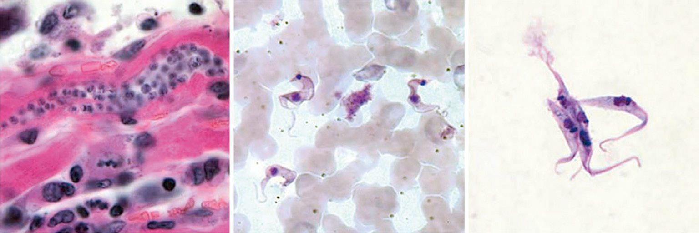

# Chapter 333: American Trypanosomiasis (Chagas Disease; Trypanosoma cruzi) — Board-Style Self-Assessment MCQs
**Part XV: Infectious Diseases** | [📖 Read Wiki Chapter](../chapters/333.md) | [🃏 Chapter Flashcards](../flashcards/333_flashcards.md) | [🏠 Course Master Index](../../index.md)

Total questions: **5** *(Click "Show Answer & Rationale" beneath each question)*

### Question 1 (Clinical Pediatrics Vignette)
A pediatric patient is evaluated for the following clinical and diagnostic profile: Vectorial; Endemic countries; • Incubation period: 1-2 wk; • Signs of portal of entry: indurated cutaneous; lesion (chagoma) or palpebral edema; (Romaña sign); • Most cases are mild disease (95–99%) and; unrecognized; • Persistent fever, fatigue, lym. Which of the following conditions or syndromes is the most likely diagnosis?

- **A.** INFANCY (Seizures in Childhood)
- **B.** OTHERS (Botulism (Clostridium botulinum))
- **C.** ACUTE FORMS (American Trypanosomiasis (Chagas Disease; Trypanosoma cruzi))
- **D.** CHRONIC FORMS (American Trypanosomiasis (Chagas Disease; Trypanosoma cruzi))

<b>Show Answer & Rationale</b>

**Correct Answer: C** — ACUTE FORMS (American Trypanosomiasis (Chagas Disease; Trypanosoma cruzi))

**Rationale:** **ACUTE FORMS (American Trypanosomiasis (Chagas Disease; Trypanosoma cruzi))** is characterized by: Vectorial; Endemic countries; • Incubation period: 1-2 wk; • Signs of portal of entry: indurated cutaneous; lesion (chagoma) or palpebral edema; (Romaña sign); • Most cases are mild disease (95–99%) and; unrecognized; • Persistent fever, fatigue, lymphadenopathy,; hepatomegaly, splenomegaly, morbilliform; rash, edema; .

**Why Other Options Are Incorrect:** **INFANCY (Seizures in Childhood)** is incorrect (characterized by Benign infantile seizures; (nonfamilial); Infant; Infant; Good). **OTHERS (Botulism (Clostridium botulinum))** is incorrect (characterized by Hypothyroidism; Drug ingestion; Organophosphate poisoning; Heavy metal poisoning (lead, arsenic)). **CHRONIC FORMS (American Trypanosomiasis (Chagas Disease; Trypanosoma cruzi))** is incorrect (characterized by Indeterminate; Endemic and nonendemic; countries; • Asymptomatic; • Normal chest radiograph and 12-l).

### Question 2 (Clinical Pediatrics Vignette)
A pediatric patient is evaluated for the following clinical and diagnostic profile: Indeterminate; Endemic and nonendemic; countries; • Asymptomatic; • Normal chest radiograph and 12-lead ECG; • Serology: detection of IgG; • PCR: low sensitivity. Which of the following conditions or syndromes is the most likely diagnosis?

- **A.** CHRONIC FORMS (American Trypanosomiasis (Chagas Disease; Trypanosoma cruzi))
- **B.** PRESENT/ABSENT (1/0)
- **C.** The Fetal to Neonatal Circulatory Transition
- **D.** Severe: Severe difficulties learning skills, affecting several academic

<b>Show Answer & Rationale</b>

**Correct Answer: A** — CHRONIC FORMS (American Trypanosomiasis (Chagas Disease; Trypanosoma cruzi))

**Rationale:** **CHRONIC FORMS (American Trypanosomiasis (Chagas Disease; Trypanosoma cruzi))** is characterized by: Indeterminate; Endemic and nonendemic; countries; • Asymptomatic; • Normal chest radiograph and 12-lead ECG; • Serology: detection of IgG; • PCR: low sensitivity.

**Why Other Options Are Incorrect:** **PRESENT/ABSENT (1/0)** is incorrect (characterized by 1. Clinical features occur; simultaneously; 2. Episodes are paroxysmal in nature; 3. Sympathetic ove). **The Fetal to Neonatal Circulatory Transition** is incorrect (characterized by This pharmacology explains why indomethacin and similar drugs are contraindicated or used with extre). **Severe: Severe difficulties learning skills, affecting several academic** is incorrect (characterized by domains, so that the individual is unlikely to learn those skills without; ongoing intensive individ).

### Question 3 (Visual Diagnosis & Clinical Spotter)

A pediatric patient undergoes evaluation for **American Trypanosomiasis (Chagas Disease; Trypanosoma cruzi)**, yielding the clinical or diagnostic finding shown below. Which of the following best characterizes the illustrated finding?

- **A.** Stages of Trypanosoma cruzi. A, Amastigote. B, Trypomastig ote. C, Epimastigotes. (From Centers for Disease Control and Prevention. Laboratory identification of parasites of public health concern
- **B.** CRISPR- Cas9-based gene editing has helped identify genes relevant to the disease and its possible prevention, as well as the design of new antitrypanosomal drugs, including those that targe
- **C.** Stage 2 Treatment Combination eflornithine and nifurtimox (NECT) is the current treatment of choice for T. brucei gambiense CNS infection.
- **D.** PREVENTION A vaccine or consistently effective prophylactic therapy is not avail able and is particularly challenging because of the antigenic variation caused by VSGs.

<b>Show Answer & Rationale</b>

**Correct Answer: A** — Stages of Trypanosoma cruzi. A, Amastigote. B, Trypomastig ote. C, Epimastigotes. (From Centers for Disease Control and Prevention. Laboratory identification of parasites of public health concern

**Rationale:** **Fig. 333.1**: Stages of Trypanosoma cruzi. A, Amastigote. B, Trypomastig ote. C, Epimastigotes. (From Centers for Disease Control and Prevention. Laboratory identification of parasites of public health concern. Trypanoso miasis, American [website], 2018. https ://www.cdc.gov/dpdx/trypanosomiasis american/index.html)

### Question 4 (Differential Diagnosis (American Trypanosomiasis (Chagas Disease; Trypanosoma cruzi)))
During a pediatric consultation regarding **American Trypanosomiasis (Chagas Disease; Trypanosoma cruzi)**, which clinical entity or concept is described by the following profile? "has recently been approved for oral treatment of stage 1 and 2 Gambian HAT in 6 years of age and older and weigh ing at least 20 kg."

- **A.** Fexinidazole
- **B.** EPIDEMIOLOGY
- **C.** Melarsoprol
- **D.** Epimastigotes

<b>Show Answer & Rationale</b>

**Correct Answer: A** — Fexinidazole

**Rationale:** Fexinidazole has recently been approved for oral treatment of stage 1 and 2 Gambian HAT in 6 years of age and older and weigh ing at least 20 kg.

### Question 5 (Pediatric Board Mastery (American Trypanosomiasis (Chagas Disease; Trypanosoma cruzi)))
When formulating an evidence-based diagnostic and management plan for **American Trypanosomiasis (Chagas Disease; Trypanosoma cruzi)** (*Part XV: Infectious Diseases*), which of the following pediatric clinical statements is **ACCURATE**? (Item 1)

- **A.** Stage 2 Treatment Combination eflornithine and nifurtimox (NECT) is the current treatment of choice for T. brucei gambiense CNS infection.
- **B.** Inheritance is exclusively holandric (Y-linked) with 100% penetrance restricted to male neonates.
- **C.** First-line management relies on immediate high-dose aspirin therapy in febrile infants.
- **D.** Diagnostic confirmation relies solely on plain skull radiographs without biochemical, microbiologic, or clinical correlation.

<b>Show Answer & Rationale</b>

**Correct Answer: A** — Stage 2 Treatment Combination eflornithine and nifurtimox (NECT) is the current treatment of choice for T. brucei gambiense CNS infection.

**Rationale:** **Pediatric Clinical Principle (American Trypanosomiasis (Chagas Disease; Trypanosoma cruzi)):** Stage 2 Treatment Combination eflornithine and nifurtimox (NECT) is the current treatment of choice for T. brucei gambiense CNS infection.

