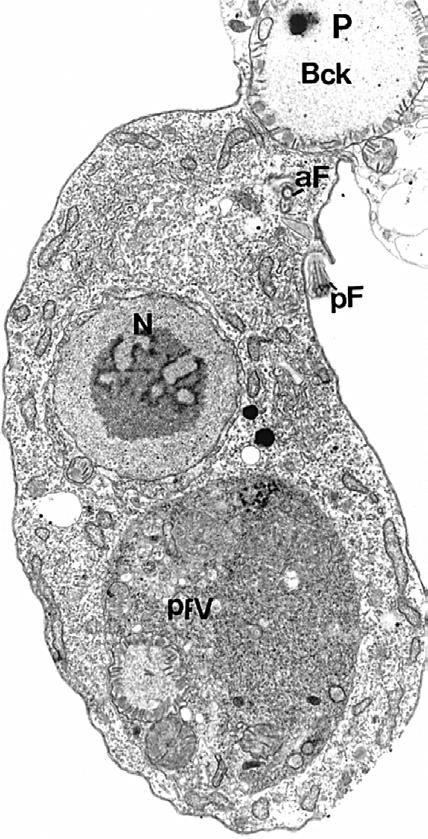

# Chapter 336: Toxoplasmosis (Toxoplasma gondii) — Board-Style Self-Assessment MCQs
**Part XV: Infectious Diseases** | [📖 Read Wiki Chapter](../chapters/336.md) | [🃏 Chapter Flashcards](../flashcards/336_flashcards.md) | [🏠 Course Master Index](../../index.md)

Total questions: **5** *(Click "Show Answer & Rationale" beneath each question)*

### Question 1 (Clinical Pediatrics Vignette)
A pediatric patient is evaluated for the following clinical and diagnostic profile: Chorioretinitis; 102 (94); 29 (66); Abnormal cerebrospinal fluid; 59 (55); 37 (84); Anemia; 55 (51); 34 (77); Convulsions; 54 (50); 8 (18); Intracranial calcification; 54 (50); 2 (4); Jaundice; 31 (29); 35 (80); Hydrocephalus; 30 (28); 0 (0); Fever; . Which of the following conditions or syndromes is the most likely diagnosis?

- **A.** 31 Patients (%) (Toxoplasmosis (Toxoplasma gondii))
- **B.** PRENATAL (Toxoplasmosis (Toxoplasma gondii))
- **C.** 44 Patients (%) (Toxoplasmosis (Toxoplasma gondii))
- **D.** Eye Disease (Toxoplasmosis (Toxoplasma gondii))

<b>Show Answer & Rationale</b>

**Correct Answer: C** — 44 Patients (%) (Toxoplasmosis (Toxoplasma gondii))

**Rationale:** **44 Patients (%) (Toxoplasmosis (Toxoplasma gondii))** is characterized by: Chorioretinitis; 102 (94); 29 (66); Abnormal cerebrospinal fluid; 59 (55); 37 (84); Anemia; 55 (51); 34 (77); Convulsions; 54 (50); 8 (18); Intracranial calcification; 54 (50); 2 (4); Jaundice; 31 (29); 35 (80); Hydrocephalus; 30 (28); 0 (0); Fever; 27 (25); 34 (77); Splenomegaly; 23 (21); 40 (90); Lymphadenopathy; 18 .

**Why Other Options Are Incorrect:** **31 Patients (%) (Toxoplasmosis (Toxoplasma gondii))** is incorrect (characterized by Intellectual impairment; 62 (89); 25 (81); Convulsions; 58 (83); 24 (77); Spasticity and palsies; 53). **PRENATAL (Toxoplasmosis (Toxoplasma gondii))** is incorrect (characterized by Acute infection; in pregnant; woman ≤15 wk; amenorrhea in; gestation and no; clinical evidence; of f). **Eye Disease (Toxoplasmosis (Toxoplasma gondii))** is incorrect (characterized by Quiescent scar**; Child; +; +/−; +/−; +/−; +/−; +/−).

### Question 2 (Clinical Pediatrics Vignette)
A pediatric patient is evaluated for the following clinical and diagnostic profile: Intellectual impairment; 62 (89); 25 (81); Convulsions; 58 (83); 24 (77); Spasticity and palsies; 53 (76); 18 (58); Severely impaired vision; 48 (69); 13 (42); Hydrocephalus or microcephaly; 31 (44); 2 (6); Deafness; 12 (17); 3 (10); Normal; 6 (9); 5. Which of the following conditions or syndromes is the most likely diagnosis?

- **A.** 31 Patients (%) (Toxoplasmosis (Toxoplasma gondii))
- **B.** Eye Disease (Toxoplasmosis (Toxoplasma gondii))
- **C.** PRENATAL (Toxoplasmosis (Toxoplasma gondii))
- **D.** 44 Patients (%) (Toxoplasmosis (Toxoplasma gondii))

<b>Show Answer & Rationale</b>

**Correct Answer: A** — 31 Patients (%) (Toxoplasmosis (Toxoplasma gondii))

**Rationale:** **31 Patients (%) (Toxoplasmosis (Toxoplasma gondii))** is characterized by: Intellectual impairment; 62 (89); 25 (81); Convulsions; 58 (83); 24 (77); Spasticity and palsies; 53 (76); 18 (58); Severely impaired vision; 48 (69); 13 (42); Hydrocephalus or microcephaly; 31 (44); 2 (6); Deafness; 12 (17); 3 (10); Normal; 6 (9); 5 (16); *Patients with otherwise undiagnosed central nervous system dis.

**Why Other Options Are Incorrect:** **Eye Disease (Toxoplasmosis (Toxoplasma gondii))** is incorrect (characterized by Quiescent scar**; Child; +; +/−; +/−; +/−; +/−; +/−). **PRENATAL (Toxoplasmosis (Toxoplasma gondii))** is incorrect (characterized by Acute infection; in pregnant; woman ≤15 wk; amenorrhea in; gestation and no; clinical evidence; of f). **44 Patients (%) (Toxoplasmosis (Toxoplasma gondii))** is incorrect (characterized by Chorioretinitis; 102 (94); 29 (66); Abnormal cerebrospinal fluid; 59 (55); 37 (84); Anemia; 55 (51);).

### Question 3 (Visual Diagnosis & Clinical Spotter)

A pediatric patient undergoes evaluation for **Toxoplasmosis (Toxoplasma gondii)**, yielding the clinical or diagnostic finding shown below. Which of the following best characterizes the illustrated finding?

- **A.** Recurrences are most common closest to the time of acquisition of infection, and treatment leads to resolution of activity.
- **B.** D, Life cycle of Toxoplasma gondii and prevention of toxoplasmosis by interruption of transmission to humans.
- **C.** The most common manifestation of acute acquired toxoplasmosis is enlargement of one or a few cervical lymph nodes.
- **D.** The parasite: Toxoplasma ancient ancestor, ultrastructure, and life cycle stages affecting humans. A, Colpodella vorax, an ancient pro genitor to the apicomplexans. B, Ultrastructure of T. gondii

<b>Show Answer & Rationale</b>

**Correct Answer: D** — The parasite: Toxoplasma ancient ancestor, ultrastructure, and life cycle stages affecting humans. A, Colpodella vorax, an ancient pro genitor to the apicomplexans. B, Ultrastructure of T. gondii

**Rationale:** **Fig. 336.1**: The parasite: Toxoplasma ancient ancestor, ultrastructure, and life cycle stages affecting humans. A, Colpodella vorax, an ancient pro genitor to the apicomplexans. B, Ultrastructure of T. gondii tachyzoite. C, Light micrographs of, top to bottom, tachyzoite, bradyzoite, and sporo zoite stages of T. gondii. D, Life cycle of Toxoplasma gondii and prevention of toxoplasmosis by interruption of transmission to humans. N, nucleus; PBck, prey being ingested; aF, anterior flagellum; pF, posterior flagellum; pFV, posterior food vacuole. (A from Brugerolle G. Colpodella vorax: Ultrastructure, predation, life-cycle, mitosis, and phylogenetic relationships. Eur J Protistol. 2002;38[2]:113–125; B from Wheeler K. Characterization of Toxoplasma gondii dense granule protein 1: Genetic, functional, and mechanistic analyses (Undergraduate Honors thesis), Kelsey Wheeler; C, bottom panel, from Dubey JP, Miller N, Frenkel JK. The Toxoplasma gondii oocyst from cat feces. J Exp Med. 1970;132[4]:636–662.)

### Question 4 (Differential Diagnosis (Toxoplasmosis (Toxoplasma gondii)))
During a pediatric consultation regarding **Toxoplasmosis (Toxoplasma gondii)**, which clinical entity or concept is described by the following profile? "xcreted by other recently infected cats."

- **A.** Skin
- **B.** sporozoites
- **C.** Congenital Toxoplasmosis
- **D.** Immunocompromised Persons

<b>Show Answer & Rationale</b>

**Correct Answer: B** — sporozoites

**Rationale:** sporozoites excreted by other recently infected cats.

### Question 5 (Pediatric Board Mastery (Toxoplasmosis (Toxoplasma gondii)))
When formulating an evidence-based diagnostic and management plan for **Toxoplasmosis (Toxoplasma gondii)** (*Part XV: Infectious Diseases*), which of the following pediatric clinical statements is **ACCURATE**? (Item 1)

- **A.** First-line management relies on immediate high-dose aspirin therapy in febrile infants.
- **B.** Diagnostic confirmation relies solely on plain skull radiographs without biochemical, microbiologic, or clinical correlation.
- **C.** D, Life cycle of Toxoplasma gondii and prevention of toxoplasmosis by interruption of transmission to humans.
- **D.** Clinical manifestations are permanently restricted to late adulthood and never present during infancy, childhood, or adolescence.

<b>Show Answer & Rationale</b>

**Correct Answer: C** — D, Life cycle of Toxoplasma gondii and prevention of toxoplasmosis by interruption of transmission to humans.

**Rationale:** **Pediatric Clinical Principle (Toxoplasmosis (Toxoplasma gondii)):** D, Life cycle of Toxoplasma gondii and prevention of toxoplasmosis by interruption of transmission to humans.

