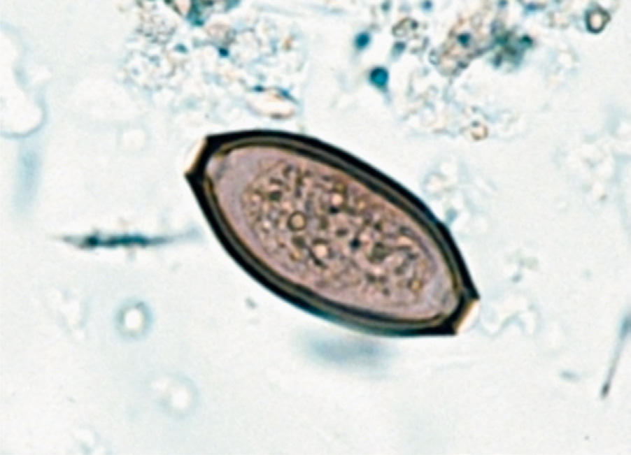

# Chapter 339: Trichuriasis (Trichuris trichiura) — Board-Style Self-Assessment MCQs
**Part XV: Infectious Diseases** | [📖 Read Wiki Chapter](../chapters/339.md) | [🃏 Chapter Flashcards](../flashcards/339_flashcards.md) | [🏠 Course Master Index](../../index.md)

Total questions: **5** *(Click "Show Answer & Rationale" beneath each question)*

### Question 1 (Clinical Pediatrics Vignette)
A pediatric patient is evaluated for the following clinical and diagnostic profile: DIAGNOSIS Because egg output is so high, fecal smears frequently reveal the char acteristic barrel-shaped ova of T. trichiura.. Which of the following conditions or syndromes is the most likely diagnosis?

- **A.** Potential for use (Substance Use Disorder)
- **B.** Intestinal Atresia, Stenosis, and Malrotation
- **C.** Trichuriasis (Trichuris trichiura)
- **D.** Cultural Issues in Pediatric Care

<b>Show Answer & Rationale</b>

**Correct Answer: C** — Trichuriasis (Trichuris trichiura)

**Rationale:** **Trichuriasis (Trichuris trichiura)** is characterized by: DIAGNOSIS Because egg output is so high, fecal smears frequently reveal the char acteristic barrel-shaped ova of T. trichiura..

**Why Other Options Are Incorrect:** **Potential for use (Substance Use Disorder)** is incorrect (characterized by • Decreased impulse control; • Need for immediate gratification; • Available substances, alcohol, in). **Intestinal Atresia, Stenosis, and Malrotation** is incorrect (characterized by Among these, congenital disruption of the tubular structure is most common and can manifest as oblit). **Cultural Issues in Pediatric Care** is incorrect (characterized by Because the rate of more serious local reactions after DTP vaccine increases with the num ber of dos).

### Question 2 (Visual Diagnosis & Clinical Spotter)

A pediatric patient undergoes evaluation for **Trichuriasis (Trichuris trichiura)**, yielding the clinical or diagnostic finding shown below. Which of the following best characterizes the illustrated finding?

- **A.** DIAGNOSIS Because egg output is so high, fecal smears frequently reveal the char acteristic barrel-shaped ova of T. trichiura.
- **B.** Trichuris trichiura. Soil-transmitted helminth eggs. (From Bethony J, Brooker S, Albonico M, et al. Soil-transmitted helminth in fections: ascariasis, trichuriasis, and hookworm. Lancet. 2006;367
- **C.** TREATMENT Albendazole (400 mg orally for 3 days, for all ages) is the drug of choice and is safe and effective, in part because it is poorly absorbed from the gastrointestinal tract.
- **D.** PREVENTION Disease can be prevented by personal hygiene, improved sanitary con ditions, and eliminating the use of human feces as fertilizer.

<b>Show Answer & Rationale</b>

**Correct Answer: B** — Trichuris trichiura. Soil-transmitted helminth eggs. (From Bethony J, Brooker S, Albonico M, et al. Soil-transmitted helminth in fections: ascariasis, trichuriasis, and hookworm. Lancet. 2006;367

**Rationale:** **Fig. 339.1**: Trichuris trichiura. Soil-transmitted helminth eggs. (From Bethony J, Brooker S, Albonico M, et al. Soil-transmitted helminth in fections: ascariasis, trichuriasis, and hookworm. Lancet. 2006;367:1521– 1532.)

### Question 3 (Differential Diagnosis (Trichuriasis (Trichuris trichiura)))
During a pediatric consultation regarding **Trichuriasis (Trichuris trichiura)**, which clinical entity or concept is described by the following profile? "Trichuriasis occurs throughout the world and is especially common in poor rural communities with inadequate sanitary facilities and soil contaminated with human or animal feces."

- **A.** oxantel pamoate
- **B.** EPIDEMIOLOGY
- **C.** CLINICAL MANIFESTATIONS
- **D.** TREATMENT Albendazole

<b>Show Answer & Rationale</b>

**Correct Answer: B** — EPIDEMIOLOGY

**Rationale:** EPIDEMIOLOGY Trichuriasis occurs throughout the world and is especially common in poor rural communities with inadequate sanitary facilities and soil contaminated with human or animal feces.

### Question 4 (Differential Diagnosis (Trichuriasis (Trichuris trichiura)))
During a pediatric consultation regarding **Trichuriasis (Trichuris trichiura)**, which clinical entity or concept is described by the following profile? "Most persons harbor low worm burdens and do not have symptoms."

- **A.** DIAGNOSIS
- **B.** CLINICAL MANIFESTATIONS
- **C.** TREATMENT Albendazole
- **D.** The Transitional Circulation (The Fetal to Neonatal Circulatory Transition)

<b>Show Answer & Rationale</b>

**Correct Answer: B** — CLINICAL MANIFESTATIONS

**Rationale:** CLINICAL MANIFESTATIONS Most persons harbor low worm burdens and do not have symptoms.

### Question 5 (Pediatric Board Mastery (Trichuriasis (Trichuris trichiura)))
When formulating an evidence-based diagnostic and management plan for **Trichuriasis (Trichuris trichiura)** (*Part XV: Infectious Diseases*), which of the following pediatric clinical statements is **ACCURATE**? (Item 1)

- **A.** Diagnostic confirmation relies solely on plain skull radiographs without biochemical, microbiologic, or clinical correlation.
- **B.** DIAGNOSIS Because egg output is so high, fecal smears frequently reveal the char acteristic barrel-shaped ova of T. trichiura.
- **C.** The condition is an entirely benign physiologic variant that never warrants laboratory or clinical evaluation.
- **D.** First-line management relies on immediate high-dose aspirin therapy in febrile infants.

<b>Show Answer & Rationale</b>

**Correct Answer: B** — DIAGNOSIS Because egg output is so high, fecal smears frequently reveal the char acteristic barrel-shaped ova of T. trichiura.

**Rationale:** **Pediatric Clinical Principle (Trichuriasis (Trichuris trichiura)):** DIAGNOSIS Because egg output is so high, fecal smears frequently reveal the char acteristic barrel-shaped ova of T. trichiura.

