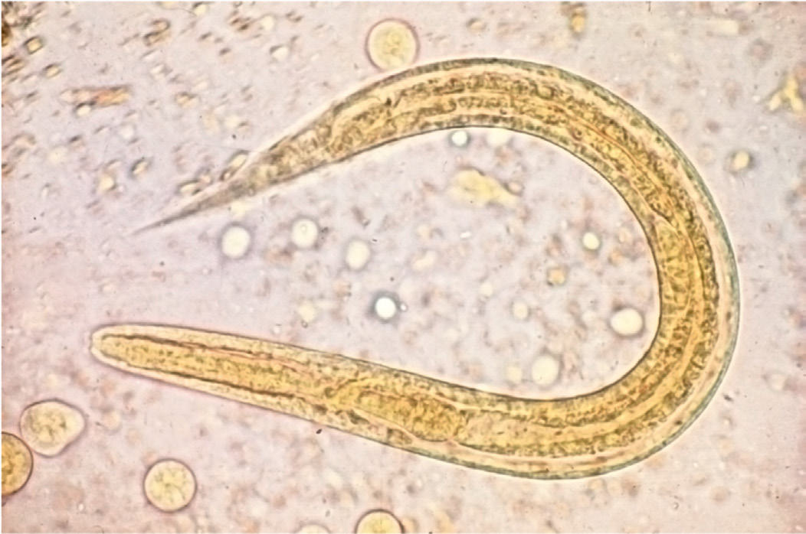

# Chapter 342: Lymphatic Filariasis (Brugia malayi, Brugia timori, and Wuchereria bancrofti) — Board-Style Self-Assessment MCQs
**Part XV: Infectious Diseases** | [📖 Read Wiki Chapter](../chapters/342.md) | [🃏 Chapter Flashcards](../flashcards/342_flashcards.md) | [🏠 Course Master Index](../../index.md)

Total questions: **5** *(Click "Show Answer & Rationale" beneath each question)*

### Question 1 (Clinical Pediatrics Vignette)
A pediatric patient is evaluated for the following clinical and diagnostic profile: These symptoms are caused by an acute inflammatory response triggered by death of adult worms.. Which of the following conditions or syndromes is the most likely diagnosis?

- **A.** Lymphatic Filariasis (Brugia malayi, Brugia timori, and Wuchereria bancrofti)
- **B.** Orbital Infections
- **C.** Acyanotic Congenital Heart Disease: Obstructive Lesions
- **D.** METABOLIC DISTURBANCES

<b>Show Answer & Rationale</b>

**Correct Answer: A** — Lymphatic Filariasis (Brugia malayi, Brugia timori, and Wuchereria bancrofti)

**Rationale:** **Lymphatic Filariasis (Brugia malayi, Brugia timori, and Wuchereria bancrofti)** is characterized by: These symptoms are caused by an acute inflammatory response triggered by death of adult worms..

**Why Other Options Are Incorrect:** **Orbital Infections** is incorrect (characterized by Dacryocystitis may occur in newborns as a complication of a con genital dacryocystocele.). **Acyanotic Congenital Heart Disease: Obstructive Lesions** is incorrect (characterized by The diagnosis should be suspected in a patient in whom symptoms of acute heart failure develop in as). **METABOLIC DISTURBANCES** is incorrect (characterized by Hyponatremia; Hypokalemia; Hypophosphatemia).

### Question 2 (Visual Diagnosis & Clinical Spotter)

A pediatric patient undergoes evaluation for **Lymphatic Filariasis (Brugia malayi, Brugia timori, and Wuchereria bancrofti)**, yielding the clinical or diagnostic finding shown below. Which of the following best characterizes the illustrated finding?

- **A.** The diagnosis is suggested by residence in a filarial endemic area, eosinophilia (>2,000/μL), compat ible clinical symptoms, increased serum IgE (>1,000 IU/mL), and high titers of antimicrof
- **B.** The clinical response to diethylcarbamazine (2 mg/kg/dose orally 3 times daily for 12-21 days) is the final criterion for diagnosis; the major ity of patients improve with this therapy.
- **C.** Larvae of intestinal strongyloidiasis.
- **D.** These symptoms are caused by an acute inflammatory response triggered by death of adult worms.

<b>Show Answer & Rationale</b>

**Correct Answer: C** — Larvae of intestinal strongyloidiasis.

**Rationale:** **Fig. 341.2**: Larvae of intestinal strongyloidiasis.

### Question 3 (Differential Diagnosis (Lymphatic Filariasis (Brugia malayi, Brugia timori, and Wuchereria bancrofti)))
During a pediatric consultation regarding **Lymphatic Filariasis (Brugia malayi, Brugia timori, and Wuchereria bancrofti)**, which clinical entity or concept is described by the following profile? "The filarial worms Brugia malayi (Malayan filariasis)*, Brugia timori, and Wuchereria bancrofti (bancroftian filariasis)* are threadlike nema todes that cause similar infections."

- **A.** Tropical Pulmonary Eosinophilia
- **B.** diethylcarbamazine
- **C.** TREATMENT
- **D.** ETIOLOGY

<b>Show Answer & Rationale</b>

**Correct Answer: D** — ETIOLOGY

**Rationale:** ETIOLOGY The filarial worms Brugia malayi (Malayan filariasis)*, Brugia timori, and Wuchereria bancrofti (bancroftian filariasis)* are threadlike nema todes that cause similar infections.

### Question 4 (Differential Diagnosis (Lymphatic Filariasis (Brugia malayi, Brugia timori, and Wuchereria bancrofti)))
During a pediatric consultation regarding **Lymphatic Filariasis (Brugia malayi, Brugia timori, and Wuchereria bancrofti)**, which clinical entity or concept is described by the following profile? "More than 120 million people living in tropical Africa, Asia, and Latin America are infected; approximately 10–20% of these individuals have clinically significant morbidity attributable to filariasis."

- **A.** Tropical Pulmonary Eosinophilia
- **B.** DIAGNOSIS
- **C.** EPIDEMIOLOGY
- **D.** Environmental and occupational health inequities

<b>Show Answer & Rationale</b>

**Correct Answer: C** — EPIDEMIOLOGY

**Rationale:** EPIDEMIOLOGY More than 120 million people living in tropical Africa, Asia, and Latin America are infected; approximately 10–20% of these individuals have clinically significant morbidity attributable to filariasis.

### Question 5 (Pediatric Board Mastery (Lymphatic Filariasis (Brugia malayi, Brugia timori, and Wuchereria bancrofti)))
When formulating an evidence-based diagnostic and management plan for **Lymphatic Filariasis (Brugia malayi, Brugia timori, and Wuchereria bancrofti)** (*Part XV: Infectious Diseases*), which of the following pediatric clinical statements is **ACCURATE**? (Item 1)

- **A.** First-line management relies on immediate high-dose aspirin therapy in febrile infants.
- **B.** Clinical manifestations are permanently restricted to late adulthood and never present during infancy, childhood, or adolescence.
- **C.** Inheritance is exclusively holandric (Y-linked) with 100% penetrance restricted to male neonates.
- **D.** These symptoms are caused by an acute inflammatory response triggered by death of adult worms.

<b>Show Answer & Rationale</b>

**Correct Answer: D** — These symptoms are caused by an acute inflammatory response triggered by death of adult worms.

**Rationale:** **Pediatric Clinical Principle (Lymphatic Filariasis (Brugia malayi, Brugia timori, and Wuchereria bancrofti)):** These symptoms are caused by an acute inflammatory response triggered by death of adult worms.

