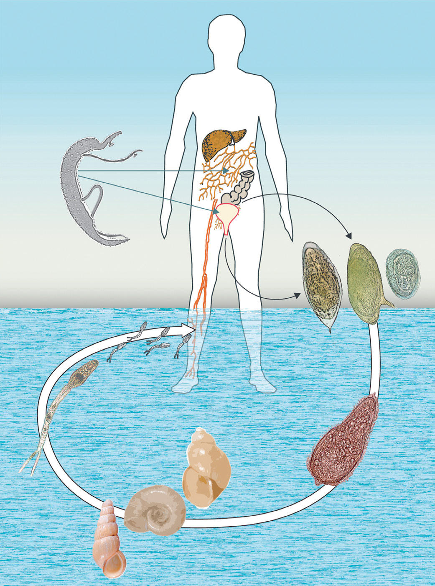

# Chapter 346: Schistosomiasis (Schistosoma) — Board-Style Self-Assessment MCQs
**Part XV: Infectious Diseases** | [📖 Read Wiki Chapter](../chapters/346.md) | [🃏 Chapter Flashcards](../flashcards/346_flashcards.md) | [🏠 Course Master Index](../../index.md)

Total questions: **5** *(Click "Show Answer & Rationale" beneath each question)*

### Question 1 (Clinical Pediatrics Vignette)
A pediatric patient is evaluated for the following clinical and diagnostic profile: Intestinal as well as hepatic granulomas underlie the pathologic sequelae of the other schistosome infections: ulcerations and fibrosis of intestinal wall, hepatosplenomegaly, and portal hypertension caused by presinusoidal obstruction of blood flow.. Which of the following conditions or syndromes is the most likely diagnosis?

- **A.** Schistosomiasis (Schistosoma)
- **B.** DEFINITION (Demyelinating Disorders of the Central Nervous System)
- **C.** RESPONSE PROTOCOL TO SCREENING (BASED ON LAST ITEM ANSWERED “YES”)
- **D.** IL23R (Inflammatory Bowel Disease)

<b>Show Answer & Rationale</b>

**Correct Answer: A** — Schistosomiasis (Schistosoma)

**Rationale:** **Schistosomiasis (Schistosoma)** is characterized by: Intestinal as well as hepatic granulomas underlie the pathologic sequelae of the other schistosome infections: ulcerations and fibrosis of intestinal wall, hepatosplenomegaly, and portal hypertension caused by presinusoidal obstruction of blood flow..

**Why Other Options Are Incorrect:** **DEFINITION (Demyelinating Disorders of the Central Nervous System)** is incorrect (characterized by Acute disseminated encephalomyelitis (ADEM); A first polyfocal CNS event with presumed inflammatory ). **RESPONSE PROTOCOL TO SCREENING (BASED ON LAST ITEM ANSWERED “YES”)** is incorrect (characterized by Item 1—Mental Health Referral at discharge; Item 2—Mental Health Referral at discharge; Item 3—Care ). **IL23R (Inflammatory Bowel Disease)** is incorrect (characterized by IL-23 receptor; Crohn disease and; ulcerative colitis; Immune regulation, proinflammatory; pathways—).

### Question 2 (Visual Diagnosis & Clinical Spotter)

A pediatric patient undergoes evaluation for **Schistosomiasis (Schistosoma)**, yielding the clinical or diagnostic finding shown below. Which of the following best characterizes the illustrated finding?

- **A.** CLINICAL MANIFESTATIONS Two main chronic clinical syndromes arise from Schistosoma spp. infection: urogenital schistosomiasis caused by S. haematobium and intestinal schistosomiasis caused b
- **B.** Life cycle of Schistosoma mansoni, S. haematobium, and S. japonicum. A, Paired adult worms (larger male enfolding slender fe male). B, Eggs (left to right, S. haematobium, S. mansoni, S. japoni c
- **C.** Intestinal as well as hepatic granulomas underlie the pathologic sequelae of the other schistosome infections: ulcerations and fibrosis of intestinal wall, hepatosplenomegaly, and portal hyp
- **D.** Skin manifesta tions are more pronounced in previously exposed individuals and are characterized by edema and intense cellular infiltrates in the dermis and epidermis.

<b>Show Answer & Rationale</b>

**Correct Answer: B** — Life cycle of Schistosoma mansoni, S. haematobium, and S. japonicum. A, Paired adult worms (larger male enfolding slender fe male). B, Eggs (left to right, S. haematobium, S. mansoni, S. japoni c

**Rationale:** **Fig. 346.2**: Life cycle of Schistosoma mansoni, S. haematobium, and S. japonicum. A, Paired adult worms (larger male enfolding slender fe male). B, Eggs (left to right, S. haematobium, S. mansoni, S. japoni cum). C, Ciliated miracidium. D, Intermediate host snails (left to right, Oncomelania, Biomphalaria, Bulinus). E, Cercariae. (From Colley DG, Bustinduy AL, Secor WE, King CH. Human schistosomiasis. Lancet. 2014;383:2253–2264. Fig 1.)

### Question 3 (Differential Diagnosis (Schistosomiasis (Schistosoma)))
During a pediatric consultation regarding **Schistosomiasis (Schistosoma)**, which clinical entity or concept is described by the following profile? "Schistosomiasis affects more than 300 million people worldwide with more than 700 million people at risk, primarily children and young adults."

- **A.** Chronic schistosomiasis
- **B.** antigenic diagnosis
- **C.** EPIDEMIOLOGY
- **D.** CLINICAL MANIFESTATIONS

<b>Show Answer & Rationale</b>

**Correct Answer: C** — EPIDEMIOLOGY

**Rationale:** EPIDEMIOLOGY Schistosomiasis affects more than 300 million people worldwide with more than 700 million people at risk, primarily children and young adults.

### Question 4 (Differential Diagnosis (Schistosomiasis (Schistosoma)))
During a pediatric consultation regarding **Schistosomiasis (Schistosoma)**, which clinical entity or concept is described by the following profile? "Both early and late manifestations of schistosomiasis are immunologi cally mediated."

- **A.** Chronic schistosomiasis
- **B.** PATHOGENESIS
- **C.** Mesenteric & Omental Lymphatic Cysts
- **D.** ACQUIRED (Disorders of the Nails)

<b>Show Answer & Rationale</b>

**Correct Answer: B** — PATHOGENESIS

**Rationale:** PATHOGENESIS Both early and late manifestations of schistosomiasis are immunologi cally mediated.

### Question 5 (Pediatric Board Mastery (Schistosomiasis (Schistosoma)))
When formulating an evidence-based diagnostic and management plan for **Schistosomiasis (Schistosoma)** (*Part XV: Infectious Diseases*), which of the following pediatric clinical statements is **ACCURATE**? (Item 1)

- **A.** Intestinal as well as hepatic granulomas underlie the pathologic sequelae of the other schistosome infections: ulcerations and fibrosis of intestinal wall, hepatosplenomegaly, and portal hypertension cause
- **B.** The condition is an entirely benign physiologic variant that never warrants laboratory or clinical evaluation.
- **C.** Diagnostic confirmation relies solely on plain skull radiographs without biochemical, microbiologic, or clinical correlation.
- **D.** First-line management relies on immediate high-dose aspirin therapy in febrile infants.

<b>Show Answer & Rationale</b>

**Correct Answer: A** — Intestinal as well as hepatic granulomas underlie the pathologic sequelae of the other schistosome infections: ulcerations and fibrosis of intestinal wall, hepatosplenomegaly, and portal hypertension cause

**Rationale:** **Pediatric Clinical Principle (Schistosomiasis (Schistosoma)):** Intestinal as well as hepatic granulomas underlie the pathologic sequelae of the other schistosome infections: ulcerations and fibrosis of intestinal wall, hepatosplenomegaly, and portal hypertension caused by presinusoidal obstruction of blood flow.

