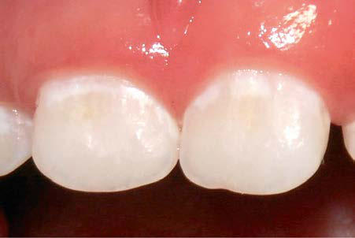

# Chapter 358: Dental Caries — Board-Style Self-Assessment MCQs
**Part XVI: The Digestive System** | [📖 Read Wiki Chapter](../chapters/358.md) | [🃏 Chapter Flashcards](../flashcards/358_flashcards.md) | [🏠 Course Master Index](../../index.md)

Total questions: **5** *(Click "Show Answer & Rationale" beneath each question)*

### Question 1 (Clinical Pediatrics Vignette)
A pediatric patient is evaluated for the following clinical and diagnostic profile: Dentoalveolar; Swelling of the alveolar ridge with; periodontal, periapical, and subperiosteal; abscess; Submental space; Firm midline swelling beneath the chin;; caused by infection from the mandibular; incisors; Submandibular space; Swelling of the. Which of the following conditions or syndromes is the most likely diagnosis?

- **A.** NUTRITIONAL DEFICIENCY–METABOLIC DISORDERS
- **B.** BIRTH PARENT MEDICAL HISTORY
- **C.** CLINICAL PRESENTATION
- **D.** Dental Caries

<b>Show Answer & Rationale</b>

**Correct Answer: C** — CLINICAL PRESENTATION

**Rationale:** **CLINICAL PRESENTATION** is characterized by: Dentoalveolar; Swelling of the alveolar ridge with; periodontal, periapical, and subperiosteal; abscess; Submental space; Firm midline swelling beneath the chin;; caused by infection from the mandibular; incisors; Submandibular space; Swelling of the submandibular triangle; of the neck around the angle of the; mandible.

**Why Other Options Are Incorrect:** **NUTRITIONAL DEFICIENCY–METABOLIC DISORDERS** is incorrect (characterized by Zinc deficiency (acrodermatitis; enteropathica); Children; Uncommon; Erythematous scaly patches and ). **BIRTH PARENT MEDICAL HISTORY** is incorrect (characterized by Genetic disorders; Diabetes mellitus; Hypertension; Asymptomatic bacteriuria; Rheumatologic illness ). **Dental Caries** is incorrect (characterized by Current evidence supports the use of a chronic disease management model to modify risk factors and m).

### Question 2 (Clinical Pediatrics Vignette)
A pediatric patient is evaluated for the following clinical and diagnostic profile: Current evidence supports the use of a chronic disease management model to modify risk factors and manage this pediatric condition.. Which of the following conditions or syndromes is the most likely diagnosis?

- **A.** Dental Caries
- **B.** CONNECTIVE TISSUE DISEASE/INFLAMMATORY
- **C.** CLINICAL PRESENTATION
- **D.** ASPIRATION (Other Distal Airway Diseases)

<b>Show Answer & Rationale</b>

**Correct Answer: A** — Dental Caries

**Rationale:** **Dental Caries** is characterized by: Current evidence supports the use of a chronic disease management model to modify risk factors and manage dental caries..

**Why Other Options Are Incorrect:** **CONNECTIVE TISSUE DISEASE/INFLAMMATORY** is incorrect (characterized by Juvenile idiopathic arthritis; Sjögren syndrome; Scleroderma; Systemic lupus erythematosus; Castlema). **CLINICAL PRESENTATION** is incorrect (characterized by Dentoalveolar; Swelling of the alveolar ridge with; periodontal, periapical, and subperiosteal; absc). **ASPIRATION (Other Distal Airway Diseases)** is incorrect (characterized by Stomach contents: gastroesophageal reflux; Foreign bodies).

### Question 3 (Visual Diagnosis & Clinical Spotter)

A pediatric patient undergoes evaluation for **Dental Caries**, yielding the clinical or diagnostic finding shown below. Which of the following best characterizes the illustrated finding?

- **A.** Clinical management of the pain and infection associated with untreated dental caries varies with the extent of involvement and the medical status of the patient.
- **B.** The disease management includes at-home strategies and in-office preventive, min imally invasive, and invasive interventions for treating dental caries.
- **C.** Current evidence supports the use of a chronic disease management model to modify risk factors and manage dental caries.
- **D.** Initial carious lesions (white spot lesions) around the necks of the maxillary central incisors.

<b>Show Answer & Rationale</b>

**Correct Answer: D** — Initial carious lesions (white spot lesions) around the necks of the maxillary central incisors.

**Rationale:** **Fig. 358.1**: Initial carious lesions (white spot lesions) around the necks of the maxillary central incisors.

### Question 4 (Differential Diagnosis (Dental Caries))
During a pediatric consultation regarding **Dental Caries**, which clinical entity or concept is described by the following profile? "As per the 2011–2012 National Health and Nutrition Examination Sur vey (NHANES), approximately 15% of children ranging from 2 to 8 years of age had one or more primary teeth affected by dental caries (Fig."

- **A.** EPIDEMIOLOGY
- **B.** COMPLICATIONS
- **C.** ASSOCIATED CONDITIONS
- **D.** PREVENTION

<b>Show Answer & Rationale</b>

**Correct Answer: A** — EPIDEMIOLOGY

**Rationale:** EPIDEMIOLOGY As per the 2011–2012 National Health and Nutrition Examination Sur vey (NHANES), approximately 15% of children ranging from 2 to 8 years of age had one or more primary teeth affected by dental caries (Fig.

### Question 5 (Pediatric Board Mastery (Dental Caries))
When formulating an evidence-based diagnostic and management plan for **Dental Caries** (*Part XVI: The Digestive System*), which of the following pediatric clinical statements is **ACCURATE**? (Item 1)

- **A.** The condition is an entirely benign physiologic variant that never warrants laboratory or clinical evaluation.
- **B.** Diagnostic confirmation relies solely on plain skull radiographs without biochemical, microbiologic, or clinical correlation.
- **C.** Current evidence supports the use of a chronic disease management model to modify risk factors and manage dental caries.
- **D.** Inheritance is exclusively holandric (Y-linked) with 100% penetrance restricted to male neonates.

<b>Show Answer & Rationale</b>

**Correct Answer: C** — Current evidence supports the use of a chronic disease management model to modify risk factors and manage dental caries.

**Rationale:** **Pediatric Clinical Principle (Dental Caries):** Current evidence supports the use of a chronic disease management model to modify risk factors and manage dental caries.

