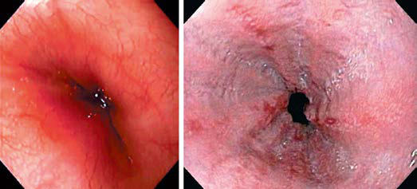

# Chapter 369: Gastroesophageal Reflux Disease — Board-Style Self-Assessment MCQs
**Part XVI: The Digestive System** | [📖 Read Wiki Chapter](../chapters/369.md) | [🃏 Chapter Flashcards](../flashcards/369_flashcards.md) | [🏠 Course Master Index](../../index.md)

Total questions: **5** *(Click "Show Answer & Rationale" beneath each question)*

### Question 1 (Clinical Pediatrics Vignette)
A pediatric patient is evaluated for the following clinical and diagnostic profile: Impaired quality of life; +++; +++; +++; Regurgitation; ++++; +; +; Excessive crying/irritability; +++; +; −; Vomiting; ++; ++; +; Food refusal/feeding disturbances/anorexia; ++; +; +; Persisting hiccups; ++; +; +; Failure to thrive; ++; +; −; Abnorm. Which of the following conditions or syndromes is the most likely diagnosis?

- **A.** PLANT-DERIVED NATURAL PRODUCTS
- **B.** ADOLESCENTS AND ADULTS
- **C.** SYMPTOMS (Gastroesophageal Reflux Disease)
- **D.** Benign: Hepatocellular adenoma

<b>Show Answer & Rationale</b>

**Correct Answer: B** — ADOLESCENTS AND ADULTS

**Rationale:** **ADOLESCENTS AND ADULTS** is characterized by: Impaired quality of life; +++; +++; +++; Regurgitation; ++++; +; +; Excessive crying/irritability; +++; +; −; Vomiting; ++; ++; +; Food refusal/feeding disturbances/anorexia; ++; +; +; Persisting hiccups; ++; +; +; Failure to thrive; ++; +; −; Abnormal posturing/Sandifer syndrome; ++; +; −; Esophagitis; +; ++; +++; Per.

**Why Other Options Are Incorrect:** **PLANT-DERIVED NATURAL PRODUCTS** is incorrect (characterized by Baker; Gluten, soybean lecithin; Candy maker; Pectin; Glove manufacturer; Latex; Health professional). **SYMPTOMS (Gastroesophageal Reflux Disease)** is incorrect (characterized by Recurrent regurgitation with or; without vomiting; Weight loss or poor weight gain; Irritability in ). **Benign: Hepatocellular adenoma** is incorrect (characterized by focal nodular hyperplasia (FNH),; regenerative nodules, and dysplas; tic nodules).

### Question 2 (Clinical Pediatrics Vignette)
A pediatric patient is evaluated for the following clinical and diagnostic profile: Recurrent regurgitation with or; without vomiting; Weight loss or poor weight gain; Irritability in infants; Ruminative behavior; Heartburn or chest pain; Hematemesis; Dysphagia, odynophagia; Wheezing; Stridor; Cough; Hoarseness. Which of the following conditions or syndromes is the most likely diagnosis?

- **A.** Type 2: Excision: Partial or total removal of the clitoris and labia
- **B.** Vaginal Ring (Contraception)
- **C.** SYMPTOMS (Gastroesophageal Reflux Disease)
- **D.** CD30 (Principles of Cancer Treatment)

<b>Show Answer & Rationale</b>

**Correct Answer: C** — SYMPTOMS (Gastroesophageal Reflux Disease)

**Rationale:** **SYMPTOMS (Gastroesophageal Reflux Disease)** is characterized by: Recurrent regurgitation with or; without vomiting; Weight loss or poor weight gain; Irritability in infants; Ruminative behavior; Heartburn or chest pain; Hematemesis; Dysphagia, odynophagia; Wheezing; Stridor; Cough; Hoarseness.

**Why Other Options Are Incorrect:** **Type 2: Excision: Partial or total removal of the clitoris and labia** is incorrect (characterized by minora with or without removal of the labia majora (the labia are; the “lips” that surround the vagi). **Vaginal Ring (Contraception)** is incorrect (characterized by 7; 0.3; Convenience of once-monthly; application, benefits similar to; combination oral contraceptiv). **CD30 (Principles of Cancer Treatment)** is incorrect (characterized by Hodgkin lymphoma; Rituximab).

### Question 3 (Visual Diagnosis & Clinical Spotter)

A pediatric patient undergoes evaluation for **Gastroesophageal Reflux Disease**, yielding the clinical or diagnostic finding shown below. Which of the following best characterizes the illustrated finding?

- **A.** DIAGNOSIS For most of the typical GERD presentations, particularly in older chil dren, a thorough history and physical examination suffice initially to reach the diagnosis.
- **B.** Whether GERD is caused by a higher frequency of TLESRs or by a greater incidence of reflux during TLESRs is debated; each is likely in different persons.
- **C.** Barium esophagogram demonstrating free gastroesopha geal reflux. Note stricture caused by peptic esophagitis. Longitudinal gastric folds above the diaphragm indicate the unusual presence of an as
- **D.** A pediatric autosomal dominant form with otolaryngologic and respiratory manifestations has been located to chromosome 13q14, and the locus is termed GERD1.

<b>Show Answer & Rationale</b>

**Correct Answer: C** — Barium esophagogram demonstrating free gastroesopha geal reflux. Note stricture caused by peptic esophagitis. Longitudinal gastric folds above the diaphragm indicate the unusual presence of an as

**Rationale:** **Fig. 369.1**: Barium esophagogram demonstrating free gastroesopha geal reflux. Note stricture caused by peptic esophagitis. Longitudinal gastric folds above the diaphragm indicate the unusual presence of an associated hiatal hernia.

### Question 4 (Differential Diagnosis (Gastroesophageal Reflux Disease))
During a pediatric consultation regarding **Gastroesophageal Reflux Disease**, which clinical entity or concept is described by the following profile? "Factors determining the esophageal manifestations of reflux include the duration of esophageal exposure (a product of the frequency and dura tion of reflux episodes), the causticity of the refluxate, and the susceptibil ity of the esophagus to damage."

- **A.** MANAGEMENT
- **B.** Endoscopy
- **C.** Pharmacotherapy
- **D.** PATHOPHYSIOLOGY

<b>Show Answer & Rationale</b>

**Correct Answer: D** — PATHOPHYSIOLOGY

**Rationale:** PATHOPHYSIOLOGY Factors determining the esophageal manifestations of reflux include the duration of esophageal exposure (a product of the frequency and dura tion of reflux episodes), the causticity of the refluxate, and the susceptibil ity of the esophagus to damage.

### Question 5 (Pediatric Board Mastery (Gastroesophageal Reflux Disease))
When formulating an evidence-based diagnostic and management plan for **Gastroesophageal Reflux Disease** (*Part XVI: The Digestive System*), which of the following pediatric clinical statements is **ACCURATE**? (Item 1)

- **A.** Clinical manifestations are permanently restricted to late adulthood and never present during infancy, childhood, or adolescence.
- **B.** First-line management relies on immediate high-dose aspirin therapy in febrile infants.
- **C.** Inheritance is exclusively holandric (Y-linked) with 100% penetrance restricted to male neonates.
- **D.** Whether GERD is caused by a higher frequency of TLESRs or by a greater incidence of reflux during TLESRs is debated; each is likely in different persons.

<b>Show Answer & Rationale</b>

**Correct Answer: D** — Whether GERD is caused by a higher frequency of TLESRs or by a greater incidence of reflux during TLESRs is debated; each is likely in different persons.

**Rationale:** **Pediatric Clinical Principle (Gastroesophageal Reflux Disease):** Whether GERD is caused by a higher frequency of TLESRs or by a greater incidence of reflux during TLESRs is debated; each is likely in different persons.

