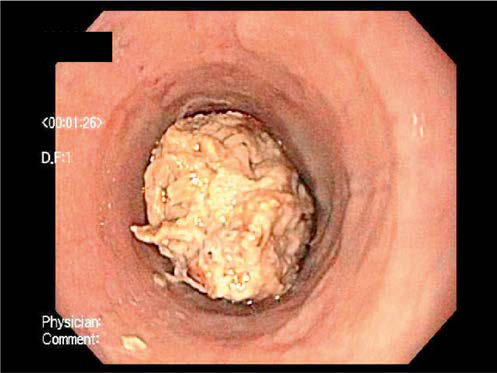

# Chapter 370: Eosinophilic Esophagitis, Pill Esophagitis, and Infective Esophagitis — Board-Style Self-Assessment MCQs
**Part XVI: The Digestive System** | [📖 Read Wiki Chapter](../chapters/370.md) | [🃏 Chapter Flashcards](../flashcards/370_flashcards.md) | [🏠 Course Master Index](../../index.md)

Total questions: **5** *(Click "Show Answer & Rationale" beneath each question)*

### Question 1 (Clinical Pediatrics Vignette)
A pediatric patient is evaluated for the following clinical and diagnostic profile: Esophageal histology reveals profound eosinophilia, with a currently acceptable cutoff for diagnosis chosen at ≥15-20 eosinophils per hpf.. Which of the following conditions or syndromes is the most likely diagnosis?

- **A.** IL2RA (Immune Dysregulation)
- **B.** Umbilical Hernia (Differential Diagnosis)
- **C.** Eosinophilic Esophagitis, Pill Esophagitis, and Infective Esophagitis
- **D.** NEPHROGENIC DIABETES INSIPIDUS

<b>Show Answer & Rationale</b>

**Correct Answer: C** — Eosinophilic Esophagitis, Pill Esophagitis, and Infective Esophagitis

**Rationale:** **Eosinophilic Esophagitis, Pill Esophagitis, and Infective Esophagitis** is characterized by: Esophageal histology reveals profound eosinophilia, with a currently acceptable cutoff for diagnosis chosen at ≥15-20 eosinophils per hpf..

**Why Other Options Are Incorrect:** **IL2RA (Immune Dysregulation)** is incorrect (characterized by CD25 deficiency). **Umbilical Hernia (Differential Diagnosis)** is incorrect (characterized by Patent umbilical ring; >85–90% close spontaneously by age 4–5 years; observe unless defect >1.5–2 cm). **NEPHROGENIC DIABETES INSIPIDUS** is incorrect (characterized by Congenital (X-linked recessive, AVP V2 receptor pathogenic variants,; autosomal recessive or dominan).

### Question 2 (Visual Diagnosis & Clinical Spotter)

A pediatric patient undergoes evaluation for **Eosinophilic Esophagitis, Pill Esophagitis, and Infective Esophagitis**, yielding the clinical or diagnostic finding shown below. Which of the following best characterizes the illustrated finding?

- **A.** Endoscopic visualization of esophageal food impaction (yellow arrow) and mucosal rings (blue arrows).
- **B.** Diagnosis of infectious esophagitis is made by endoscopy, usually notable for white plaques in Candida, multiple superficial ulcers or volcano ulcers in HSV, and single deep ulcer in CMV.
- **C.** Esophageal histology reveals profound eosinophilia, with a currently acceptable cutoff for diagnosis chosen at ≥15-20 eosinophils per hpf.
- **D.** Topically acting swallowed corticosteroids (fluticasone with out spacer, viscous budesonide suspension) are the only therapy strongly recommended based on moderate quality evidence as first-

<b>Show Answer & Rationale</b>

**Correct Answer: A** — Endoscopic visualization of esophageal food impaction (yellow arrow) and mucosal rings (blue arrows).

**Rationale:** **Fig. 370.1**: Endoscopic visualization of esophageal food impaction (yellow arrow) and mucosal rings (blue arrows).

### Question 3 (Pediatric Board Mastery (Eosinophilic Esophagitis, Pill Esophagitis, and Infective Esophagitis))
When formulating an evidence-based diagnostic and management plan for **Eosinophilic Esophagitis, Pill Esophagitis, and Infective Esophagitis** (*Part XVI: The Digestive System*), which of the following pediatric clinical statements is **ACCURATE**? (Item 1)

- **A.** First-line management relies on immediate high-dose aspirin therapy in febrile infants.
- **B.** Inheritance is exclusively holandric (Y-linked) with 100% penetrance restricted to male neonates.
- **C.** Diagnostic confirmation relies solely on plain skull radiographs without biochemical, microbiologic, or clinical correlation.
- **D.** Esophageal histology reveals profound eosinophilia, with a currently acceptable cutoff for diagnosis chosen at ≥15-20 eosinophils per hpf.

<b>Show Answer & Rationale</b>

**Correct Answer: D** — Esophageal histology reveals profound eosinophilia, with a currently acceptable cutoff for diagnosis chosen at ≥15-20 eosinophils per hpf.

**Rationale:** **Pediatric Clinical Principle (Eosinophilic Esophagitis, Pill Esophagitis, and Infective Esophagitis):** Esophageal histology reveals profound eosinophilia, with a currently acceptable cutoff for diagnosis chosen at ≥15-20 eosinophils per hpf.

### Question 4 (Pediatric Board Mastery (Eosinophilic Esophagitis, Pill Esophagitis, and Infective Esophagitis))
When formulating an evidence-based diagnostic and management plan for **Eosinophilic Esophagitis, Pill Esophagitis, and Infective Esophagitis** (*Part XVI: The Digestive System*), which of the following pediatric clinical statements is **ACCURATE**? (Item 2)

- **A.** Topically acting swallowed corticosteroids (fluticasone with out spacer, viscous budesonide suspension) are the only therapy strongly recommended based on moderate quality evidence as first-line therapy, a
- **B.** The condition is an entirely benign physiologic variant that never warrants laboratory or clinical evaluation.
- **C.** Diagnostic confirmation relies solely on plain skull radiographs without biochemical, microbiologic, or clinical correlation.
- **D.** Clinical manifestations are permanently restricted to late adulthood and never present during infancy, childhood, or adolescence.

<b>Show Answer & Rationale</b>

**Correct Answer: A** — Topically acting swallowed corticosteroids (fluticasone with out spacer, viscous budesonide suspension) are the only therapy strongly recommended based on moderate quality evidence as first-line therapy, a

**Rationale:** **Pediatric Clinical Principle (Eosinophilic Esophagitis, Pill Esophagitis, and Infective Esophagitis):** Topically acting swallowed corticosteroids (fluticasone with out spacer, viscous budesonide suspension) are the only therapy strongly recommended based on moderate quality evidence as first-line therapy, as well as for those who refuse, fail to adhere, or have a poor response to restricted diets.

### Question 5 (Pediatric Board Mastery (Eosinophilic Esophagitis, Pill Esophagitis, and Infective Esophagitis))
When formulating an evidence-based diagnostic and management plan for **Eosinophilic Esophagitis, Pill Esophagitis, and Infective Esophagitis** (*Part XVI: The Digestive System*), which of the following pediatric clinical statements is **ACCURATE**? (Item 3)

- **A.** The condition is an entirely benign physiologic variant that never warrants laboratory or clinical evaluation.
- **B.** Diagnosis of infectious esophagitis is made by endoscopy, usually notable for white plaques in Candida, multiple superficial ulcers or volcano ulcers in HSV, and single deep ulcer in CMV.
- **C.** Diagnostic confirmation relies solely on plain skull radiographs without biochemical, microbiologic, or clinical correlation.
- **D.** Inheritance is exclusively holandric (Y-linked) with 100% penetrance restricted to male neonates.

<b>Show Answer & Rationale</b>

**Correct Answer: B** — Diagnosis of infectious esophagitis is made by endoscopy, usually notable for white plaques in Candida, multiple superficial ulcers or volcano ulcers in HSV, and single deep ulcer in CMV.

**Rationale:** **Pediatric Clinical Principle (Eosinophilic Esophagitis, Pill Esophagitis, and Infective Esophagitis):** Diagnosis of infectious esophagitis is made by endoscopy, usually notable for white plaques in Candida, multiple superficial ulcers or volcano ulcers in HSV, and single deep ulcer in CMV.

