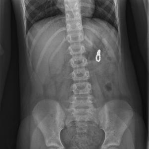

# Chapter 380: Foreign Bodies and Bezoars — Board-Style Self-Assessment MCQs
**Part XVI: The Digestive System** | [📖 Read Wiki Chapter](../chapters/380.md) | [🃏 Chapter Flashcards](../flashcards/380_flashcards.md) | [🏠 Course Master Index](../../index.md)

Total questions: **5** *(Click "Show Answer & Rationale" beneath each question)*

### Question 1 (Clinical Pediatrics Vignette)
A pediatric patient is evaluated for the following clinical and diagnostic profile: PROGNOSIS Untreated ileal-colonic intussusception in infants is usually fatal; the chances of recovery are directly related to the duration of intus susception before reduction.. Which of the following conditions or syndromes is the most likely diagnosis?

- **A.** Foreign Bodies and Bezoars
- **B.** SECONDARY PIPO (Motility Disorders and Hirschsprung Disease)
- **C.** Immune Dysregulation
- **D.** COG AREN0533 (Neoplasms of the Kidney)

<b>Show Answer & Rationale</b>

**Correct Answer: A** — Foreign Bodies and Bezoars

**Rationale:** **Foreign Bodies and Bezoars** is characterized by: PROGNOSIS Untreated ileal-colonic intussusception in infants is usually fatal; the chances of recovery are directly related to the duration of intus susception before reduction..

**Why Other Options Are Incorrect:** **SECONDARY PIPO (Motility Disorders and Hirschsprung Disease)** is incorrect (characterized by • Conditions affecting GI smooth muscle:; • Rheumatologic conditions (dermatomyositis/polymyositis,;). **Immune Dysregulation** is incorrect (characterized by Congenital immunodeficiency disorders; Selective immunoglobulin A deficiency (associated with celiac). **COG AREN0533 (Neoplasms of the Kidney)** is incorrect (characterized by Stage III or IV FH; +LOH; Regimen M; Radiation to flank per local stage; Radiation to metastatic sit).

### Question 2 (Clinical Pediatrics Vignette)
A pediatric patient is evaluated for the following clinical and diagnostic profile: Repeated reducible episodes caused by lymphonodular hyperplasia may respond to treatment of identifiable food aller gies if present.. Which of the following conditions or syndromes is the most likely diagnosis?

- **A.** MIXED OR UNKNOWN CAUSES
- **B.** Foreign Bodies in the Stomach and Intestine (Foreign Bodies and Bezoars)
- **C.** Foreign Bodies and Bezoars
- **D.** Adolescence and Pre-Pregnancy

<b>Show Answer & Rationale</b>

**Correct Answer: B** — Foreign Bodies in the Stomach and Intestine (Foreign Bodies and Bezoars)

**Rationale:** **Foreign Bodies in the Stomach and Intestine (Foreign Bodies and Bezoars)** is characterized by: Repeated reducible episodes caused by lymphonodular hyperplasia may respond to treatment of identifiable food aller gies if present..

**Why Other Options Are Incorrect:** **MIXED OR UNKNOWN CAUSES** is incorrect (characterized by Neurogenic pulmonary edema; High-altitude pulmonary edema; Eclampsia; Pancreatitis; Pulmonary emboli). **Foreign Bodies and Bezoars** is incorrect (characterized by PROGNOSIS Untreated ileal-colonic intussusception in infants is usually fatal; the chances of recove). **Adolescence and Pre-Pregnancy** is incorrect (characterized by • Family planning; • Preconception care).

### Question 3 (Visual Diagnosis & Clinical Spotter)

A pediatric patient undergoes evaluation for **Foreign Bodies and Bezoars**, yielding the clinical or diagnostic finding shown below. Which of the following best characterizes the illustrated finding?

- **A.** Abdominal radiograph of a 3-yr-old boy, noting three at tached magnets that resulted in volvulus (i.e., twisting of the bowel) and multiple bowel perforations. (Courtesy U.S. Consumer Product Saf
- **B.** It is unlikely that an intussusception caused by a lesion such as lymphosarcoma, polyp, or Meckel diverticulum will be successfully reduced by radiologic intervention.
- **C.** PROGNOSIS Untreated ileal-colonic intussusception in infants is usually fatal; the chances of recovery are directly related to the duration of intus susception before reduction.
- **D.** Repeated reducible episodes caused by lymphonodular hyperplasia may respond to treatment of identifiable food aller gies if present.

<b>Show Answer & Rationale</b>

**Correct Answer: A** — Abdominal radiograph of a 3-yr-old boy, noting three at tached magnets that resulted in volvulus (i.e., twisting of the bowel) and multiple bowel perforations. (Courtesy U.S. Consumer Product Saf

**Rationale:** **Fig. 380.2**: Abdominal radiograph of a 3-yr-old boy, noting three at tached magnets that resulted in volvulus (i.e., twisting of the bowel) and multiple bowel perforations. (Courtesy U.S. Consumer Product Safety Commission. From Centers for Disease Control and Prevention: Gas trointestinal injuries from magnet ingestion in children—United States, 2003–2006. MMWR Morb Mortal Wkly Rep. 2006;55:1296–1300.)

### Question 4 (Differential Diagnosis (Foreign Bodies and Bezoars))
During a pediatric consultation regarding **Foreign Bodies and Bezoars**, which clinical entity or concept is described by the following profile? "Untreated ileal-colonic intussusception in infants is usually fatal; the chances of recovery are directly related to the duration of intus susception before reduction."

- **A.** CMV (Epidemiology of Infections)
- **B.** PROGNOSIS
- **C.** BUTTON BATTERIES
- **D.** Foreign Bodies and Bezoars

<b>Show Answer & Rationale</b>

**Correct Answer: B** — PROGNOSIS

**Rationale:** PROGNOSIS Untreated ileal-colonic intussusception in infants is usually fatal; the chances of recovery are directly related to the duration of intus susception before reduction.

### Question 5 (Pediatric Board Mastery (Foreign Bodies and Bezoars))
When formulating an evidence-based diagnostic and management plan for **Foreign Bodies and Bezoars** (*Part XVI: The Digestive System*), which of the following pediatric clinical statements is **ACCURATE**? (Item 1)

- **A.** PROGNOSIS Untreated ileal-colonic intussusception in infants is usually fatal; the chances of recovery are directly related to the duration of intus susception before reduction.
- **B.** Inheritance is exclusively holandric (Y-linked) with 100% penetrance restricted to male neonates.
- **C.** First-line management relies on immediate high-dose aspirin therapy in febrile infants.
- **D.** Diagnostic confirmation relies solely on plain skull radiographs without biochemical, microbiologic, or clinical correlation.

<b>Show Answer & Rationale</b>

**Correct Answer: A** — PROGNOSIS Untreated ileal-colonic intussusception in infants is usually fatal; the chances of recovery are directly related to the duration of intus susception before reduction.

**Rationale:** **Pediatric Clinical Principle (Foreign Bodies and Bezoars):** PROGNOSIS Untreated ileal-colonic intussusception in infants is usually fatal; the chances of recovery are directly related to the duration of intus susception before reduction.

