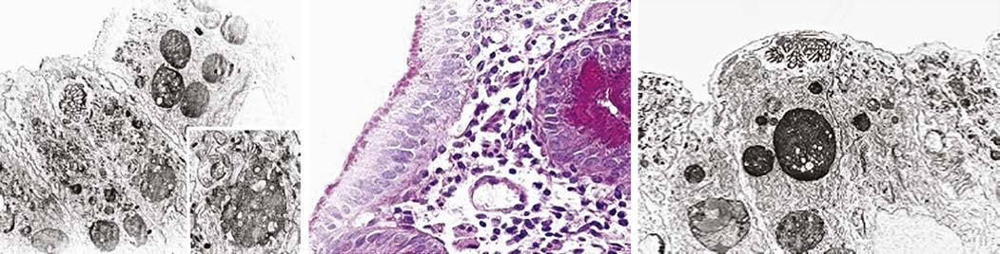

# Chapter 385: Disorders of Malabsorption — Board-Style Self-Assessment MCQs
**Part XVI: The Digestive System** | [📖 Read Wiki Chapter](../chapters/385.md) | [🃏 Chapter Flashcards](../flashcards/385_flashcards.md) | [🏠 Course Master Index](../../index.md)

Total questions: **5** *(Click "Show Answer & Rationale" beneath each question)*

### Question 1 (Clinical Pediatrics Vignette)
A pediatric patient is evaluated for the following clinical and diagnostic profile: Celiac disease (Gluten sensitive enteropathy); Cow’s milk and other protein intolerance enteropathy; Eosinophilic enteropathy; Crohn disease. Which of the following conditions or syndromes is the most likely diagnosis?

- **A.** ACQUIRED AUTOIMMUNITY
- **B.** Mechanical Defects
- **C.** Enteroendocrine Cell Dysfunction
- **D.** ACQUIRED IMMUNE DEFICIENCY

<b>Show Answer & Rationale</b>

**Correct Answer: A** — ACQUIRED AUTOIMMUNITY

**Rationale:** **ACQUIRED AUTOIMMUNITY** is characterized by: Celiac disease (Gluten sensitive enteropathy); Cow’s milk and other protein intolerance enteropathy; Eosinophilic enteropathy; Crohn disease.

**Why Other Options Are Incorrect:** **Mechanical Defects** is incorrect (characterized by Short bowel syndrome; Blind loop syndrome; Pseudoobstruction). **Enteroendocrine Cell Dysfunction** is incorrect (characterized by Enteric anendocrinosis (NEUROG3); Proprotein convertase 1/3 deficiency (PCSK1)). **ACQUIRED IMMUNE DEFICIENCY** is incorrect (characterized by HIV infection; Immunosuppressive therapy and post bone marrow transplantation).

### Question 2 (Clinical Pediatrics Vignette)
A pediatric patient is evaluated for the following clinical and diagnostic profile: Congenital immunodeficiency disorders; Selective immunoglobulin A deficiency (associated with celiac; disease); Severe combined immunodeficiency; Agammaglobulinemia; X-linked hypogammaglobulinemia; Wiskott-Aldrich syndrome; Common variable immunodefi. Which of the following conditions or syndromes is the most likely diagnosis?

- **A.** CONGENITAL BOWEL MUCOSAL DEFECTS
- **B.** ACQUIRED IMMUNE DEFICIENCY
- **C.** ACQUIRED AUTOIMMUNITY
- **D.** Immune Dysregulation

<b>Show Answer & Rationale</b>

**Correct Answer: D** — Immune Dysregulation

**Rationale:** **Immune Dysregulation** is characterized by: Congenital immunodeficiency disorders; Selective immunoglobulin A deficiency (associated with celiac; disease); Severe combined immunodeficiency; Agammaglobulinemia; X-linked hypogammaglobulinemia; Wiskott-Aldrich syndrome; Common variable immunodeficiency disease; Chronic granulomatous disease; IPEX (immune dysregulat.

**Why Other Options Are Incorrect:** **CONGENITAL BOWEL MUCOSAL DEFECTS** is incorrect (characterized by Microvillus inclusion disease; Tufting enteropathy; Carbohydrate-deficient glycoprotein syndrome; En). **ACQUIRED IMMUNE DEFICIENCY** is incorrect (characterized by HIV infection; Immunosuppressive therapy and post bone marrow transplantation). **ACQUIRED AUTOIMMUNITY** is incorrect (characterized by Celiac disease (Gluten sensitive enteropathy); Cow’s milk and other protein intolerance enteropathy;).

### Question 3 (Visual Diagnosis & Clinical Spotter)

A pediatric patient undergoes evaluation for **Disorders of Malabsorption**, yielding the clinical or diagnostic finding shown below. Which of the following best characterizes the illustrated finding?

- **A.** INVESTIGATIONS FOR EXOCRINE PANCREATIC FUNCTION Cystic fibrosis is the most common cause of exo crine pancreatic insufficiency in children; therefore a sweat chloride test must be performed
- **B.** INVESTIGATIONS FOR INTESTINAL MUCOSAL DISORDERS Establishing a specific diagnosis for malabsorption often requires histo logic examination of small bowel mucosal biopsies.
- **C.** Microvillus inclusion disease. A, From top to bottom: microvillus inclusion (a), a granule with few microvilli (b), and a lysosome (c) de tected in the same enterocyte. Inset: Higher magnificatio
- **D.** The gold standard test for exocrine pancreatic function is direct analysis of duodenal aspirate for volume, bicarbonate, trypsin, and lipase upon secretin and pancreozymin/cholecystokinin st

<b>Show Answer & Rationale</b>

**Correct Answer: C** — Microvillus inclusion disease. A, From top to bottom: microvillus inclusion (a), a granule with few microvilli (b), and a lysosome (c) de tected in the same enterocyte. Inset: Higher magnificatio

**Rationale:** **Fig. 385.3**: Microvillus inclusion disease. A, From top to bottom: microvillus inclusion (a), a granule with few microvilli (b), and a lysosome (c) de tected in the same enterocyte. Inset: Higher magnification of b and c ×11,000, inset ×21,500. B, Microvillus inclusion disease. Periodic acid–Schiff (PAS) staining highlights abundant PAS-positive material (arrows) in the apical part of the enterocyte cytoplasm. C, Microvillus inclusion disease. The villous enterocytes lack brush border microvilli, whereas their apical cytoplasm contains a microvillus inclusion (MI) and numerous lysosomes (L) ×5,500. (A from Morroni M, Cangiotti AM, Guarino A, et al. Unusual ultrastructural features in microvillous inclusion disease: a report of two cases. Virchows Arch. 2006;448:805–810.)

### Question 4 (Differential Diagnosis (Disorders of Malabsorption))
During a pediatric consultation regarding **Disorders of Malabsorption**, which clinical entity or concept is described by the following profile? "Because malnutrition leads to the loss of typically absorbed compo nents in stool, the presentation of a patient will differ depending upon the length of time with malabsorption, the extent of losses, and the phase of growth and magnitude of required nutrients."

- **A.** H2-RECEPTOR ANTAGONISTS
- **B.** iron-refractory iron deficiency anemia
- **C.** TREHALASE DEFICIENCY
- **D.** CLINICAL APPROACH

<b>Show Answer & Rationale</b>

**Correct Answer: D** — CLINICAL APPROACH

**Rationale:** CLINICAL APPROACH Because malnutrition leads to the loss of typically absorbed compo nents in stool, the presentation of a patient will differ depending upon the length of time with malabsorption, the extent of losses, and the phase of growth and magnitude of required nutrients.

### Question 5 (Pediatric Board Mastery (Disorders of Malabsorption))
When formulating an evidence-based diagnostic and management plan for **Disorders of Malabsorption** (*Part XVI: The Digestive System*), which of the following pediatric clinical statements is **ACCURATE**? (Item 1)

- **A.** The condition is an entirely benign physiologic variant that never warrants laboratory or clinical evaluation.
- **B.** Inheritance is exclusively holandric (Y-linked) with 100% penetrance restricted to male neonates.
- **C.** INVESTIGATIONS FOR EXOCRINE PANCREATIC FUNCTION Cystic fibrosis is the most common cause of exo crine pancreatic insufficiency in children; therefore a sweat chloride test must be performed before embarkin
- **D.** First-line management relies on immediate high-dose aspirin therapy in febrile infants.

<b>Show Answer & Rationale</b>

**Correct Answer: C** — INVESTIGATIONS FOR EXOCRINE PANCREATIC FUNCTION Cystic fibrosis is the most common cause of exo crine pancreatic insufficiency in children; therefore a sweat chloride test must be performed before embarkin

**Rationale:** **Pediatric Clinical Principle (Disorders of Malabsorption):** INVESTIGATIONS FOR EXOCRINE PANCREATIC FUNCTION Cystic fibrosis is the most common cause of exo crine pancreatic insufficiency in children; therefore a sweat chloride test must be performed before embarking on invasive tests to investi gate possible exocrine pancreatic insufficiency.

