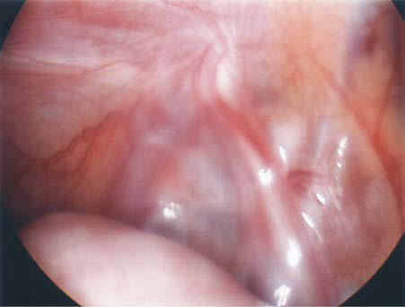

# Chapter 394: Inguinal Hernias — Board-Style Self-Assessment MCQs
**Part XVI: The Digestive System** | [📖 Read Wiki Chapter](../chapters/394.md) | [🃏 Chapter Flashcards](../flashcards/394_flashcards.md) | [🏠 Course Master Index](../../index.md)

Total questions: **5** *(Click "Show Answer & Rationale" beneath each question)*

### Question 1 (Clinical Pediatrics Vignette)
A pediatric patient is evaluated for the following clinical and diagnostic profile: this pediatric condition are one of the most common conditions seen in pedi atric practice, with an overall incidence of 0.8–4.5% in term infants and children and increasing to nearly 30% in premature and low birth weight (<1 kg) infants.. Which of the following conditions or syndromes is the most likely diagnosis?

- **A.** Inguinal Hernias
- **B.** GLI3 (Development and Developmental Anomalies of the Teeth)
- **C.** DRUGS AND TOXINS (Pancreatitis)
- **D.** MCV (Hereditary Stomatocytosis Syndromes)

<b>Show Answer & Rationale</b>

**Correct Answer: A** — Inguinal Hernias

**Rationale:** **Inguinal Hernias** is characterized by: Inguinal hernias are one of the most common conditions seen in pedi atric practice, with an overall incidence of 0.8–4.5% in term infants and children and increasing to nearly 30% in premature and low birth weight (<1 kg) infants..

**Why Other Options Are Incorrect:** **GLI3 (Development and Developmental Anomalies of the Teeth)** is incorrect (characterized by >13 cases to date; 8:5 male to female; Wiedemann-Rautenstrauch; Endocrine dysfunction, aged facies, ). **DRUGS AND TOXINS (Pancreatitis)** is incorrect (characterized by Acetaminophen overdose; Alcohol; Anabolic androgenic steroids; l-Asparaginase; Azathioprine; Cannabi). **MCV (Hereditary Stomatocytosis Syndromes)** is incorrect (characterized by Increased; Normal to; increased; Normal to; increased; High normal to; increased; Normal to; increas).

### Question 2 (Visual Diagnosis & Clinical Spotter)

A pediatric patient undergoes evaluation for **Inguinal Hernias**, yielding the clinical or diagnostic finding shown below. Which of the following best characterizes the illustrated finding?

- **A.** Diagnostic laparoscopic image of obliterated processus vaginalis on left side.
- **B.** Clinical Presentation and Diagnosis An inguinal hernia typically appears as an intermittent, asymptomatic bulge or mass in the inguinal region or scrotum, most often noted on routine physica
- **C.** A direct inguinal hernia results from a weakness in the abdomi nal wall musculature in the inguinal region, specifically the transverse abdominis muscle, which forms the floor of the inguina
- **D.** Inguinal hernias are one of the most common conditions seen in pedi atric practice, with an overall incidence of 0.8–4.5% in term infants and children and increasing to nearly 30% in prematu

<b>Show Answer & Rationale</b>

**Correct Answer: A** — Diagnostic laparoscopic image of obliterated processus vaginalis on left side.

**Rationale:** **Fig. 394.3**: Diagnostic laparoscopic image of obliterated processus vaginalis on left side.

### Question 3 (Differential Diagnosis (Inguinal Hernias))
During a pediatric consultation regarding **Inguinal Hernias**, which clinical entity or concept is described by the following profile? "Vascular malformations and hemangiomas are rare in children."

- **A.** Vascular Tumors
- **B.** transillumination
- **C.** EMBRYOLOGY AND PATHOGENESIS
- **D.** medial

<b>Show Answer & Rationale</b>

**Correct Answer: A** — Vascular Tumors

**Rationale:** Vascular Tumors Vascular malformations and hemangiomas are rare in children.

### Question 4 (Differential Diagnosis (Inguinal Hernias))
During a pediatric consultation regarding **Inguinal Hernias**, which clinical entity or concept is described by the following profile? "hernias (99%) because of a patent processus vaginalis (PV), an evagination of peritoneum in the inguinal area important in testicular descent."

- **A.** femoral hernia
- **B.** Wound Infection
- **C.** congenital indirect
- **D.** hallmark sign

<b>Show Answer & Rationale</b>

**Correct Answer: C** — congenital indirect

**Rationale:** congenital indirect hernias (99%) because of a patent processus vaginalis (PV), an evagination of peritoneum in the inguinal area important in testicular descent.

### Question 5 (Pediatric Board Mastery (Inguinal Hernias))
When formulating an evidence-based diagnostic and management plan for **Inguinal Hernias** (*Part XVI: The Digestive System*), which of the following pediatric clinical statements is **ACCURATE**? (Item 1)

- **A.** Systemic tetracyclines and fluoroquinolones are universally required as routine prophylaxis in all healthy newborns.
- **B.** Diagnostic confirmation relies solely on plain skull radiographs without biochemical, microbiologic, or clinical correlation.
- **C.** Inguinal hernias are one of the most common conditions seen in pedi atric practice, with an overall incidence of 0.8–4.5% in term infants and children and increasing to nearly 30% in premature and low birt
- **D.** First-line management relies on immediate high-dose aspirin therapy in febrile infants.

<b>Show Answer & Rationale</b>

**Correct Answer: C** — Inguinal hernias are one of the most common conditions seen in pedi atric practice, with an overall incidence of 0.8–4.5% in term infants and children and increasing to nearly 30% in premature and low birt

**Rationale:** **Pediatric Clinical Principle (Inguinal Hernias):** Inguinal hernias are one of the most common conditions seen in pedi atric practice, with an overall incidence of 0.8–4.5% in term infants and children and increasing to nearly 30% in premature and low birth weight (<1 kg) infants.

