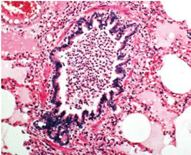

# Chapter 439: Wheezing, Bronchiolitis, and Bronchitis — Board-Style Self-Assessment MCQs
**Part XVII: The Respiratory System** | [📖 Read Wiki Chapter](../chapters/439.md) | [🃏 Chapter Flashcards](../flashcards/439_flashcards.md) | [🏠 Course Master Index](../../index.md)

Total questions: **5** *(Click "Show Answer & Rationale" beneath each question)*

### Question 1 (Clinical Pediatrics Vignette)
A pediatric patient is evaluated for the following clinical and diagnostic profile: Respiratory syncytial virus; Human metapneumovirus; Parainfluenza; Adenovirus; Influenza; Rhinovirus; Bocavirus; Coronavirus, including COVID-19 variants; Enterovirus. Which of the following conditions or syndromes is the most likely diagnosis?

- **A.** Central Airway Abnormalities
- **B.** Intrinsic Airway Anomalies
- **C.** Viral (Wheezing, Bronchiolitis, and Bronchitis)
- **D.** Immunodeficiency States

<b>Show Answer & Rationale</b>

**Correct Answer: C** — Viral (Wheezing, Bronchiolitis, and Bronchitis)

**Rationale:** **Viral (Wheezing, Bronchiolitis, and Bronchitis)** is characterized by: Respiratory syncytial virus; Human metapneumovirus; Parainfluenza; Adenovirus; Influenza; Rhinovirus; Bocavirus; Coronavirus, including COVID-19 variants; Enterovirus.

**Why Other Options Are Incorrect:** **Central Airway Abnormalities** is incorrect (characterized by Malacia of the larynx, trachea, and/or bronchi; Laryngeal or tracheal web; Tracheoesophageal fistula). **Intrinsic Airway Anomalies** is incorrect (characterized by Airway hemangioma or other tumor; Congenital pulmonary airway malformation (cystic adenomatoid; malf). **Immunodeficiency States** is incorrect (characterized by Immunoglobulin A deficiency; B-cell deficiencies).

### Question 2 (Clinical Pediatrics Vignette)
A pediatric patient is evaluated for the following clinical and diagnostic profile: Malacia of the larynx, trachea, and/or bronchi; Laryngeal or tracheal web; Tracheoesophageal fistula (specifically H-type fistula); Laryngeal cleft (resulting in aspiration). Which of the following conditions or syndromes is the most likely diagnosis?

- **A.** Immunodeficiency States
- **B.** Viral (Wheezing, Bronchiolitis, and Bronchitis)
- **C.** MUCOCILIARY CLEARANCE DISORDERS
- **D.** Central Airway Abnormalities

<b>Show Answer & Rationale</b>

**Correct Answer: D** — Central Airway Abnormalities

**Rationale:** **Central Airway Abnormalities** is characterized by: Malacia of the larynx, trachea, and/or bronchi; Laryngeal or tracheal web; Tracheoesophageal fistula (specifically H-type fistula); Laryngeal cleft (resulting in aspiration).

**Why Other Options Are Incorrect:** **Immunodeficiency States** is incorrect (characterized by Immunoglobulin A deficiency; B-cell deficiencies). **Viral (Wheezing, Bronchiolitis, and Bronchitis)** is incorrect (characterized by Respiratory syncytial virus; Human metapneumovirus; Parainfluenza; Adenovirus; Influenza; Rhinovirus). **MUCOCILIARY CLEARANCE DISORDERS** is incorrect (characterized by Cystic fibrosis; Primary ciliary dyskinesia; Bronchiectasis).

### Question 3 (Visual Diagnosis & Clinical Spotter)

A pediatric patient undergoes evaluation for **Wheezing, Bronchiolitis, and Bronchitis**, yielding the clinical or diagnostic finding shown below. Which of the following best characterizes the illustrated finding?

- **A.** Although wheezing in infants most frequently results from inflam mation due to acute viral infections, there are many potential causes of wheezing.
- **B.** Typical clinical course and pathophysiology of viral bronchiolitis. (From Florin TA, Plint PC, Zorc JJ. Viral bronchiolitis. Lancet. 2017;389:211–224, Fig. 1.)
- **C.** Marginal additional narrowing, such as that caused by inflammation related to viral infection, is then more likely to result in wheezing.
- **D.** Despite its com monality, a universal set of diagnostic criteria for bronchiolitis does not exist, with significant disagreement about the upper age limit for appro priate use of the diagnos

<b>Show Answer & Rationale</b>

**Correct Answer: B** — Typical clinical course and pathophysiology of viral bronchiolitis. (From Florin TA, Plint PC, Zorc JJ. Viral bronchiolitis. Lancet. 2017;389:211–224, Fig. 1.)

**Rationale:** **Fig. 439.1**: Typical clinical course and pathophysiology of viral bronchiolitis. (From Florin TA, Plint PC, Zorc JJ. Viral bronchiolitis. Lancet. 2017;389:211–224, Fig. 1.)

### Question 4 (Differential Diagnosis (439.1 Wheezing in Infants: Bronchiolitis))
During a pediatric consultation regarding **Wheezing, Bronchiolitis, and Bronchitis**, which clinical entity or concept is described by the following profile? "nother important cause of wheez ing, and the possibility of this diagnosis complicates the treatment of young children with bronchiolitis, although diagnosing this pediatric condition in the very young can be difficult."

- **A.** ACUTE BRONCHITIS
- **B.** Central Airway Abnormalities
- **C.** acute bronchiolitis
- **D.** Asthma

<b>Show Answer & Rationale</b>

**Correct Answer: D** — Asthma

**Rationale:** Asthma is another important cause of wheez ing, and the possibility of this diagnosis complicates the treatment of young children with bronchiolitis, although diagnosing asthma in the very young can be difficult.

### Question 5 (Pediatric Board Mastery (Wheezing, Bronchiolitis, and Bronchitis))
When formulating an evidence-based diagnostic and management plan for **Wheezing, Bronchiolitis, and Bronchitis** (*Part XVII: The Respiratory System*), which of the following pediatric clinical statements is **ACCURATE**? (Item 1)

- **A.** Clinical manifestations are permanently restricted to late adulthood and never present during infancy, childhood, or adolescence.
- **B.** Marginal additional narrowing, such as that caused by inflammation related to viral infection, is then more likely to result in wheezing.
- **C.** Inheritance is exclusively holandric (Y-linked) with 100% penetrance restricted to male neonates.
- **D.** Systemic tetracyclines and fluoroquinolones are universally required as routine prophylaxis in all healthy newborns.

<b>Show Answer & Rationale</b>

**Correct Answer: B** — Marginal additional narrowing, such as that caused by inflammation related to viral infection, is then more likely to result in wheezing.

**Rationale:** **Pediatric Clinical Principle (Wheezing, Bronchiolitis, and Bronchitis):** Marginal additional narrowing, such as that caused by inflammation related to viral infection, is then more likely to result in wheezing.

