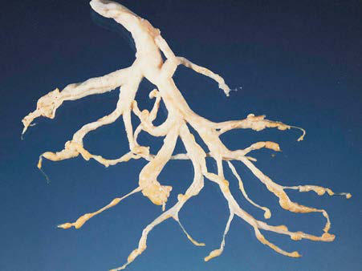

# Chapter 440: Plastic Bronchitis — Board-Style Self-Assessment MCQs
**Part XVII: The Respiratory System** | [📖 Read Wiki Chapter](../chapters/440.md) | [🃏 Chapter Flashcards](../flashcards/440_flashcards.md) | [🏠 Course Master Index](../../index.md)

Total questions: **5** *(Click "Show Answer & Rationale" beneath each question)*

### Question 1 (Clinical Pediatrics Vignette)
A pediatric patient is evaluated for the following clinical and diagnostic profile: Congenital heart disease with Fontan physiology; Pulmonary lymphatic anomalies; Influenza A pulmonary infection; Adenovirus infection; Mycoplasma pneumoniae infection. Which of the following conditions or syndromes is the most likely diagnosis?

- **A.** CENTRAL NERVOUS SYSTEM (CNS)
- **B.** UNLIKELY AND UNPROVEN CONDITIONS
- **C.** N, C, A (Inherited Tubular Transport Abnormalities)
- **D.** PROVEN CONDITIONS (Plastic Bronchitis)

<b>Show Answer & Rationale</b>

**Correct Answer: D** — PROVEN CONDITIONS (Plastic Bronchitis)

**Rationale:** **PROVEN CONDITIONS (Plastic Bronchitis)** is characterized by: Congenital heart disease with Fontan physiology; Pulmonary lymphatic anomalies; Influenza A pulmonary infection; Adenovirus infection; Mycoplasma pneumoniae infection.

**Why Other Options Are Incorrect:** **CENTRAL NERVOUS SYSTEM (CNS)** is incorrect (characterized by Congenital central hypoventilation syndrome (CCHS); Rapid-onset obesity with hypothalamic dysregulat). **UNLIKELY AND UNPROVEN CONDITIONS** is incorrect (characterized by Bacterial pneumonia; Bronchiectasis; Cystic fibrosis; Chronic obstructive pulmonary disease; Nephrot). **N, C, A (Inherited Tubular Transport Abnormalities)** is incorrect (characterized by Low; Very low; Normal; High, high; Low, normal, or high; —; BS IVa, IVb).

### Question 2 (Clinical Pediatrics Vignette)
A pediatric patient is evaluated for the following clinical and diagnostic profile: Toxic inhalation; Sickle cell acute chest syndrome; Hypersecretory and near-fatal asthma (eosinophilic casts); Noonan syndrome. Which of the following conditions or syndromes is the most likely diagnosis?

- **A.** Rheumatologic Conditions
- **B.** Unilateral (Pediatric Cardiorespiratory Emergencies and Resuscitation)
- **C.** POSSIBLE CONDITIONS
- **D.** Respiratory (Delirium)

<b>Show Answer & Rationale</b>

**Correct Answer: C** — POSSIBLE CONDITIONS

**Rationale:** **POSSIBLE CONDITIONS** is characterized by: Toxic inhalation; Sickle cell acute chest syndrome; Hypersecretory and near-fatal asthma (eosinophilic casts); Noonan syndrome.

**Why Other Options Are Incorrect:** **Rheumatologic Conditions** is incorrect (characterized by Systemic lupus erythematosus (SLE); Antiphospholipid antibody syndrome; Juvenile idiopathic arthriti). **Unilateral (Pediatric Cardiorespiratory Emergencies and Resuscitation)** is incorrect (characterized by Third nerve compression with; uncal herniation). **Respiratory (Delirium)** is incorrect (characterized by Respiratory insufficiency, respiratory failure,; pneumothorax).

### Question 3 (Visual Diagnosis & Clinical Spotter)

A pediatric patient undergoes evaluation for **Plastic Bronchitis**, yielding the clinical or diagnostic finding shown below. Which of the following best characterizes the illustrated finding?

- **A.** CHRONIC BRONCHITIS Chronic bronchitis is well recognized in adults, formally defined as 3 months or longer of productive cough each year for 2 or more years.
- **B.** Normal physiologic neonatal finding requiring no diagnostic workup or follow-up.
- **C.** Plastic bronchitis is a rare condition characterized by recurrent episodes of airway obstruction secondary to the formation of large proteinaceous branching casts that take on the shape of a
- **D.** Tracheobronchial casts after bronchoscopic extraction. Casts show branched architecture corresponding to the bronchial tree. (From Corrin B, Nicholson AG. Pathology of the Lungs, 3rd ed. London:

<b>Show Answer & Rationale</b>

**Correct Answer: D** — Tracheobronchial casts after bronchoscopic extraction. Casts show branched architecture corresponding to the bronchial tree. (From Corrin B, Nicholson AG. Pathology of the Lungs, 3rd ed. London:

**Rationale:** **Fig. 440.1**: Tracheobronchial casts after bronchoscopic extraction. Casts show branched architecture corresponding to the bronchial tree. (From Corrin B, Nicholson AG. Pathology of the Lungs, 3rd ed. London: Churchill Livingstone; 2011: Fig. 3.20.)

### Question 4 (Differential Diagnosis (Plastic Bronchitis))
During a pediatric consultation regarding **Plastic Bronchitis**, which clinical entity or concept is described by the following profile? "this pediatric condition is well recognized in adults, formally defined as 3 months or longer of productive cough each year for 2 or more years."

- **A.** PATHOGENESIS
- **B.** CHRONIC BRONCHITIS
- **C.** PROVEN CONDITIONS (Plastic Bronchitis)
- **D.** UNLIKELY AND UNPROVEN CONDITIONS

<b>Show Answer & Rationale</b>

**Correct Answer: B** — CHRONIC BRONCHITIS

**Rationale:** CHRONIC BRONCHITIS Chronic bronchitis is well recognized in adults, formally defined as 3 months or longer of productive cough each year for 2 or more years.

### Question 5 (Pediatric Board Mastery (Plastic Bronchitis))
When formulating an evidence-based diagnostic and management plan for **Plastic Bronchitis** (*Part XVII: The Respiratory System*), which of the following pediatric clinical statements is **ACCURATE**? (Item 1)

- **A.** First-line management relies on immediate high-dose aspirin therapy in febrile infants.
- **B.** Inheritance is exclusively holandric (Y-linked) with 100% penetrance restricted to male neonates.
- **C.** Plastic bronchitis is a rare condition characterized by recurrent episodes of airway obstruction secondary to the formation of large proteinaceous branching casts that take on the shape of and obstruct the
- **D.** Clinical manifestations are permanently restricted to late adulthood and never present during infancy, childhood, or adolescence.

<b>Show Answer & Rationale</b>

**Correct Answer: C** — Plastic bronchitis is a rare condition characterized by recurrent episodes of airway obstruction secondary to the formation of large proteinaceous branching casts that take on the shape of and obstruct the

**Rationale:** **Pediatric Clinical Principle (Plastic Bronchitis):** Plastic bronchitis is a rare condition characterized by recurrent episodes of airway obstruction secondary to the formation of large proteinaceous branching casts that take on the shape of and obstruct the tracheobron chial tree.

