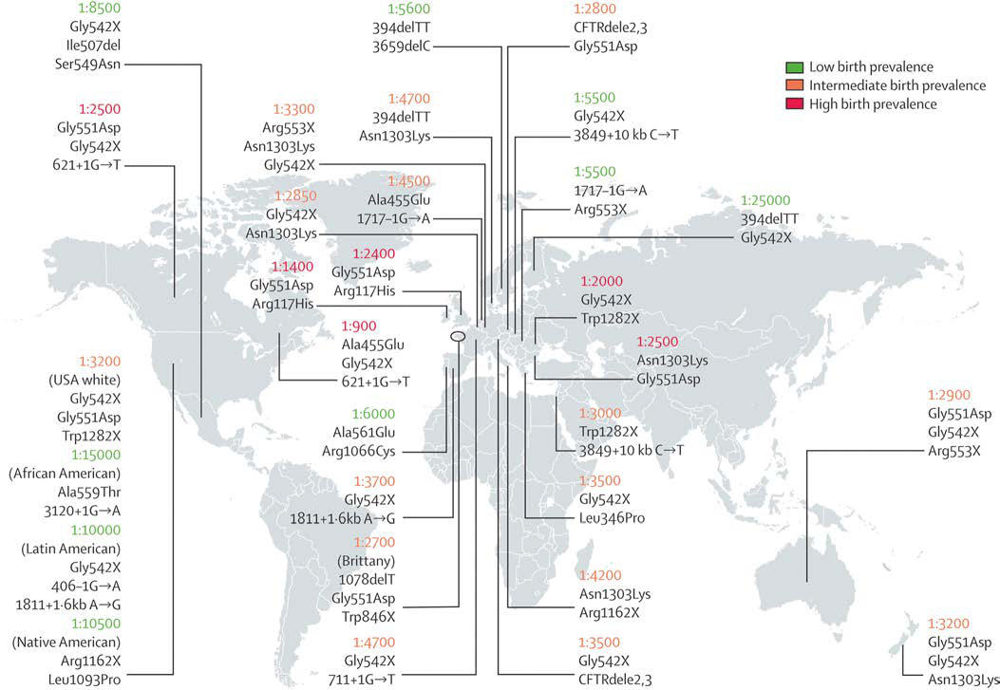

# Chapter 454: Cystic Fibrosis — Board-Style Self-Assessment MCQs
**Part XVII: The Respiratory System** | [📖 Read Wiki Chapter](../chapters/454.md) | [🃏 Chapter Flashcards](../flashcards/454_flashcards.md) | [🏠 Course Master Index](../../index.md)

Total questions: **5** *(Click "Show Answer & Rationale" beneath each question)*

### Question 1 (Clinical Pediatrics Vignette)
A pediatric patient is evaluated for the following clinical and diagnostic profile: Oral anaerobes; Less commonly: Staphylococcus aureus, Klebsiella pneumoniae,; Pseudomonas aeruginosa, enteric gram-negative rods, Pasteurella; multocida, Burkholderia cepacia, Burkholderia pseudomallei,; Haemophilus influenzae types b and c, Legionel. Which of the following conditions or syndromes is the most likely diagnosis?

- **A.** Septic Pulmonary Embolism
- **B.** Bacteria (Cystic Fibrosis)
- **C.** Mycobacteria (Cystic Fibrosis)
- **D.** Fungi (Cystic Fibrosis)

<b>Show Answer & Rationale</b>

**Correct Answer: B** — Bacteria (Cystic Fibrosis)

**Rationale:** **Bacteria (Cystic Fibrosis)** is characterized by: Oral anaerobes; Less commonly: Staphylococcus aureus, Klebsiella pneumoniae,; Pseudomonas aeruginosa, enteric gram-negative rods, Pasteurella; multocida, Burkholderia cepacia, Burkholderia pseudomallei,; Haemophilus influenzae types b and c, Legionella, group A; streptococcus, Streptococcus pneumoniae, Streptococcus; a.

**Why Other Options Are Incorrect:** **Septic Pulmonary Embolism** is incorrect (characterized by Originating in septic phlebitis, including Lemierre syndrome and; vegetations from tricuspid endocar). **Mycobacteria (Cystic Fibrosis)** is incorrect (characterized by Tuberculosis and nontuberculous pathogens). **Fungi (Cystic Fibrosis)** is incorrect (characterized by Endemic mycoses (Histoplasma, Coccidioides, blastomycosis),; Cryptococcus, Aspergillus, Zygomycetes).

### Question 2 (Clinical Pediatrics Vignette)
A pediatric patient is evaluated for the following clinical and diagnostic profile: Originating in septic phlebitis, including Lemierre syndrome and; vegetations from tricuspid endocarditis. Which of the following conditions or syndromes is the most likely diagnosis?

- **A.** Septic Pulmonary Embolism
- **B.** Neoplasm (Cystic Fibrosis)
- **C.** Bacteria (Cystic Fibrosis)
- **D.** Parasites (Cystic Fibrosis)

<b>Show Answer & Rationale</b>

**Correct Answer: A** — Septic Pulmonary Embolism

**Rationale:** **Septic Pulmonary Embolism** is characterized by: Originating in septic phlebitis, including Lemierre syndrome and; vegetations from tricuspid endocarditis.

**Why Other Options Are Incorrect:** **Neoplasm (Cystic Fibrosis)** is incorrect (characterized by Primary lung cancer, metastatic carcinoma (particularly squamous; cell); Pulmonary infarction caused). **Bacteria (Cystic Fibrosis)** is incorrect (characterized by Oral anaerobes; Less commonly: Staphylococcus aureus, Klebsiella pneumoniae,; Pseudomonas aeruginosa). **Parasites (Cystic Fibrosis)** is incorrect (characterized by Paragonimus westermani, Entamoeba histolytica, Echinococcus).

### Question 3 (Visual Diagnosis & Clinical Spotter)

A pediatric patient undergoes evaluation for **Cystic Fibrosis**, yielding the clinical or diagnostic finding shown below. Which of the following best characterizes the illustrated finding?

- **A.** Cystic fibrosis (CF) is an inherited multisystem disorder of children and adults; it is the most common life-limiting recessive genetic trait among Whites.
- **B.** Because CF may manifest as failure to thrive and hepatic dysfunction, including cirrhosis, this disorder enters into the differential diagnosis of many pediatric conditions.
- **C.** CF is inherited as an autosomal recessive trait.
- **D.** Approximate cystic fibrosis birth prevalence and common pathogenic variants for selected countries. Birth prevalence is reported as the number of live births per case of cystic fibrosis. Common/i

<b>Show Answer & Rationale</b>

**Correct Answer: D** — Approximate cystic fibrosis birth prevalence and common pathogenic variants for selected countries. Birth prevalence is reported as the number of live births per case of cystic fibrosis. Common/i

**Rationale:** **Fig. 454.1**: Approximate cystic fibrosis birth prevalence and common pathogenic variants for selected countries. Birth prevalence is reported as the number of live births per case of cystic fibrosis. Common/important pathogenic variants in each region are listed below the prevalence figures. The birth prevalence can vary greatly among ethnic groups in a country. (From O’Sullivan BP, Freedman SD. Cystic fibrosis. Lancet. 2009;373:1891–1902.)

### Question 4 (Differential Diagnosis (Cystic Fibrosis))
During a pediatric consultation regarding **Cystic Fibrosis**, which clinical entity or concept is described by the following profile? "CF occurs most frequently in White populations of Northern Europe, North America, and Australia/New Zealand."

- **A.** Pancreatitis
- **B.** Pulmonary Hypertension and Cor Pulmonale
- **C.** Intestinal Tract
- **D.** GENETICS

<b>Show Answer & Rationale</b>

**Correct Answer: D** — GENETICS

**Rationale:** GENETICS CF occurs most frequently in White populations of Northern Europe, North America, and Australia/New Zealand.

### Question 5 (Pediatric Board Mastery (Cystic Fibrosis))
When formulating an evidence-based diagnostic and management plan for **Cystic Fibrosis** (*Part XVII: The Respiratory System*), which of the following pediatric clinical statements is **ACCURATE**? (Item 1)

- **A.** First-line management relies on immediate high-dose aspirin therapy in febrile infants.
- **B.** Clinical manifestations are permanently restricted to late adulthood and never present during infancy, childhood, or adolescence.
- **C.** Inheritance is exclusively holandric (Y-linked) with 100% penetrance restricted to male neonates.
- **D.** Cystic fibrosis (CF) is an inherited multisystem disorder of children and adults; it is the most common life-limiting recessive genetic trait among Whites.

<b>Show Answer & Rationale</b>

**Correct Answer: D** — Cystic fibrosis (CF) is an inherited multisystem disorder of children and adults; it is the most common life-limiting recessive genetic trait among Whites.

**Rationale:** **Pediatric Clinical Principle (Cystic Fibrosis):** Cystic fibrosis (CF) is an inherited multisystem disorder of children and adults; it is the most common life-limiting recessive genetic trait among Whites.

