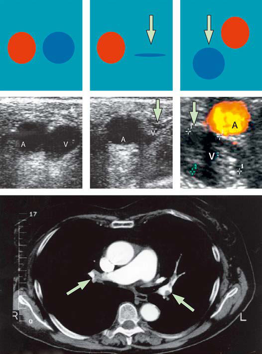

# Chapter 458: Pulmonary Embolism, Infarction, and Hemorrhage — Board-Style Self-Assessment MCQs
**Part XVII: The Respiratory System** | [📖 Read Wiki Chapter](../chapters/458.md) | [🃏 Chapter Flashcards](../flashcards/458_flashcards.md) | [🏠 Course Master Index](../../index.md)

Total questions: **5** *(Click "Show Answer & Rationale" beneath each question)*

### Question 1 (Clinical Pediatrics Vignette)
A pediatric patient is evaluated for the following clinical and diagnostic profile: Long-haul air travel (>4 hr); Obesity; Cigarette smoking; Hypertension; Immobility. Which of the following conditions or syndromes is the most likely diagnosis?

- **A.** NONTHROMBOTIC (Pulmonary Embolism, Infarction, and Hemorrhage)
- **B.** ENVIRONMENTAL (Pulmonary Embolism, Infarction, and Hemorrhage)
- **C.** THROMBOPHILIA (Pulmonary Embolism, Infarction, and Hemorrhage)
- **D.** MEDICAL ILLNESS (Pulmonary Embolism, Infarction, and Hemorrhage)

<b>Show Answer & Rationale</b>

**Correct Answer: B** — ENVIRONMENTAL (Pulmonary Embolism, Infarction, and Hemorrhage)

**Rationale:** **ENVIRONMENTAL (Pulmonary Embolism, Infarction, and Hemorrhage)** is characterized by: Long-haul air travel (>4 hr); Obesity; Cigarette smoking; Hypertension; Immobility.

**Why Other Options Are Incorrect:** **NONTHROMBOTIC (Pulmonary Embolism, Infarction, and Hemorrhage)** is incorrect (characterized by Air; Foreign particles (e.g., hair, talc, as a consequence of intravenous; drug misuse); Amniotic fl). **THROMBOPHILIA (Pulmonary Embolism, Infarction, and Hemorrhage)** is incorrect (characterized by Factor V Leiden mutation; Prothrombin gene (20210G A) pathogenic variant; Hyperhomocysteinemia (incl). **MEDICAL ILLNESS (Pulmonary Embolism, Infarction, and Hemorrhage)** is incorrect (characterized by Personal or family history of prior pulmonary embolism or deep; venous thrombosis; Cancer; L-Asparag).

### Question 2 (Clinical Pediatrics Vignette)
A pediatric patient is evaluated for the following clinical and diagnostic profile: Oral contraceptives, including progesterone-only and, especially,; third-generation pills; Pregnancy or puerperium; Hormone replacement therapy; Septic abortion. Which of the following conditions or syndromes is the most likely diagnosis?

- **A.** SURGICAL (Pulmonary Embolism, Infarction, and Hemorrhage)
- **B.** ENVIRONMENTAL (Pulmonary Embolism, Infarction, and Hemorrhage)
- **C.** MEDICAL ILLNESS (Pulmonary Embolism, Infarction, and Hemorrhage)
- **D.** WOMEN’S HEALTH (Pulmonary Embolism, Infarction, and Hemorrhage)

<b>Show Answer & Rationale</b>

**Correct Answer: D** — WOMEN’S HEALTH (Pulmonary Embolism, Infarction, and Hemorrhage)

**Rationale:** **WOMEN’S HEALTH (Pulmonary Embolism, Infarction, and Hemorrhage)** is characterized by: Oral contraceptives, including progesterone-only and, especially,; third-generation pills; Pregnancy or puerperium; Hormone replacement therapy; Septic abortion.

**Why Other Options Are Incorrect:** **SURGICAL (Pulmonary Embolism, Infarction, and Hemorrhage)** is incorrect (characterized by Trauma, including fractures; Orthopedic surgery; General surgery; Neurosurgery, especially craniotom). **ENVIRONMENTAL (Pulmonary Embolism, Infarction, and Hemorrhage)** is incorrect (characterized by Long-haul air travel (>4 hr); Obesity; Cigarette smoking; Hypertension; Immobility). **MEDICAL ILLNESS (Pulmonary Embolism, Infarction, and Hemorrhage)** is incorrect (characterized by Personal or family history of prior pulmonary embolism or deep; venous thrombosis; Cancer; L-Asparag).

### Question 3 (Visual Diagnosis & Clinical Spotter)

A pediatric patient undergoes evaluation for **Pulmonary Embolism, Infarction, and Hemorrhage**, yielding the clinical or diagnostic finding shown below. Which of the following best characterizes the illustrated finding?

- **A.** In a retrospective study of PE found at the time of autopsy, the investigators discovered antemortem consideration of the diagnosis in only 15% of cases.
- **B.** Pulmonary emboli are more likely to be silent or to present atypically in infants and chil dren as compared to adults, and a delay in diagnosis is commonly encountered.
- **C.** A diagnosis of PE may only be discovered on postmor tem examination.
- **D.** A, Compression ultrasound. Top images, from left to right, representation of vein and artery without and with (arrow) gentle compression with the echocardiographic probe. Bottom images, cor respo

<b>Show Answer & Rationale</b>

**Correct Answer: D** — A, Compression ultrasound. Top images, from left to right, representation of vein and artery without and with (arrow) gentle compression with the echocardiographic probe. Bottom images, cor respo

**Rationale:** **Fig. 458.1**: A, Compression ultrasound. Top images, from left to right, representation of vein and artery without and with (arrow) gentle compression with the echocardiographic probe. Bottom images, cor responding echocardiographic findings. The third image from the left shows a thrombus in the vein (vein not compressible by the probe). B, CT angiography showing several emboli (arrows) in the main right pulmonary artery and in left lobar and segmental arteries. A, Artery; V, vein. (From Goldhaber SZ, Bounameaux H. Pulmonary embolism and deep vein thrombosis. Lancet. 2012;379:1835–1844, Fig. 2, p. 1838.)

### Question 4 (Differential Diagnosis (458.1 Pulmonary Embolus and Infarction))
During a pediatric consultation regarding **Pulmonary Embolism, Infarction, and Hemorrhage**, which clinical entity or concept is described by the following profile? "In the adult population, PE and VTE may be idiopathic in ∼30% of patients."

- **A.** ETIOLOGY
- **B.** TREATMENT
- **C.** SURGICAL (Pulmonary Embolism, Infarction, and Hemorrhage)
- **D.** DURATION OF TREATMENT

<b>Show Answer & Rationale</b>

**Correct Answer: A** — ETIOLOGY

**Rationale:** ETIOLOGY In the adult population, PE and VTE may be idiopathic in ∼30% of patients.

### Question 5 (Pediatric Board Mastery (Pulmonary Embolism, Infarction, and Hemorrhage))
When formulating an evidence-based diagnostic and management plan for **Pulmonary Embolism, Infarction, and Hemorrhage** (*Part XVII: The Respiratory System*), which of the following pediatric clinical statements is **ACCURATE**? (Item 1)

- **A.** Inheritance is exclusively holandric (Y-linked) with 100% penetrance restricted to male neonates.
- **B.** Clinical manifestations are permanently restricted to late adulthood and never present during infancy, childhood, or adolescence.
- **C.** Pulmonary emboli are more likely to be silent or to present atypically in infants and chil dren as compared to adults, and a delay in diagnosis is commonly encountered.
- **D.** First-line management relies on immediate high-dose aspirin therapy in febrile infants.

<b>Show Answer & Rationale</b>

**Correct Answer: C** — Pulmonary emboli are more likely to be silent or to present atypically in infants and chil dren as compared to adults, and a delay in diagnosis is commonly encountered.

**Rationale:** **Pediatric Clinical Principle (Pulmonary Embolism, Infarction, and Hemorrhage):** Pulmonary emboli are more likely to be silent or to present atypically in infants and chil dren as compared to adults, and a delay in diagnosis is commonly encountered.

