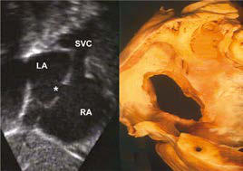

# Chapter 475: Acyanotic Congenital Heart Disease: Left-to-Right Shunt Lesions — Board-Style Self-Assessment MCQs
**Part XVIII: The Cardiovascular System** | [📖 Read Wiki Chapter](../chapters/475.md) | [🃏 Chapter Flashcards](../flashcards/475_flashcards.md) | [🏠 Course Master Index](../../index.md)

Total questions: **5** *(Click "Show Answer & Rationale" beneath each question)*

### Question 1 (Clinical Pediatrics Vignette)
A pediatric patient is evaluated for the following clinical and diagnostic profile: The majority of cases of ASD are sporadic; autosomal dominant inheritance does occur as part of Holt-Oram syndrome (hypoplastic or absent thumbs, radii, triphalangism, phocomelia, first-degree heart block, ASD) or in families with both secundum ASD a. Which of the following conditions or syndromes is the most likely diagnosis?

- **A.** VARIATIONS OF PUBERTAL DEVELOPMENT
- **B.** AKT1 (Cutaneous Nevi)
- **C.** Acyanotic Congenital Heart Disease: Left-to-Right Shunt Lesions
- **D.** Viral myocarditis: Linear subepicardial or midwall LGE, commonly

<b>Show Answer & Rationale</b>

**Correct Answer: C** — Acyanotic Congenital Heart Disease: Left-to-Right Shunt Lesions

**Rationale:** **Acyanotic Congenital Heart Disease: Left-to-Right Shunt Lesions** (associated with **`ACTA2, GATA4, TBX5`**) is characterized by: The majority of cases of ASD are sporadic; autosomal dominant inheritance does occur as part of Holt-Oram syndrome (hypoplastic or absent thumbs, radii, triphalangism, phocomelia, first-degree heart block, ASD) or in families with both secundum ASD and heart block..

**Why Other Options Are Incorrect:** **VARIATIONS OF PUBERTAL DEVELOPMENT** is incorrect (characterized by Premature thelarche; Premature isolated menarche; Premature adrenarche; Adolescent gynecomastia in m). **AKT1 (Cutaneous Nevi)** is incorrect (characterized by PIK3CA-related overgrowth spectrum/). **Viral myocarditis: Linear subepicardial or midwall LGE, commonly** is incorrect (characterized by involving the basal inferolateral wall, basal anterior septum,; mid-inferolateral wall, and basal to).

### Question 2 (Pediatric Genetics & Molecular Etiology)
A child is diagnosed with **Acyanotic Congenital Heart Disease: Left-to-Right Shunt Lesions** after presenting with The majority of cases of ASD are sporadic; autosomal dominant inheritance does occur as part of Holt-Oram syndrome (hypoplastic or absent thumbs, radii, triphalangism, phocomelia, first-degree heart block, ASD). Pathogenic variants in which of the following genes are most classically implicated?

- **A.** HADHA
- **B.** STXBP1
- **C.** NEMO
- **D.** ACTA2

<b>Show Answer & Rationale</b>

**Correct Answer: D** — ACTA2

**Rationale:** Pathogenic variants in **`ACTA2`** (AD) are associated with **Acyanotic Congenital Heart Disease: Left-to-Right Shunt Lesions** (The majority of cases of ASD are sporadic; autosomal dominant inheritance does occur as part of Holt-Oram syndrome (hypoplastic or absent thumbs, radii, triphalangism, phocomelia, first-degree heart block, ASD) or in families with both secundum ASD and heart block.).

**Why Other Options Are Incorrect:** **NEMO** is incorrect (associated with COMBINED IMMUNODEFICIENCIES WITH SYNDROMIC OR OTHER FEATURES).

### Question 3 (Visual Diagnosis & Clinical Spotter)

A pediatric patient undergoes evaluation for **Acyanotic Congenital Heart Disease: Left-to-Right Shunt Lesions**, yielding the clinical or diagnostic finding shown below. Which of the following best characterizes the illustrated finding?

- **A.** Top left, Coronary sinus defect caused by unroofing; top right, superior sinus venosus defect; bottom left, inferior sinus venosus defect; bottom right, ASD in the setting of an atrioventric
- **B.** Atrial septal defects (ASDs). A, Schematic diagram outlining the different types of interatrial shunting that can be encountered. Note that only the central defect is suitable for device closure.
- **C.** An ostium secundum defect in the region of the fossa ovalis is the most common form of ASD and is associated with structurally normal atrioventricular (AV) valves.
- **D.** The majority of cases of ASD are sporadic; autosomal dominant inheritance does occur as part of Holt-Oram syndrome (hypoplastic or absent thumbs, radii, triphalangism, phocomelia, first-degr

<b>Show Answer & Rationale</b>

**Correct Answer: B** — Atrial septal defects (ASDs). A, Schematic diagram outlining the different types of interatrial shunting that can be encountered. Note that only the central defect is suitable for device closure.

**Rationale:** **Fig. 475.1**: Atrial septal defects (ASDs). A, Schematic diagram outlining the different types of interatrial shunting that can be encountered. Note that only the central defect is suitable for device closure. B, Left, Subcostal right anterior oblique view of a secundum ASD (asterisk) that is suitable for device closure. Right, Specimen as seen in a similar view, outlining the landmarks of the defect. C, Left, Transesophageal echocardiogram with color flow before device closure. Right, Taken after release of an Amplatzer device. D, Montage of echocardiographic interatrial communications that are not secundum ASDs (asterisks) and therefore not suitable for device closure. Top left, Coronary sinus defect caused by unroofing; top right, superior sinus venosus defect; bottom left, inferior sinus venosus defect; bottom right, ASD in the setting of an atrioventricular septal defect. AO, Aorta; CS, coronary sinus; Eust, eustachian; IVC, inferior vena cava; LA, left atrium; LV, left ventricle; RA, right atrium; SVC, superior vena cava; Tric, tricuspid. (From Webb GD, Smallhorn JF, Therrien J, et al. Congenital heart disease in the adult and pediatric patient. In: Zipes DP, Libby P, Bon

### Question 4 (Differential Diagnosis (475.1 Atrial Septal Defect Daniel Bernstein))
During a pediatric consultation regarding **Acyanotic Congenital Heart Disease: Left-to-Right Shunt Lesions**, which clinical entity or concept is described by the following profile? "com mon echocardiographic finding during infancy."

- **A.** patent foramen ovale (PFO)
- **B.** DIAGNOSIS
- **C.** TREATMENT
- **D.** Two-Step Process (Fever Without a Focus in the Neonate and Young Infant)

<b>Show Answer & Rationale</b>

**Correct Answer: A** — patent foramen ovale (PFO)

**Rationale:** patent foramen ovale (PFO) is a com mon echocardiographic finding during infancy.

### Question 5 (Pediatric Board Mastery (Acyanotic Congenital Heart Disease: Left-to-Right Shunt Lesions))
When formulating an evidence-based diagnostic and management plan for **Acyanotic Congenital Heart Disease: Left-to-Right Shunt Lesions** (*Part XVIII: The Cardiovascular System*), which of the following pediatric clinical statements is **ACCURATE**? (Item 1)

- **A.** Inheritance is exclusively holandric (Y-linked) with 100% penetrance restricted to male neonates.
- **B.** The majority of cases of ASD are sporadic; autosomal dominant inheritance does occur as part of Holt-Oram syndrome (hypoplastic or absent thumbs, radii, triphalangism, phocomelia, first-degree heart block,
- **C.** Clinical manifestations are permanently restricted to late adulthood and never present during infancy, childhood, or adolescence.
- **D.** First-line management relies on immediate high-dose aspirin therapy in febrile infants.

<b>Show Answer & Rationale</b>

**Correct Answer: B** — The majority of cases of ASD are sporadic; autosomal dominant inheritance does occur as part of Holt-Oram syndrome (hypoplastic or absent thumbs, radii, triphalangism, phocomelia, first-degree heart block,

**Rationale:** **Pediatric Clinical Principle (Acyanotic Congenital Heart Disease: Left-to-Right Shunt Lesions):** The majority of cases of ASD are sporadic; autosomal dominant inheritance does occur as part of Holt-Oram syndrome (hypoplastic or absent thumbs, radii, triphalangism, phocomelia, first-degree heart block, ASD) or in families with both secundum ASD and heart block.

