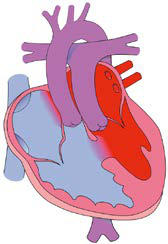

# Chapter 480: Cyanotic Congenital Heart Disease: Lesions Associated with Increased Pulmonary Blood Flow — Board-Style Self-Assessment MCQs
**Part XVIII: The Cardiovascular System** | [📖 Read Wiki Chapter](../chapters/480.md) | [🃏 Chapter Flashcards](../flashcards/480_flashcards.md) | [🏠 Course Master Index](../../index.md)

Total questions: **5** *(Click "Show Answer & Rationale" beneath each question)*

### Question 1 (Visual Diagnosis & Clinical Spotter)

A pediatric patient undergoes evaluation for **Cyanotic Congenital Heart Disease: Lesions Associated with Increased Pulmonary Blood Flow**, yielding the clinical or diagnostic finding shown below. Which of the following best characterizes the illustrated finding?

- **A.** DIAGNOSIS The electrocardiogram (ECG) is usually normal, showing the expected neonatal right-sided dominant pattern.
- **B.** d-Looped transposition of the great arteries (TGA). A, Diagram of d-TGA, with the main pulmonary artery (MPA) arising from the left ventricle (LV) and the aorta (Ao) arising from the right ventri
- **C.** This condition is a medi cal emergency, and only early diagnosis and appropriate intervention can avert the development of prolonged severe hypoxemia and acido sis, which lead to death.
- **D.** The arterial switch (Jatene) procedure is the surgical treatment of choice for neonates with d-TGA and an intact ventricular septum and is usually performed within the first 2 weeks of life.

<b>Show Answer & Rationale</b>

**Correct Answer: B** — d-Looped transposition of the great arteries (TGA). A, Diagram of d-TGA, with the main pulmonary artery (MPA) arising from the left ventricle (LV) and the aorta (Ao) arising from the right ventri

**Rationale:** **Fig. 480.1**: d-Looped transposition of the great arteries (TGA). A, Diagram of d-TGA, with the main pulmonary artery (MPA) arising from the left ventricle (LV) and the aorta (Ao) arising from the right ventricle (RV). The degree of cyanosis is variable and depends on the presence of intracardiac shunts such as an atrial septal defect or a ventricular septal defect (VSD) to get oxygenated blood into the systemic circulation. LA, Left atrium; PA, pulmonary artery; RA, right atrium. B and C, Oblique reformatted images from a 3D steady-state free-precession sequence show (B) the Ao arising from the anterior RV with a subaortic conus (arrow), and (C) the MPA arising from the posterior LV. D, The Ao and MPA have a parallel “back-to-front” arrangement. E, This parallel back-to-front arrangement contributes to the narrow mediastinum and “egg on a string” appearance seen on chest radiography. This patient has a large VSD with increased pulmonary blood flow. (From Frost JL, Krishnamurthy R, Sena L. Cardiac imaging. In: Walters MM, Robertson RL, eds. Pediatric Radiology: The Requisites, 4th ed. Philadelphia: Elsevier; 2017, Fig 3-20, p. 75.)

### Question 2 (Differential Diagnosis (480.2 d-Transposition of the Great Arteries with Intact Ventricular Septum Daniel Bernstein))
During a pediatric consultation regarding **Cyanotic Congenital Heart Disease: Lesions Associated with Increased Pulmonary Blood Flow**, which clinical entity or concept is described by the following profile? "Cyanosis and tachypnea are most often recognized within the first hours or days of postnatal life."

- **A.** CLINICAL MANIFESTATIONS
- **B.** TREATMENT
- **C.** Anomalous coronary arteries
- **D.** PROGNOSIS AND COMPLICATIONS

<b>Show Answer & Rationale</b>

**Correct Answer: A** — CLINICAL MANIFESTATIONS

**Rationale:** CLINICAL MANIFESTATIONS Cyanosis and tachypnea are most often recognized within the first hours or days of postnatal life.

### Question 3 (Differential Diagnosis (480.2 d-Transposition of the Great Arteries with Intact Ventricular Septum Daniel Bernstein))
During a pediatric consultation regarding **Cyanotic Congenital Heart Disease: Lesions Associated with Increased Pulmonary Blood Flow**, which clinical entity or concept is described by the following profile? "The electrocardiogram (ECG) is usually normal, showing the expected neonatal right-sided dominant pattern."

- **A.** DIAGNOSIS
- **B.** ASYMPTOMATIC INTESTINAL COLONIZATION
- **C.** Anomalous coronary arteries
- **D.** arterial switch (Jatene) procedure

<b>Show Answer & Rationale</b>

**Correct Answer: A** — DIAGNOSIS

**Rationale:** DIAGNOSIS The electrocardiogram (ECG) is usually normal, showing the expected neonatal right-sided dominant pattern.

### Question 4 (Pediatric Board Mastery (Cyanotic Congenital Heart Disease: Lesions Associated with Increased Pulmonary Blood Flow))
When formulating an evidence-based diagnostic and management plan for **Cyanotic Congenital Heart Disease: Lesions Associated with Increased Pulmonary Blood Flow** (*Part XVIII: The Cardiovascular System*), which of the following pediatric clinical statements is **ACCURATE**? (Item 1)

- **A.** Inheritance is exclusively holandric (Y-linked) with 100% penetrance restricted to male neonates.
- **B.** The condition is an entirely benign physiologic variant that never warrants laboratory or clinical evaluation.
- **C.** This condition is a medi cal emergency, and only early diagnosis and appropriate intervention can avert the development of prolonged severe hypoxemia and acido sis, which lead to death.
- **D.** Clinical manifestations are permanently restricted to late adulthood and never present during infancy, childhood, or adolescence.

<b>Show Answer & Rationale</b>

**Correct Answer: C** — This condition is a medi cal emergency, and only early diagnosis and appropriate intervention can avert the development of prolonged severe hypoxemia and acido sis, which lead to death.

**Rationale:** **Pediatric Clinical Principle (Cyanotic Congenital Heart Disease: Lesions Associated with Increased Pulmonary Blood Flow):** This condition is a medi cal emergency, and only early diagnosis and appropriate intervention can avert the development of prolonged severe hypoxemia and acido sis, which lead to death.

### Question 5 (Pediatric Board Mastery (Cyanotic Congenital Heart Disease: Lesions Associated with Increased Pulmonary Blood Flow))
When formulating an evidence-based diagnostic and management plan for **Cyanotic Congenital Heart Disease: Lesions Associated with Increased Pulmonary Blood Flow** (*Part XVIII: The Cardiovascular System*), which of the following pediatric clinical statements is **ACCURATE**? (Item 2)

- **A.** Systemic tetracyclines and fluoroquinolones are universally required as routine prophylaxis in all healthy newborns.
- **B.** DIAGNOSIS The electrocardiogram (ECG) is usually normal, showing the expected neonatal right-sided dominant pattern.
- **C.** Clinical manifestations are permanently restricted to late adulthood and never present during infancy, childhood, or adolescence.
- **D.** The condition is an entirely benign physiologic variant that never warrants laboratory or clinical evaluation.

<b>Show Answer & Rationale</b>

**Correct Answer: B** — DIAGNOSIS The electrocardiogram (ECG) is usually normal, showing the expected neonatal right-sided dominant pattern.

**Rationale:** **Pediatric Clinical Principle (Cyanotic Congenital Heart Disease: Lesions Associated with Increased Pulmonary Blood Flow):** DIAGNOSIS The electrocardiogram (ECG) is usually normal, showing the expected neonatal right-sided dominant pattern.

