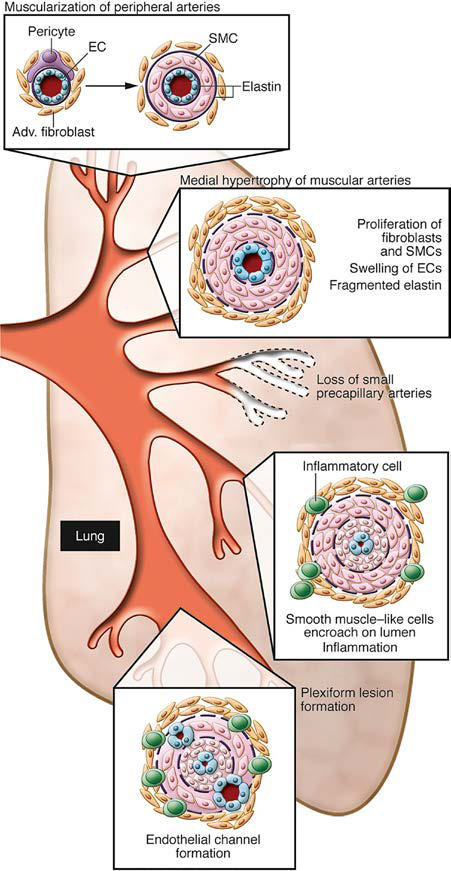

# Chapter 482: Pulmonary Hypertension — Board-Style Self-Assessment MCQs
**Part XVIII: The Cardiovascular System** | [📖 Read Wiki Chapter](../chapters/482.md) | [🃏 Chapter Flashcards](../flashcards/482_flashcards.md) | [🏠 Course Master Index](../../index.md)

Total questions: **5** *(Click "Show Answer & Rationale" beneath each question)*

### Question 1 (Clinical Pediatrics Vignette)
A pediatric patient is evaluated for the following clinical and diagnostic profile: Cobalamin C deficiency; Lung hypoplasia, acinar dysplasia; Surfactant protein abnormalities; Surfactant protein B deficiency; Surfactant protein C deficiency; ATP-binding cassette A3 variants; Thyroid transcription factor 1 (TTF1)/Nkx2.1 homeobox pat. Which of the following conditions or syndromes is the most likely diagnosis?

- **A.** (FOXF1) (Pulmonary Hypertension)
- **B.** DEFINITION (Tonsils and Adenoids)
- **C.** KCNK3, SMAD9, SOX17)
- **D.** COMMON SIDE EFFECTS

<b>Show Answer & Rationale</b>

**Correct Answer: A** — (FOXF1) (Pulmonary Hypertension)

**Rationale:** **(FOXF1) (Pulmonary Hypertension)** (associated with **`FOXF1, TBX4, BMPR2`**) is characterized by: Cobalamin C deficiency; Lung hypoplasia, acinar dysplasia; Surfactant protein abnormalities; Surfactant protein B deficiency; Surfactant protein C deficiency; ATP-binding cassette A3 variants; Thyroid transcription factor 1 (TTF1)/Nkx2.1 homeobox pathogenic; variants; T-box transcription factor 4 (TBX4); Pulmonary inte.

**Why Other Options Are Incorrect:** **DEFINITION (Tonsils and Adenoids)** is incorrect (characterized by Minimum; frequency of; sore throat; episodes; At least seven episodes in the previous year OR; at le). **KCNK3, SMAD9, SOX17)** is incorrect (characterized by Adapted with data from Rosenzweig EB, Abman SH, Adatia I, et al. Paediatric; pulmonary arterial hype). **COMMON SIDE EFFECTS** is incorrect (characterized by Epoprostenol (prostacyclin [PGI2], a; potent vasodilator; also inhibits platelet; aggregation); 1-2 ).

### Question 2 (Clinical Pediatrics Vignette)
A pediatric patient is evaluated for the following clinical and diagnostic profile: Adapted with data from Rosenzweig EB, Abman SH, Adatia I, et al. Paediatric; pulmonary arterial hypertension: updates on definition, classification, diagnostics and; management. Eur Respir J. 2019;53(1):1801916; and Ivy DD, Abman SH, Barst RJ et al.;. Which of the following conditions or syndromes is the most likely diagnosis?

- **A.** KCNK3, SMAD9, SOX17)
- **B.** EXTRAINTESTINAL COMPLICATIONS
- **C.** (FOXF1) (Pulmonary Hypertension)
- **D.** SUNBURN, TANNING HISTORY

<b>Show Answer & Rationale</b>

**Correct Answer: A** — KCNK3, SMAD9, SOX17)

**Rationale:** **KCNK3, SMAD9, SOX17)** (associated with **`SOX17`**) is characterized by: Adapted with data from Rosenzweig EB, Abman SH, Adatia I, et al. Paediatric; pulmonary arterial hypertension: updates on definition, classification, diagnostics and; management. Eur Respir J. 2019;53(1):1801916; and Ivy DD, Abman SH, Barst RJ et al.; Pediatric pulmonary hypertension. J Amer Coll Cardiol. 2013;62(25):Su.

**Why Other Options Are Incorrect:** **EXTRAINTESTINAL COMPLICATIONS** is incorrect (characterized by Dehydration; Severe hyponatremia (serum sodium 40 000/μL)*). **(FOXF1) (Pulmonary Hypertension)** is incorrect (characterized by Cobalamin C deficiency; Lung hypoplasia, acinar dysplasia; Surfactant protein abnormalities; Surfact). **SUNBURN, TANNING HISTORY** is incorrect (characterized by brown tan; brown).

### Question 3 (Pediatric Genetics & Molecular Etiology)
A child is diagnosed with **(FOXF1) (Pulmonary Hypertension)** after presenting with Cobalamin C deficiency; Lung hypoplasia, acinar dysplasia; Surfactant protein abnormalities; Surfactant protein B deficiency; Surfactant protein C deficiency; ATP-binding cassette A3 variants; Thyroid transcrip. Pathogenic variants in which of the following genes are most classically implicated?

- **A.** DLD
- **B.** CYP27B1
- **C.** HBB
- **D.** FOXF1

<b>Show Answer & Rationale</b>

**Correct Answer: D** — FOXF1

**Rationale:** Pathogenic variants in **`FOXF1`** (The Cardiovascular System) are associated with **(FOXF1) (Pulmonary Hypertension)** (Cobalamin C deficiency; Lung hypoplasia, acinar dysplasia; Surfactant protein abnormalities; Surfactant protein B deficiency; Surfactant protein C deficiency; ATP-binding cassette A3 variants; Thyroid transcription factor 1 (TTF1)/Nkx2.1 homeobox pathogenic; variants; T-box transcription factor 4 (TBX4); Pulmonary inte).

**Why Other Options Are Incorrect:** **HBB** is incorrect (associated with Development of the Hematopoietic System).

### Question 4 (Visual Diagnosis & Clinical Spotter)

A pediatric patient undergoes evaluation for **Pulmonary Hypertension**, yielding the clinical or diagnostic finding shown below. Which of the following best characterizes the illustrated finding?

- **A.** PAH accounts for nearly half of all pediatric PH (45%), with PAH asso ciated with congenital heart disease being the most common in pedi atric patients, followed by idiopathic or familial di
- **B.** PH is often characterized by progressive vascular disease of the pulmonary arteries (pulmonary arterial hypertension [PAH], previously called primary PH).
- **C.** Vascular abnormalities associated with pulmonary arterial hypertension: abnormal muscularization of distal and medial precapil lary arteries, loss of precapillary arteries, thickening of large pu
- **D.** PH occurs at any age, although in pediatric patients the mean age at diagnosis is 7-10 years.

<b>Show Answer & Rationale</b>

**Correct Answer: C** — Vascular abnormalities associated with pulmonary arterial hypertension: abnormal muscularization of distal and medial precapil lary arteries, loss of precapillary arteries, thickening of large pu

**Rationale:** **Fig. 482.1**: Vascular abnormalities associated with pulmonary arterial hypertension: abnormal muscularization of distal and medial precapil lary arteries, loss of precapillary arteries, thickening of large pulmonary arterioles, and new vascular intimal formation that is occlusive in ves sels <500-100 μM and in plexiform lesions therein. Adv. adventitial; EC, endothelial cell; SMC, smooth muscle cell. (From Rabinovitch M. Mo lecular pathogenesis of pulmonary arterial hypertension. J Clin Invest. 2012;122:4306–4313, Fig 1.)

### Question 5 (Pediatric Board Mastery (Pulmonary Hypertension))
When formulating an evidence-based diagnostic and management plan for **Pulmonary Hypertension** (*Part XVIII: The Cardiovascular System*), which of the following pediatric clinical statements is **ACCURATE**? (Item 1)

- **A.** Diagnostic confirmation relies solely on plain skull radiographs without biochemical, microbiologic, or clinical correlation.
- **B.** The condition is an entirely benign physiologic variant that never warrants laboratory or clinical evaluation.
- **C.** First-line management relies on immediate high-dose aspirin therapy in febrile infants.
- **D.** PH is often characterized by progressive vascular disease of the pulmonary arteries (pulmonary arterial hypertension [PAH], previously called primary PH).

<b>Show Answer & Rationale</b>

**Correct Answer: D** — PH is often characterized by progressive vascular disease of the pulmonary arteries (pulmonary arterial hypertension [PAH], previously called primary PH).

**Rationale:** **Pediatric Clinical Principle (Pulmonary Hypertension):** PH is often characterized by progressive vascular disease of the pulmonary arteries (pulmonary arterial hypertension [PAH], previously called primary PH).

