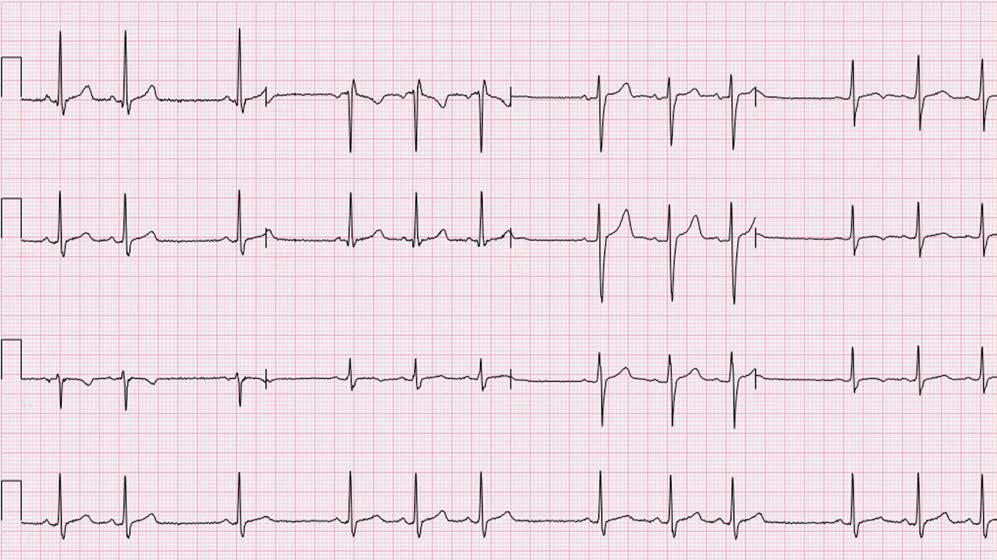

# Chapter 484: Disturbances of Rate and Rhythm of the Heart — Board-Style Self-Assessment MCQs
**Part XVIII: The Cardiovascular System** | [📖 Read Wiki Chapter](../chapters/484.md) | [🃏 Chapter Flashcards](../flashcards/484_flashcards.md) | [🏠 Course Master Index](../../index.md)

Total questions: **5** *(Click "Show Answer & Rationale" beneath each question)*

### Question 1 (Clinical Pediatrics Vignette)
A pediatric patient is evaluated for the following clinical and diagnostic profile: Quinidine; SVT, atrial fibrillation,; atrial flutter, VT; in; atrial flutter, an AV; node–blocking drug; (digoxin, verapamil,; propranolol) must; be given first; to prevent 1:1; conduction; Oral: 30-60 mg/; kg/24 hr divided; q6h (sulfate) or q8h; (gl. Which of the following conditions or syndromes is the most likely diagnosis?

- **A.** KCNQ1 (LQT1) (Disturbances of Rate and Rhythm of the Heart)
- **B.** REGULARITY (Disturbances of Rate and Rhythm of the Heart)
- **C.** KCNH2 (LQT2) (Disturbances of Rate and Rhythm of the Heart)
- **D.** CLASS IA: INHIBITS NA+ FAST CHANNEL, PROLONGS REPOLARIZATION

<b>Show Answer & Rationale</b>

**Correct Answer: D** — CLASS IA: INHIBITS NA+ FAST CHANNEL, PROLONGS REPOLARIZATION

**Rationale:** **CLASS IA: INHIBITS NA+ FAST CHANNEL, PROLONGS REPOLARIZATION** is characterized by: Quinidine; SVT, atrial fibrillation,; atrial flutter, VT; in; atrial flutter, an AV; node–blocking drug; (digoxin, verapamil,; propranolol) must; be given first; to prevent 1:1; conduction; Oral: 30-60 mg/; kg/24 hr divided; q6h (sulfate) or q8h; (gluconate); 200 mg q6 (1-1.5 g/; day divided q6),; sulfate; 324 mg; q8-1.

**Why Other Options Are Incorrect:** **KCNQ1 (LQT1) (Disturbances of Rate and Rhythm of the Heart)** is incorrect (characterized by 11p15.5; IKs potassium channel alpha subunit (KVLQT1, Kv7.1)). **REGULARITY (Disturbances of Rate and Rhythm of the Heart)** is incorrect (characterized by Sinus tachycardia; <230; Always present, normal axis; Normal; Rate varies with respiration; Atrial t). **KCNH2 (LQT2) (Disturbances of Rate and Rhythm of the Heart)** is incorrect (characterized by 7q35-36; IKr potassium channel alpha subunit (HERG, Kv11.1)).

### Question 2 (Clinical Pediatrics Vignette)
A pediatric patient is evaluated for the following clinical and diagnostic profile: IV: 1 mg/kg repeat; q 5 min 2 times; followed by 20-; 50 μg/kg/min (max; dose: 3 mg/kg); Adult infusion rate:; 1-4 mg/min; CNS effects, confusion,; convulsions, high-grade; AV block, asystole, coma,; paresthesias, respiratory; failure; Propranolol,; . Which of the following conditions or syndromes is the most likely diagnosis?

- **A.** VT, VF (Disturbances of Rate and Rhythm of the Heart)
- **B.** CLASS IA: INHIBITS NA+ FAST CHANNEL, PROLONGS REPOLARIZATION
- **C.** KCNQ1 (LQT1) (Disturbances of Rate and Rhythm of the Heart)
- **D.** REGULARITY (Disturbances of Rate and Rhythm of the Heart)

<b>Show Answer & Rationale</b>

**Correct Answer: A** — VT, VF (Disturbances of Rate and Rhythm of the Heart)

**Rationale:** **VT, VF (Disturbances of Rate and Rhythm of the Heart)** is characterized by: IV: 1 mg/kg repeat; q 5 min 2 times; followed by 20-; 50 μg/kg/min (max; dose: 3 mg/kg); Adult infusion rate:; 1-4 mg/min; CNS effects, confusion,; convulsions, high-grade; AV block, asystole, coma,; paresthesias, respiratory; failure; Propranolol,; cimetidine, increases; toxicity; 1.5-5.0 μg/; mL; Mexiletine.

**Why Other Options Are Incorrect:** **CLASS IA: INHIBITS NA+ FAST CHANNEL, PROLONGS REPOLARIZATION** is incorrect (characterized by Quinidine; SVT, atrial fibrillation,; atrial flutter, VT; in; atrial flutter, an AV; node–blocking d). **KCNQ1 (LQT1) (Disturbances of Rate and Rhythm of the Heart)** is incorrect (characterized by 11p15.5; IKs potassium channel alpha subunit (KVLQT1, Kv7.1)). **REGULARITY (Disturbances of Rate and Rhythm of the Heart)** is incorrect (characterized by Sinus tachycardia; <230; Always present, normal axis; Normal; Rate varies with respiration; Atrial t).

### Question 3 (Visual Diagnosis & Clinical Spotter)

A pediatric patient undergoes evaluation for **Disturbances of Rate and Rhythm of the Heart**, yielding the clinical or diagnostic finding shown below. Which of the following best characterizes the illustrated finding?

- **A.** PVCs are characterized by premature, widened, bizarre QRS complexes that are not preceded by a premature P wave.
- **B.** Nor mal phasic sinus arrhythmia is caused by the activity of the parasympa thetic nervous system and can be quite prominent in healthy children.
- **C.** Phasic sinus arrhythmia. Note the variation in P-P interval with no significant change in P-wave morphology or PR interval. This rhythm is normal.
- **D.** Under certain circumstances, however, premature beats may be caused by organic heart disease (inflammation, ischemia, fibro sis) or drug toxicity.

<b>Show Answer & Rationale</b>

**Correct Answer: C** — Phasic sinus arrhythmia. Note the variation in P-P interval with no significant change in P-wave morphology or PR interval. This rhythm is normal.

**Rationale:** **Fig. 484.1**: Phasic sinus arrhythmia. Note the variation in P-P interval with no significant change in P-wave morphology or PR interval. This rhythm is normal.

### Question 4 (Differential Diagnosis (Disturbances of Rate and Rhythm of the Heart))
During a pediatric consultation regarding **Disturbances of Rate and Rhythm of the Heart**, which clinical entity or concept is described by the following profile? "vailable for treating arrhythmias; many have not been studied extensively in children."

- **A.** Sinoatrial block
- **B.** Transcatheter ablation
- **C.** pharmacologic agents
- **D.** class I agents

<b>Show Answer & Rationale</b>

**Correct Answer: C** — pharmacologic agents

**Rationale:** pharmacologic agents are available for treating arrhythmias; many have not been studied extensively in children.

### Question 5 (Pediatric Board Mastery (Disturbances of Rate and Rhythm of the Heart))
When formulating an evidence-based diagnostic and management plan for **Disturbances of Rate and Rhythm of the Heart** (*Part XVIII: The Cardiovascular System*), which of the following pediatric clinical statements is **ACCURATE**? (Item 1)

- **A.** Nor mal phasic sinus arrhythmia is caused by the activity of the parasympa thetic nervous system and can be quite prominent in healthy children.
- **B.** Systemic tetracyclines and fluoroquinolones are universally required as routine prophylaxis in all healthy newborns.
- **C.** First-line management relies on immediate high-dose aspirin therapy in febrile infants.
- **D.** The condition is an entirely benign physiologic variant that never warrants laboratory or clinical evaluation.

<b>Show Answer & Rationale</b>

**Correct Answer: A** — Nor mal phasic sinus arrhythmia is caused by the activity of the parasympa thetic nervous system and can be quite prominent in healthy children.

**Rationale:** **Pediatric Clinical Principle (Disturbances of Rate and Rhythm of the Heart):** Nor mal phasic sinus arrhythmia is caused by the activity of the parasympa thetic nervous system and can be quite prominent in healthy children.

