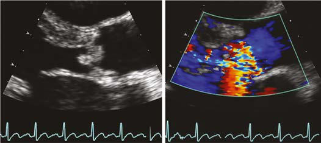

# Chapter 486: Infective Endocarditis* — Board-Style Self-Assessment MCQs
**Part XVIII: The Cardiovascular System** | [📖 Read Wiki Chapter](../chapters/486.md) | [🃏 Chapter Flashcards](../flashcards/486_flashcards.md) | [🏠 Course Master Index](../../index.md)

Total questions: **5** *(Click "Show Answer & Rationale" beneath each question)*

### Question 1 (Clinical Pediatrics Vignette)
A pediatric patient is evaluated for the following clinical and diagnostic profile: 1. Chest pain/discomfort/tightness/pressure related to exertion; 2. Unexplained syncope/near-syncope: Judged not to be of; neurocardiogenic (vasovagal) origin; of particular concern when; occurring during or after physical exertion; 3. Excessive exer. Which of the following conditions or syndromes is the most likely diagnosis?

- **A.** UNCOMMON: NATIVE VALVE OR OTHER CARDIAC LESIONS
- **B.** PHYSICAL EXAMINATION
- **C.** FAMILY HISTORY (Infective Endocarditis*)
- **D.** PERSONAL HISTORY (Infective Endocarditis*)

<b>Show Answer & Rationale</b>

**Correct Answer: D** — PERSONAL HISTORY (Infective Endocarditis*)

**Rationale:** **PERSONAL HISTORY (Infective Endocarditis*)** is characterized by: 1. Chest pain/discomfort/tightness/pressure related to exertion; 2. Unexplained syncope/near-syncope: Judged not to be of; neurocardiogenic (vasovagal) origin; of particular concern when; occurring during or after physical exertion; 3. Excessive exertional and unexplained dyspnea/fatigue or; palpitations, associated wi.

**Why Other Options Are Incorrect:** **UNCOMMON: NATIVE VALVE OR OTHER CARDIAC LESIONS** is incorrect (characterized by Streptococcus pneumoniae; Haemophilus influenzae; Coagulase-negative staphylococci; Abiotrophia defe). **PHYSICAL EXAMINATION** is incorrect (characterized by Child or parent reports; persistent neck pain,; abnormal head posture,; or difficulty with neck; mov). **FAMILY HISTORY (Infective Endocarditis*)** is incorrect (characterized by 8. Premature death (sudden and unexpected, or otherwise) before; age 50 attributable to heart diseas).

### Question 2 (Clinical Pediatrics Vignette)
A pediatric patient is evaluated for the following clinical and diagnostic profile: 8. Premature death (sudden and unexpected, or otherwise) before; age 50 attributable to heart disease in at least one relative; 9. Disability from heart disease in close relative <50 yr of age; 10. Hypertrophic or dilated cardiomyopathy, long QT synd. Which of the following conditions or syndromes is the most likely diagnosis?

- **A.** FAMILY HISTORY (Infective Endocarditis*)
- **B.** UNCOMMON: NATIVE VALVE OR OTHER CARDIAC LESIONS
- **C.** PROSTHETIC VALVE (Infective Endocarditis*)
- **D.** COMMON: NATIVE VALVE OR OTHER CARDIAC LESIONS

<b>Show Answer & Rationale</b>

**Correct Answer: A** — FAMILY HISTORY (Infective Endocarditis*)

**Rationale:** **FAMILY HISTORY (Infective Endocarditis*)** is characterized by: 8. Premature death (sudden and unexpected, or otherwise) before; age 50 attributable to heart disease in at least one relative; 9. Disability from heart disease in close relative <50 yr of age; 10. Hypertrophic or dilated cardiomyopathy, long QT syndrome,; or other ion channelopathies, Marfan syndrome, or clinically; s.

**Why Other Options Are Incorrect:** **UNCOMMON: NATIVE VALVE OR OTHER CARDIAC LESIONS** is incorrect (characterized by Streptococcus pneumoniae; Haemophilus influenzae; Coagulase-negative staphylococci; Abiotrophia defe). **PROSTHETIC VALVE (Infective Endocarditis*)** is incorrect (characterized by Staphylococcus epidermidis; Staphylococcus aureus; Viridans group streptococcus; Pseudomonas aerugin). **COMMON: NATIVE VALVE OR OTHER CARDIAC LESIONS** is incorrect (characterized by Viridans group streptococci (S. mutans, S. sanguinis, S. mitis); Staphylococcus aureus; Group D stre).

### Question 3 (Visual Diagnosis & Clinical Spotter)

A pediatric patient undergoes evaluation for **Infective Endocarditis***, yielding the clinical or diagnostic finding shown below. Which of the following best characterizes the illustrated finding?

- **A.** Infective endocarditis includes acute and subacute bacterial endo carditis, as well as nonbacterial endocarditis, caused by viruses, fungi, and other microbiologic agents.
- **B.** The inability to eradicate infective endocar ditis by prevention or early treatment stems from several factors.
- **C.** Infective endocarditis of the native aortic valve. A, Tran sthoracic echocardiography shows vegetations (small arrows) attached to the left ventricular aspects of the valve cusps and prolapsing i
- **D.** It is a significant cause of morbidity and mortality in children and adolescents despite advances in the management and prophylaxis of the disease with antimicrobial agents.

<b>Show Answer & Rationale</b>

**Correct Answer: C** — Infective endocarditis of the native aortic valve. A, Tran sthoracic echocardiography shows vegetations (small arrows) attached to the left ventricular aspects of the valve cusps and prolapsing i

**Rationale:** **Fig. 486.2**: Infective endocarditis of the native aortic valve. A, Tran sthoracic echocardiography shows vegetations (small arrows) attached to the left ventricular aspects of the valve cusps and prolapsing into the left ventricular outflow tract (large arrow) during diastole. B, Severe aortic regurgitation (arrow) is shown by color Doppler. Ao, Ascending aorta; LA, left atrium; LV, left ventricle. (From Baddour LM, Freeman WK, Suri RM, Wilson WR. Cardiovascular infections. In: Zipes DP, Libby P, Bonow RO, et al., eds. Braunwald’s Heart Disease, 11th ed. Philadel phia: Elsevier; 2019: Fig. 73-1, p. 1490.)

### Question 4 (Differential Diagnosis (Infective Endocarditis*))
During a pediatric consultation regarding **Infective Endocarditis***, which clinical entity or concept is described by the following profile? "Viridans-type streptococci (α-hemolytic streptococci groups such as *Streptococcus mitis, S."

- **A.** PHYSICAL EXAMINATION
- **B.** Multisystem Syndromic Disorders
- **C.** rheumatic fever
- **D.** ETIOLOGY

<b>Show Answer & Rationale</b>

**Correct Answer: D** — ETIOLOGY

**Rationale:** ETIOLOGY Viridans-type streptococci (α-hemolytic streptococci groups such as *Streptococcus mitis, S.

### Question 5 (Pediatric Board Mastery (Infective Endocarditis*))
When formulating an evidence-based diagnostic and management plan for **Infective Endocarditis*** (*Part XVIII: The Cardiovascular System*), which of the following pediatric clinical statements is **ACCURATE**? (Item 1)

- **A.** Inheritance is exclusively holandric (Y-linked) with 100% penetrance restricted to male neonates.
- **B.** Systemic tetracyclines and fluoroquinolones are universally required as routine prophylaxis in all healthy newborns.
- **C.** First-line management relies on immediate high-dose aspirin therapy in febrile infants.
- **D.** Infective endocarditis includes acute and subacute bacterial endo carditis, as well as nonbacterial endocarditis, caused by viruses, fungi, and other microbiologic agents.

<b>Show Answer & Rationale</b>

**Correct Answer: D** — Infective endocarditis includes acute and subacute bacterial endo carditis, as well as nonbacterial endocarditis, caused by viruses, fungi, and other microbiologic agents.

**Rationale:** **Pediatric Clinical Principle (Infective Endocarditis*):** Infective endocarditis includes acute and subacute bacterial endo carditis, as well as nonbacterial endocarditis, caused by viruses, fungi, and other microbiologic agents.

