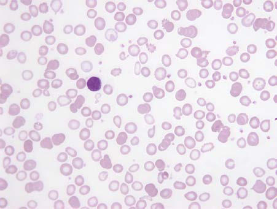

# Chapter 504: Iron-Deficiency Anemia — Board-Style Self-Assessment MCQs
**Part XIX: Diseases of the Blood** | [📖 Read Wiki Chapter](../chapters/504.md) | [🃏 Chapter Flashcards](../flashcards/504_flashcards.md) | [🏠 Course Master Index](../../index.md)

Total questions: **5** *(Click "Show Answer & Rationale" beneath each question)*

### Question 1 (Clinical Pediatrics Vignette)
A pediatric patient is evaluated for the following clinical and diagnostic profile: • Inadequate nutritional iron intake; • Inadequate dietary iron content; • Low heme iron content (e.g., from a vegetarian or vegan diet); • Food insecurity or low dietary diversity (e.g., resulting from poverty, especially in low-income countries); •. Which of the following conditions or syndromes is the most likely diagnosis?

- **A.** EXERCISE (Iron-Deficiency Anemia)
- **B.** BLOOD LOSS (Iron-Deficiency Anemia)
- **C.** COMMENTS (Iron-Deficiency Anemia)
- **D.** INADEQUATE IRON UPTAKE

<b>Show Answer & Rationale</b>

**Correct Answer: D** — INADEQUATE IRON UPTAKE

**Rationale:** **INADEQUATE IRON UPTAKE** (associated with **`TMPRSS6`**) is characterized by: • Inadequate nutritional iron intake; • Inadequate dietary iron content; • Low heme iron content (e.g., from a vegetarian or vegan diet); • Food insecurity or low dietary diversity (e.g., resulting from poverty, especially in low-income countries); • Low iron content complementary diet (e.g., prolonged breastfeeding, o.

**Why Other Options Are Incorrect:** **EXERCISE (Iron-Deficiency Anemia)** is incorrect (characterized by • Multifactorial: reduced dietary iron intake, reduced iron absorption because of inflammation, incr). **BLOOD LOSS (Iron-Deficiency Anemia)** is incorrect (characterized by • Intestinal blood loss; • Esophageal; • Varices; • Carcinoma; • Ulceration; • Reflux esophagitis; •). **COMMENTS (Iron-Deficiency Anemia)** is incorrect (characterized by Hemoglobin (g/dL); <11.0 for non-Hispanic Whites ages 0.5-4 yr; When used alone, it has low specific).

### Question 2 (Clinical Pediatrics Vignette)
A pediatric patient is evaluated for the following clinical and diagnostic profile: • Growth (e.g., during early childhood and adolescence); • Pregnancy; • Physiologic blood losses exceeding iron intake; • Erythropoiesis stimulating agent therapy. Which of the following conditions or syndromes is the most likely diagnosis?

- **A.** INCREASED IRON REQUIREMENTS
- **B.** INADEQUATE IRON UPTAKE
- **C.** EXERCISE (Iron-Deficiency Anemia)
- **D.** COMMENTS (Iron-Deficiency Anemia)

<b>Show Answer & Rationale</b>

**Correct Answer: A** — INCREASED IRON REQUIREMENTS

**Rationale:** **INCREASED IRON REQUIREMENTS** is characterized by: • Growth (e.g., during early childhood and adolescence); • Pregnancy; • Physiologic blood losses exceeding iron intake; • Erythropoiesis stimulating agent therapy.

**Why Other Options Are Incorrect:** **INADEQUATE IRON UPTAKE** is incorrect (characterized by • Inadequate nutritional iron intake; • Inadequate dietary iron content; • Low heme iron content (e.). **EXERCISE (Iron-Deficiency Anemia)** is incorrect (characterized by • Multifactorial: reduced dietary iron intake, reduced iron absorption because of inflammation, incr). **COMMENTS (Iron-Deficiency Anemia)** is incorrect (characterized by Hemoglobin (g/dL); <11.0 for non-Hispanic Whites ages 0.5-4 yr; When used alone, it has low specific).

### Question 3 (Pediatric Genetics & Molecular Etiology)
A child is diagnosed with **INADEQUATE IRON UPTAKE** after presenting with • Inadequate nutritional iron intake; • Inadequate dietary iron content; • Low heme iron content (e.g., from a vegetarian or vegan diet); • Food insecurity or low dietary diversity (e.g., resulting from poverty. Pathogenic variants in which of the following genes are most classically implicated?

- **A.** CLN5
- **B.** SLC3A1
- **C.** COL4A5
- **D.** TMPRSS6

<b>Show Answer & Rationale</b>

**Correct Answer: D** — TMPRSS6

**Rationale:** Pathogenic variants in **`TMPRSS6`** (Diseases of the Blood) are associated with **INADEQUATE IRON UPTAKE** (• Inadequate nutritional iron intake; • Inadequate dietary iron content; • Low heme iron content (e.g., from a vegetarian or vegan diet); • Food insecurity or low dietary diversity (e.g., resulting from poverty, especially in low-income countries); • Low iron content complementary diet (e.g., prolonged breastfeeding, o).

### Question 4 (Visual Diagnosis & Clinical Spotter)

A pediatric patient undergoes evaluation for **Iron-Deficiency Anemia**, yielding the clinical or diagnostic finding shown below. Which of the following best characterizes the illustrated finding?

- **A.** Peripheral blood smear in iron deficiency. Note the small, pale (microcytic, hypochromic) red blood cells with variable sizes and shapes (anisopoikilocytosis). Occasional target cells with centra
- **B.** The usual form of hereditary orotic aciduria is caused by a deficiency (in all body tissues) of orotic phosphoribosyl transferase and orotidine- 5-phosphate decarboxylase, two sequential enz
- **C.** This defect is the most common metabolic error in the de novo synthesis of pyrimidines and therefore affects nucleic acid synthe sis.
- **D.** Orotic aciduria is a rare autosomal recessive disorder that usually appears in the first year of life and is characterized by growth failure, developmen tal delay, megaloblastic anemia, and

<b>Show Answer & Rationale</b>

**Correct Answer: A** — Peripheral blood smear in iron deficiency. Note the small, pale (microcytic, hypochromic) red blood cells with variable sizes and shapes (anisopoikilocytosis). Occasional target cells with centra

**Rationale:** **Fig. 504.1**: Peripheral blood smear in iron deficiency. Note the small, pale (microcytic, hypochromic) red blood cells with variable sizes and shapes (anisopoikilocytosis). Occasional target cells with central hemo globin pooling, as well as several somewhat elongated hypochromic microcytes (pencil cells), are present. (From Fleming MD. Disorders of iron and copper metabolism, the sideroblastic anemias, and lead toxic ity. In Orkin SH, Fisher DE, Ginsburg D, et al., eds. Nathan and Oski’s Hematology and Oncology of Infancy and Childhood, 8th ed. Philadel phia: Elsevier, 2015; Fig 11.7.)

### Question 5 (Pediatric Board Mastery (Iron-Deficiency Anemia))
When formulating an evidence-based diagnostic and management plan for **Iron-Deficiency Anemia** (*Part XIX: Diseases of the Blood*), which of the following pediatric clinical statements is **ACCURATE**? (Item 1)

- **A.** First-line management relies on immediate high-dose aspirin therapy in febrile infants.
- **B.** Inheritance is exclusively holandric (Y-linked) with 100% penetrance restricted to male neonates.
- **C.** The condition is an entirely benign physiologic variant that never warrants laboratory or clinical evaluation.
- **D.** Orotic aciduria is a rare autosomal recessive disorder that usually appears in the first year of life and is characterized by growth failure, developmen tal delay, megaloblastic anemia, and increased urina

<b>Show Answer & Rationale</b>

**Correct Answer: D** — Orotic aciduria is a rare autosomal recessive disorder that usually appears in the first year of life and is characterized by growth failure, developmen tal delay, megaloblastic anemia, and increased urina

**Rationale:** **Pediatric Clinical Principle (Iron-Deficiency Anemia):** Orotic aciduria is a rare autosomal recessive disorder that usually appears in the first year of life and is characterized by growth failure, developmen tal delay, megaloblastic anemia, and increased urinary excretion of orotic acid.

