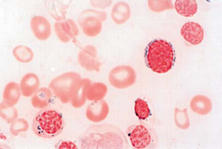

# Chapter 506: Definitions and Classification of Hemolytic Anemias — Board-Style Self-Assessment MCQs
**Part XIX: Diseases of the Blood** | [📖 Read Wiki Chapter](../chapters/506.md) | [🃏 Chapter Flashcards](../flashcards/506_flashcards.md) | [🏠 Course Master Index](../../index.md)

Total questions: **5** *(Click "Show Answer & Rationale" beneath each question)*

### Question 1 (Clinical Pediatrics Vignette)
A pediatric patient is evaluated for the following clinical and diagnostic profile: Hereditary spherocytosis; Spherocytes; EMA binding, osmotic fragility; Hereditary elliptocytosis; Elliptocytes; Blood smear; Hereditary pyropoikilocytosis; Microcytes, fragments. Which of the following conditions or syndromes is the most likely diagnosis?

- **A.** Microangiopathic Hemolytic Anemias
- **B.** Enzyme Disorders (Definitions and Classification of Hemolytic Anemias)
- **C.** Membrane Disorders
- **D.** Infections (Definitions and Classification of Hemolytic Anemias)

<b>Show Answer & Rationale</b>

**Correct Answer: C** — Membrane Disorders

**Rationale:** **Membrane Disorders** is characterized by: Hereditary spherocytosis; Spherocytes; EMA binding, osmotic fragility; Hereditary elliptocytosis; Elliptocytes; Blood smear; Hereditary pyropoikilocytosis; Microcytes, fragments.

**Why Other Options Are Incorrect:** **Microangiopathic Hemolytic Anemias** is incorrect (characterized by TTP, HUS, DIC, cancer, heart valves; Schistocytes, red blood cell fragments; Targeted to diagnosis). **Enzyme Disorders (Definitions and Classification of Hemolytic Anemias)** is incorrect (characterized by G6PD deficiency; Bite cells, blister cells; Supravital stain, G6PD level; Others; Variable; Individu). **Infections (Definitions and Classification of Hemolytic Anemias)** is incorrect (characterized by Malaria, babesiosis, Clostridium perfringens; Parasite (malaria, babesiosis); Giemsa stain (babesios).

### Question 2 (Clinical Pediatrics Vignette)
A pediatric patient is evaluated for the following clinical and diagnostic profile: Sickle cell disease; Sickle cells, targets; Hemoglobin electrophoresis; Unstable hemoglobins; Bite cells; Supravital stain, heat or alcohol stability test. Which of the following conditions or syndromes is the most likely diagnosis?

- **A.** Toxins and Physical Agents
- **B.** Hemoglobin Disorders
- **C.** Enzyme Disorders (Definitions and Classification of Hemolytic Anemias)
- **D.** Microangiopathic Hemolytic Anemias

<b>Show Answer & Rationale</b>

**Correct Answer: B** — Hemoglobin Disorders

**Rationale:** **Hemoglobin Disorders** is characterized by: Sickle cell disease; Sickle cells, targets; Hemoglobin electrophoresis; Unstable hemoglobins; Bite cells; Supravital stain, heat or alcohol stability test.

**Why Other Options Are Incorrect:** **Toxins and Physical Agents** is incorrect (characterized by Arsenic, lead, copper; Basophilic stippling (lead); Element levels; Insect, spider, snake venoms; Sc). **Enzyme Disorders (Definitions and Classification of Hemolytic Anemias)** is incorrect (characterized by G6PD deficiency; Bite cells, blister cells; Supravital stain, G6PD level; Others; Variable; Individu). **Microangiopathic Hemolytic Anemias** is incorrect (characterized by TTP, HUS, DIC, cancer, heart valves; Schistocytes, red blood cell fragments; Targeted to diagnosis).

### Question 3 (Visual Diagnosis & Clinical Spotter)

A pediatric patient undergoes evaluation for **Definitions and Classification of Hemolytic Anemias**, yielding the clinical or diagnostic finding shown below. Which of the following best characterizes the illustrated finding?

- **A.** In: Hoffman R, Benz EJ Jr, Shattil SJ, et al., eds.
- **B.** Isolated benign artifact with no clinical correlation to pediatric disease.
- **C.** Ring sideroblast in myelodysplastic syndrome (refractory anemia with ring sideroblasts)—iron stain. (From Ryan DH, Cohen HJ. Bone marrow examination. In: Hoffman R, Benz EJ Jr, Shattil SJ, et al.
- **D.** Normal physiologic neonatal finding requiring no diagnostic workup or follow-up.

<b>Show Answer & Rationale</b>

**Correct Answer: C** — Ring sideroblast in myelodysplastic syndrome (refractory anemia with ring sideroblasts)—iron stain. (From Ryan DH, Cohen HJ. Bone marrow examination. In: Hoffman R, Benz EJ Jr, Shattil SJ, et al.

**Rationale:** **Fig. 505.1**: Ring sideroblast in myelodysplastic syndrome (refractory anemia with ring sideroblasts)—iron stain. (From Ryan DH, Cohen HJ. Bone marrow examination. In: Hoffman R, Benz EJ Jr, Shattil SJ, et al., eds. Hematology, 4th ed. Philadelphia: Churchill Livingstone, 2005.)

### Question 4 (Differential Diagnosis (Definitions and Classification of Hemolytic Anemias))
During a pediatric consultation regarding **Definitions and Classification of Hemolytic Anemias**, which clinical entity or concept is described by the following profile? "defined as the premature destruction of red blood cells (RBCs)."

- **A.** Hemolysis
- **B.** Toxins and Physical Agents
- **C.** intrinsic
- **D.** Microangiopathic Hemolytic Anemias

<b>Show Answer & Rationale</b>

**Correct Answer: A** — Hemolysis

**Rationale:** Hemolysis is defined as the premature destruction of red blood cells (RBCs).

### Question 5 (Pediatric Board Mastery (Definitions and Classification of Hemolytic Anemias))
When formulating an evidence-based diagnostic and management plan for **Definitions and Classification of Hemolytic Anemias** (*Part XIX: Diseases of the Blood*), which of the following pediatric clinical statements is **ACCURATE**? (Item 1)

- **A.** Clinical manifestations are permanently restricted to late adulthood and never present during infancy, childhood, or adolescence.
- **B.** In: Hoffman R, Benz EJ Jr, Shattil SJ, et al., eds.
- **C.** The condition is an entirely benign physiologic variant that never warrants laboratory or clinical evaluation.
- **D.** First-line management relies on immediate high-dose aspirin therapy in febrile infants.

<b>Show Answer & Rationale</b>

**Correct Answer: B** — In: Hoffman R, Benz EJ Jr, Shattil SJ, et al., eds.

**Rationale:** **Pediatric Clinical Principle (Definitions and Classification of Hemolytic Anemias):** In: Hoffman R, Benz EJ Jr, Shattil SJ, et al., eds.

