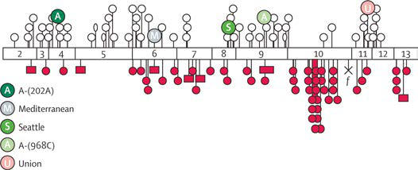

# Chapter 512: Enzymatic Defects — Board-Style Self-Assessment MCQs
**Part XIX: Diseases of the Blood** | [📖 Read Wiki Chapter](../chapters/512.md) | [🃏 Chapter Flashcards](../flashcards/512_flashcards.md) | [🏠 Course Master Index](../../index.md)

Total questions: **5** *(Click "Show Answer & Rationale" beneath each question)*

### Question 1 (Clinical Pediatrics Vignette)
A pediatric patient is evaluated for the following clinical and diagnostic profile: +; Congenital malformations; 13-24; 0; —; —; Recessive; ++; 15-20; +; Normal; Abnormal; Recessive; ++; 16; 0; —; Abnormal; Recessive; +++; Hydrops fetalis; 17; Recessive; +; 20; 0; Normal; Normal; Recessive; ++; Low platelet and fibroblast; HK activi. Which of the following conditions or syndromes is the most likely diagnosis?

- **A.** DHH (Development and Function of the Gonads)
- **B.** ANTIMALARIAL DRUGS
- **C.** FREQUENT PATHOGENS (IN ORDER OF FREQUENCY)
- **D.** MOBILITY (Enzymatic Defects)

<b>Show Answer & Rationale</b>

**Correct Answer: D** — MOBILITY (Enzymatic Defects)

**Rationale:** **MOBILITY (Enzymatic Defects)** is characterized by: —; +; Congenital malformations; 13-24; 0; —; —; Recessive; ++; 15-20; +; Normal; Abnormal; Recessive; ++; 16; 0; —; Abnormal; Recessive; +++; Hydrops fetalis; 17; Recessive; +; 20; 0; Normal; Normal; Recessive; ++; Low platelet and fibroblast; HK activity; 20; 0; Low; Normal; Recessive; ++; Low platelet HK activity; 25.

**Why Other Options Are Incorrect:** **DHH (Development and Function of the Gonads)** is incorrect (characterized by Signaling; molecule; 605423; 12q13.1). **ANTIMALARIAL DRUGS** is incorrect (characterized by Dapsone; Chloroquine; Pamaquine; Quinidine; Primaquine; Quinine; Tafenoquine). **FREQUENT PATHOGENS (IN ORDER OF FREQUENCY)** is incorrect (characterized by Neonates (<3 wk); Group B streptococcus, Escherichia coli, other gram-negative bacilli, Streptococcu).

### Question 2 (Clinical Pediatrics Vignette)
A pediatric patient is evaluated for the following clinical and diagnostic profile: Dapsone; Chloroquine; Pamaquine; Quinidine; Primaquine; Quinine; Tafenoquine. Which of the following conditions or syndromes is the most likely diagnosis?

- **A.** MOBILITY (Enzymatic Defects)
- **B.** ANTIMALARIAL DRUGS
- **C.** Control Classification
- **D.** HLA-B27 (Juvenile Idiopathic Arthritis)

<b>Show Answer & Rationale</b>

**Correct Answer: B** — ANTIMALARIAL DRUGS

**Rationale:** **ANTIMALARIAL DRUGS** is characterized by: Dapsone; Chloroquine; Pamaquine; Quinidine; Primaquine; Quinine; Tafenoquine.

**Why Other Options Are Incorrect:** **MOBILITY (Enzymatic Defects)** is incorrect (characterized by —; +; Congenital malformations; 13-24; 0; —; —; Recessive; ++; 15-20; +; Normal; Abnormal; Recessive). **Control Classification** is incorrect (characterized by • Clinical assessment while asthma being managed and treated; Well controlled; Not well controlled; ). **HLA-B27 (Juvenile Idiopathic Arthritis)** is incorrect (characterized by NSAIDs and intraarticular; corticosteroids; consider; sulfasalazine as alternative to MTX;; anti-TNF).

### Question 3 (Visual Diagnosis & Clinical Spotter)

A pediatric patient undergoes evaluation for **Enzymatic Defects**, yielding the clinical or diagnostic finding shown below. Which of the following best characterizes the illustrated finding?

- **A.** Diagnosis relies on demonstration of a marked reduction of RBC PK activity or an increase in the Michaelis- Menten dissociation constant (Km) for its substrate, phosphoenol pyruvate (high Km
- **B.** The pathogenic variants 1456 C to T and 1529 G to A are the most common pathogenic variants in the White population.
- **C.** Most common pathogenic variants along coding sequence of G6PD gene. Exons are shown as open numbered boxes. Open circles are pathogenic variants causing classes II and III variants. Filled circle
- **D.** Congenital nonspherocytic hemolytic anemia occurs in persons homozygous or compound heterozygous for autosomal recessive genes that cause either a marked reduction in red blood cell (RBC) py

<b>Show Answer & Rationale</b>

**Correct Answer: C** — Most common pathogenic variants along coding sequence of G6PD gene. Exons are shown as open numbered boxes. Open circles are pathogenic variants causing classes II and III variants. Filled circle

**Rationale:** **Fig. 512.2**: Most common pathogenic variants along coding sequence of G6PD gene. Exons are shown as open numbered boxes. Open circles are pathogenic variants causing classes II and III variants. Filled circles represent sporadic pathogenic variants giving rise to severe variants (class I). Open ellipses are pathogenic variants causing class IV variants. X is a nonsense pathogenic variant; f, a splice site pathogenic variant; filled squares, small deletions. 202A and 968C are the two sites of base substitution in G6PD-A. (From Cappellini MD, Fiorelli G. Glucose-6- phosphate dehydrogenase deficiency. Lancet. 2008;371:64–74.)

### Question 4 (Differential Diagnosis (512.1 Pyruvate Kinase Deficiency Allison S. Remiker and Amanda M. Brandow))
During a pediatric consultation regarding **Enzymatic Defects**, which clinical entity or concept is described by the following profile? "There are two mammalian PK genes, but only the PKLR gene is expressed in RBCs."

- **A.** nonspherocytic hemolytic anemia
- **B.** ANTIMALARIAL DRUGS
- **C.** TREATMENT
- **D.** ETIOLOGY

<b>Show Answer & Rationale</b>

**Correct Answer: D** — ETIOLOGY

**Rationale:** ETIOLOGY There are two mammalian PK genes, but only the PKLR gene is expressed in RBCs.

### Question 5 (Pediatric Board Mastery (Enzymatic Defects))
When formulating an evidence-based diagnostic and management plan for **Enzymatic Defects** (*Part XIX: Diseases of the Blood*), which of the following pediatric clinical statements is **ACCURATE**? (Item 1)

- **A.** The condition is an entirely benign physiologic variant that never warrants laboratory or clinical evaluation.
- **B.** Congenital nonspherocytic hemolytic anemia occurs in persons homozygous or compound heterozygous for autosomal recessive genes that cause either a marked reduction in red blood cell (RBC) pyruvate kinase (
- **C.** Systemic tetracyclines and fluoroquinolones are universally required as routine prophylaxis in all healthy newborns.
- **D.** Inheritance is exclusively holandric (Y-linked) with 100% penetrance restricted to male neonates.

<b>Show Answer & Rationale</b>

**Correct Answer: B** — Congenital nonspherocytic hemolytic anemia occurs in persons homozygous or compound heterozygous for autosomal recessive genes that cause either a marked reduction in red blood cell (RBC) pyruvate kinase (

**Rationale:** **Pediatric Clinical Principle (Enzymatic Defects):** Congenital nonspherocytic hemolytic anemia occurs in persons homozygous or compound heterozygous for autosomal recessive genes that cause either a marked reduction in red blood cell (RBC) pyruvate kinase (PK) or production of an abnormal enzyme with decreased catalytic activity resulting in impaired conversion of phosphoenol pyruvate to pyruvate.

