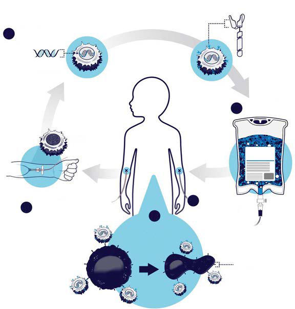

# Chapter 543: Principles of Cancer Treatment — Board-Style Self-Assessment MCQs
**Part XX: Cancer and Benign Tumors** | [📖 Read Wiki Chapter](../chapters/543.md) | [🃏 Chapter Flashcards](../flashcards/543_flashcards.md) | [🏠 Course Master Index](../../index.md)

Total questions: **5** *(Click "Show Answer & Rationale" beneath each question)*

### Question 1 (Clinical Pediatrics Vignette)
A pediatric patient is evaluated for the following clinical and diagnostic profile: Philadelphia chromosome–positive. Which of the following conditions or syndromes is the most likely diagnosis?

- **A.** VEGFR-1, -2 (Principles of Cancer Treatment)
- **B.** MAPK/MEK (Principles of Cancer Treatment)
- **C.** ALL (Principles of Cancer Treatment)
- **D.** CML (Principles of Cancer Treatment)

<b>Show Answer & Rationale</b>

**Correct Answer: D** — CML (Principles of Cancer Treatment)

**Rationale:** **CML (Principles of Cancer Treatment)** is characterized by: Philadelphia chromosome–positive.

**Why Other Options Are Incorrect:** **VEGFR-1, -2 (Principles of Cancer Treatment)** is incorrect (characterized by Low-grade glioma; Crizotinib,; lorlatinib). **MAPK/MEK (Principles of Cancer Treatment)** is incorrect (characterized by Plexiform neurofibroma; Low-grade glioma; Bevacizumab). **ALL (Principles of Cancer Treatment)** is incorrect (characterized by PDGFRα; Hypereosinophilic syndrome; cKIT; Gastrointestinal stromal tumor; Dasatinib,; nilotinib).

### Question 2 (Clinical Pediatrics Vignette)
A pediatric patient is evaluated for the following clinical and diagnostic profile: PDGFRα; Hypereosinophilic syndrome; cKIT; Gastrointestinal stromal tumor; Dasatinib,; nilotinib. Which of the following conditions or syndromes is the most likely diagnosis?

- **A.** MAPK/MEK (Principles of Cancer Treatment)
- **B.** ALL (Principles of Cancer Treatment)
- **C.** CD20 (Principles of Cancer Treatment)
- **D.** CD30 (Principles of Cancer Treatment)

<b>Show Answer & Rationale</b>

**Correct Answer: B** — ALL (Principles of Cancer Treatment)

**Rationale:** **ALL (Principles of Cancer Treatment)** is characterized by: PDGFRα; Hypereosinophilic syndrome; cKIT; Gastrointestinal stromal tumor; Dasatinib,; nilotinib.

**Why Other Options Are Incorrect:** **MAPK/MEK (Principles of Cancer Treatment)** is incorrect (characterized by Plexiform neurofibroma; Low-grade glioma; Bevacizumab). **CD20 (Principles of Cancer Treatment)** is incorrect (characterized by Non-Hodgkin lymphoma; Selumetinib). **CD30 (Principles of Cancer Treatment)** is incorrect (characterized by Hodgkin lymphoma; Rituximab).

### Question 3 (Visual Diagnosis & Clinical Spotter)

A pediatric patient undergoes evaluation for **Principles of Cancer Treatment**, yielding the clinical or diagnostic finding shown below. Which of the following best characterizes the illustrated finding?

- **A.** Accordingly, children with a better prognosis are treated with less intensive therapy, including lower doses of chemotherapy or radiation therapy, a shorter duration of treatment, or elimina
- **B.** DIAGNOSIS AND STAGING Accurate diagnosis and staging of the extent of disease are imperative because the nature of therapy depends strongly on the type of cancer.
- **C.** Chimeric antigen receptor (CAR) T-cell therapy. CAR T-cell therapy is a type of treatment in which a patient’s T cells are genetically engineered in the laboratory so they will bind to spe cific
- **D.** All patients with cancer should be referred to an appropriate specialized center as soon as pos sible when the diagnosis of cancer is suspected.

<b>Show Answer & Rationale</b>

**Correct Answer: C** — Chimeric antigen receptor (CAR) T-cell therapy. CAR T-cell therapy is a type of treatment in which a patient’s T cells are genetically engineered in the laboratory so they will bind to spe cific

**Rationale:** **Fig. 543.7**: Chimeric antigen receptor (CAR) T-cell therapy. CAR T-cell therapy is a type of treatment in which a patient’s T cells are genetically engineered in the laboratory so they will bind to spe cific proteins (antigens) on cancer cells and kill them. (1) A patient’s T cells are removed from their blood. Then (2) the gene for a spe cial receptor called a chimeric antigen receptor is inserted into the T cells in the laboratory. The gene encodes the engineered CAR protein that is expressed on the surface of the patient’s T cells, creating a CAR T cell. (3) Millions of CAR T cells are grown in the laboratory. (4) They are then given to the patient by intravenous in fusion. (5) The CAR T cells bind to antigens on the cancer cells and kill them. (Courtesy National Institutes of Health, National Can cer Institute, Bethesda, Maryland. https://www.cancer.gov/about- cancer/treatment/research/car-t-cell-therapy-infographic)

### Question 4 (Differential Diagnosis (Principles of Cancer Treatment))
During a pediatric consultation regarding **Principles of Cancer Treatment**, which clinical entity or concept is described by the following profile? "Accurate this pediatric condition of the extent of disease are imperative because the nature of therapy depends strongly on the type of cancer."

- **A.** DIAGNOSIS AND STAGING
- **B.** CD20 (Principles of Cancer Treatment)
- **C.** Radiation therapy
- **D.** leukemias

<b>Show Answer & Rationale</b>

**Correct Answer: A** — DIAGNOSIS AND STAGING

**Rationale:** DIAGNOSIS AND STAGING Accurate diagnosis and staging of the extent of disease are imperative because the nature of therapy depends strongly on the type of cancer.

### Question 5 (Pediatric Board Mastery (Principles of Cancer Treatment))
When formulating an evidence-based diagnostic and management plan for **Principles of Cancer Treatment** (*Part XX: Cancer and Benign Tumors*), which of the following pediatric clinical statements is **ACCURATE**? (Item 1)

- **A.** Diagnostic confirmation relies solely on plain skull radiographs without biochemical, microbiologic, or clinical correlation.
- **B.** All patients with cancer should be referred to an appropriate specialized center as soon as pos sible when the diagnosis of cancer is suspected.
- **C.** The condition is an entirely benign physiologic variant that never warrants laboratory or clinical evaluation.
- **D.** Clinical manifestations are permanently restricted to late adulthood and never present during infancy, childhood, or adolescence.

<b>Show Answer & Rationale</b>

**Correct Answer: B** — All patients with cancer should be referred to an appropriate specialized center as soon as pos sible when the diagnosis of cancer is suspected.

**Rationale:** **Pediatric Clinical Principle (Principles of Cancer Treatment):** All patients with cancer should be referred to an appropriate specialized center as soon as pos sible when the diagnosis of cancer is suspected.

