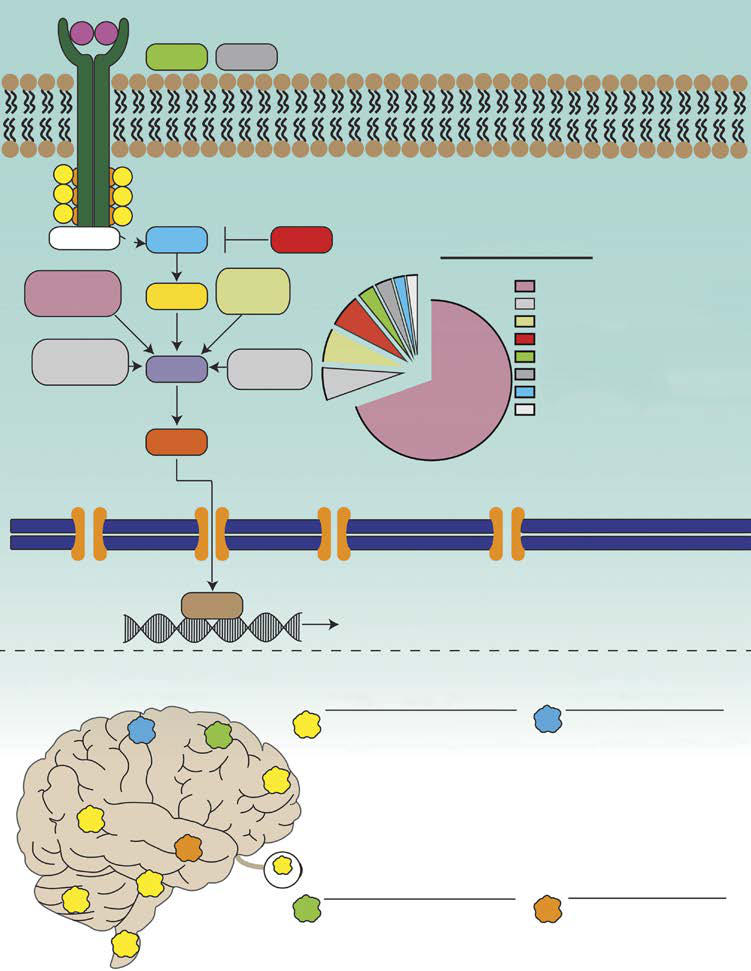

# Chapter 546: Central Nervous System Tumors in Childhood — Board-Style Self-Assessment MCQs
**Part XX: Cancer and Benign Tumors** | [📖 Read Wiki Chapter](../chapters/546.md) | [🃏 Chapter Flashcards](../flashcards/546_flashcards.md) | [🏠 Course Master Index](../../index.md)

Total questions: **5** *(Click "Show Answer & Rationale" beneath each question)*

### Question 1 (Clinical Pediatrics Vignette)
A pediatric patient is evaluated for the following clinical and diagnostic profile: Neurofibromatosis type 1; (autosomal dominant); Optic pathway gliomas, astrocytoma, malignant peripheral nerve sheath; tumors, neurofibromas; 17q11. Which of the following conditions or syndromes is the most likely diagnosis?

- **A.** NF1 (Central Nervous System Tumors in Childhood)
- **B.** GENE (Central Nervous System Tumors in Childhood)
- **C.** TSC2 (Central Nervous System Tumors in Childhood)
- **D.** TP53 (Central Nervous System Tumors in Childhood)

<b>Show Answer & Rationale</b>

**Correct Answer: B** — GENE (Central Nervous System Tumors in Childhood)

**Rationale:** **GENE (Central Nervous System Tumors in Childhood)** is characterized by: Neurofibromatosis type 1; (autosomal dominant); Optic pathway gliomas, astrocytoma, malignant peripheral nerve sheath; tumors, neurofibromas; 17q11.

**Why Other Options Are Incorrect:** **NF1 (Central Nervous System Tumors in Childhood)** is incorrect (characterized by Neurofibromatosis type 2; (autosomal dominant); Vestibular schwannomas, meningiomas, spinal cord epe). **TSC2 (Central Nervous System Tumors in Childhood)** is incorrect (characterized by Li-Fraumeni (autosomal dominant); Astrocytoma, primitive neuroectodermal tumor; 17q13). **TP53 (Central Nervous System Tumors in Childhood)** is incorrect (characterized by Cowden (autosomal dominant); Dysplastic gangliocytoma of the cerebellum (Lhermitte-Duclos disease); ).

### Question 2 (Clinical Pediatrics Vignette)
A pediatric patient is evaluated for the following clinical and diagnostic profile: Neurofibromatosis type 2; (autosomal dominant); Vestibular schwannomas, meningiomas, spinal cord ependymoma,; spinal cord astrocytoma, hamartomas; 22q12. Which of the following conditions or syndromes is the most likely diagnosis?

- **A.** TP53 (Central Nervous System Tumors in Childhood)
- **B.** TSC2 (Central Nervous System Tumors in Childhood)
- **C.** VHL (Central Nervous System Tumors in Childhood)
- **D.** NF1 (Central Nervous System Tumors in Childhood)

<b>Show Answer & Rationale</b>

**Correct Answer: D** — NF1 (Central Nervous System Tumors in Childhood)

**Rationale:** **NF1 (Central Nervous System Tumors in Childhood)** (associated with **`NF1`**) is characterized by: Neurofibromatosis type 2; (autosomal dominant); Vestibular schwannomas, meningiomas, spinal cord ependymoma,; spinal cord astrocytoma, hamartomas; 22q12.

**Why Other Options Are Incorrect:** **TP53 (Central Nervous System Tumors in Childhood)** is incorrect (characterized by Cowden (autosomal dominant); Dysplastic gangliocytoma of the cerebellum (Lhermitte-Duclos disease); ). **TSC2 (Central Nervous System Tumors in Childhood)** is incorrect (characterized by Li-Fraumeni (autosomal dominant); Astrocytoma, primitive neuroectodermal tumor; 17q13). **VHL (Central Nervous System Tumors in Childhood)** is incorrect (characterized by Tuberous sclerosis (autosomal; dominant); Subependymal giant cell astrocytoma, cortical tubers; 9q34).

### Question 3 (Visual Diagnosis & Clinical Spotter)

A pediatric patient undergoes evaluation for **Central Nervous System Tumors in Childhood**, yielding the clinical or diagnostic finding shown below. Which of the following best characterizes the illustrated finding?

- **A.** A, Schematic of the frequen cy of MAPK pathway alterations detected by biopsy of pilocytic astrocytomas. This underestimates the frequency of NF1 pathogenic variants among children with low-grade
- **B.** Primary central nervous system (CNS) tumors are a heterogeneous group of diseases that are, collectively, the most common malignancy in childhood and adolescence.
- **C.** A review of the National Cancer Institute Sur veillance, Epidemiology, and End Results data over a 25-year followup demonstrates that the relative survival curves do not plateau after 10 yea
- **D.** Surgery with complete resection, if feasible, is the foundation, with radia tion therapy and chemotherapy utilized according to the diagnosis, patient age, and other factors.

<b>Show Answer & Rationale</b>

**Correct Answer: A** — A, Schematic of the frequen cy of MAPK pathway alterations detected by biopsy of pilocytic astrocytomas. This underestimates the frequency of NF1 pathogenic variants among children with low-grade

**Rationale:** **Fig. 546.4**: A, Schematic of the frequen cy of MAPK pathway alterations detected by biopsy of pilocytic astrocytomas. This underestimates the frequency of NF1 pathogenic variants among children with low-grade gliomas (LGGs) because the tumors in patients affected by NF1 often do not undergo biopsy. Although BRAF fu sions (BRAF Fus) constitute the majority of alterations in pilocytic astrocytoma, BRAF pathogenic variants are more commonly observed in pleomorphic xanthoastrocy tomas and gangliogliomas. B, Frequency of the different BRAF abnormalities as a function of tumor location and histologi cal diagnosis. (From Pollack IF, Agnihotri S, Broniscer A. Childhood brain tumors: current management, biological insights, and future directions. J Neurosurg Pediatr. 2019;23:261–273. Fig. 1.)

### Question 4 (Differential Diagnosis (Central Nervous System Tumors in Childhood))
During a pediatric consultation regarding **Central Nervous System Tumors in Childhood**, which clinical entity or concept is described by the following profile? "The this pediatric condition of pediatric CNS tumors is not well defined."

- **A.** ETIOLOGY
- **B.** Atypical teratoid/rhabdoid tumor
- **C.** Choroid Plexus Tumors
- **D.** PATHOGENESIS

<b>Show Answer & Rationale</b>

**Correct Answer: A** — ETIOLOGY

**Rationale:** ETIOLOGY The etiology of pediatric CNS tumors is not well defined.

### Question 5 (Pediatric Board Mastery (Central Nervous System Tumors in Childhood))
When formulating an evidence-based diagnostic and management plan for **Central Nervous System Tumors in Childhood** (*Part XX: Cancer and Benign Tumors*), which of the following pediatric clinical statements is **ACCURATE**? (Item 1)

- **A.** Diagnostic confirmation relies solely on plain skull radiographs without biochemical, microbiologic, or clinical correlation.
- **B.** The condition is an entirely benign physiologic variant that never warrants laboratory or clinical evaluation.
- **C.** A review of the National Cancer Institute Sur veillance, Epidemiology, and End Results data over a 25-year followup demonstrates that the relative survival curves do not plateau after 10 years following di
- **D.** Inheritance is exclusively holandric (Y-linked) with 100% penetrance restricted to male neonates.

<b>Show Answer & Rationale</b>

**Correct Answer: C** — A review of the National Cancer Institute Sur veillance, Epidemiology, and End Results data over a 25-year followup demonstrates that the relative survival curves do not plateau after 10 years following di

**Rationale:** **Pediatric Clinical Principle (Central Nervous System Tumors in Childhood):** A review of the National Cancer Institute Sur veillance, Epidemiology, and End Results data over a 25-year followup demonstrates that the relative survival curves do not plateau after 10 years following diagnosis of HL, but rather accelerate.

