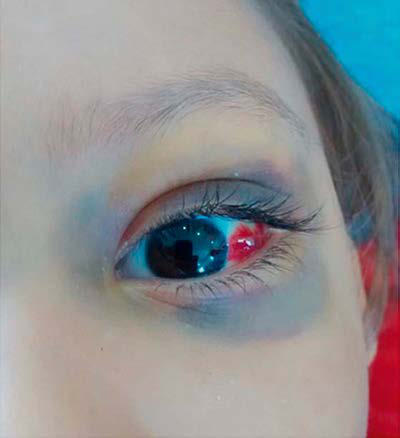

# Chapter 547: Neuroblastoma — Board-Style Self-Assessment MCQs
**Part XX: Cancer and Benign Tumors** | [📖 Read Wiki Chapter](../chapters/547.md) | [🃏 Chapter Flashcards](../flashcards/547_flashcards.md) | [🏠 Course Master Index](../../index.md)

Total questions: **5** *(Click "Show Answer & Rationale" beneath each question)*

### Question 1 (Clinical Pediatrics Vignette)
A pediatric patient is evaluated for the following clinical and diagnostic profile: Pepper syndrome; Massive involvement of the liver with metastatic disease with or without respiratory distress; Horner syndrome; Unilateral ptosis, myosis, and anhidrosis associated with a thoracic or cervical primary tumor; symptoms do; not resolve . Which of the following conditions or syndromes is the most likely diagnosis?

- **A.** SYNDROMES CAUSED BY NEUROBLASTOMA
- **B.** ROHHAD (Neuroblastoma)
- **C.** SURVIVAL AT 5 YR (%)
- **D.** SHIMADA (Neuroblastoma)

<b>Show Answer & Rationale</b>

**Correct Answer: A** — SYNDROMES CAUSED BY NEUROBLASTOMA

**Rationale:** **SYNDROMES CAUSED BY NEUROBLASTOMA** is characterized by: Pepper syndrome; Massive involvement of the liver with metastatic disease with or without respiratory distress; Horner syndrome; Unilateral ptosis, myosis, and anhidrosis associated with a thoracic or cervical primary tumor; symptoms do; not resolve with tumor resection; Hutchinson syndrome; Limping and irritability in.

**Why Other Options Are Incorrect:** **ROHHAD (Neuroblastoma)** is incorrect (characterized by Approximately 40% may have neural crest-derived tumors. Obesity and neurologic issues may be part of). **SURVIVAL AT 5 YR (%)** is incorrect (characterized by 1; Localized tumor with complete gross excision, with or without microscopic; residual disease; repr). **SHIMADA (Neuroblastoma)** is incorrect (characterized by Low; 1; Any; Any; Any; Any; Low).

### Question 2 (Clinical Pediatrics Vignette)
A pediatric patient is evaluated for the following clinical and diagnostic profile: Approximately 40% may have neural crest-derived tumors. Obesity and neurologic issues may be part of a; paraneoplastic syndrome. Which of the following conditions or syndromes is the most likely diagnosis?

- **A.** 2A/2B (Neuroblastoma)
- **B.** SURVIVAL AT 5 YR (%)
- **C.** SYNDROMES PREDISPOSING TO NEUROBLASTOMA
- **D.** ROHHAD (Neuroblastoma)

<b>Show Answer & Rationale</b>

**Correct Answer: D** — ROHHAD (Neuroblastoma)

**Rationale:** **ROHHAD (Neuroblastoma)** is characterized by: Approximately 40% may have neural crest-derived tumors. Obesity and neurologic issues may be part of a; paraneoplastic syndrome.

**Why Other Options Are Incorrect:** **2A/2B (Neuroblastoma)** is incorrect (characterized by Any; Not amplified; Any; Any; High). **SURVIVAL AT 5 YR (%)** is incorrect (characterized by 1; Localized tumor with complete gross excision, with or without microscopic; residual disease; repr). **SYNDROMES PREDISPOSING TO NEUROBLASTOMA** is incorrect (characterized by Neurocristopathy syndrome; Neuroblastoma associated with other neural crest disorders, including con).

### Question 3 (Visual Diagnosis & Clinical Spotter)

A pediatric patient undergoes evaluation for **Neuroblastoma**, yielding the clinical or diagnostic finding shown below. Which of the following best characterizes the illustrated finding?

- **A.** Optimal seizure management, physical therapy, endocrine management with timely growth hormone and thyroid replacement therapy, tailored educational programs, and vocational interventions may
- **B.** Neuroblastoma. Periorbital ecchymosis, proptosis, and subconjunctival hemorrhage of the left eye. (From Mota EB, Penna CRR, Marchiori E. Metastatic dissemination of a neuroblastoma. J Pedi atr. 2
- **C.** COMPLICATIONS AND LONG-TERM MANAGEMENT Data from the National Cancer Institute Surveillance, Epidemiology, and End Results Program indicate that more than 70% of patients with childhood brai
- **D.** Therapeutic approaches are based on the specific histologic diagnosis and may incorporate radiation therapy, intrathecal administration of chemotherapy, and/or systemic administration of che

<b>Show Answer & Rationale</b>

**Correct Answer: B** — Neuroblastoma. Periorbital ecchymosis, proptosis, and subconjunctival hemorrhage of the left eye. (From Mota EB, Penna CRR, Marchiori E. Metastatic dissemination of a neuroblastoma. J Pedi atr. 2

**Rationale:** **Fig. 547.1**: Neuroblastoma. Periorbital ecchymosis, proptosis, and subconjunctival hemorrhage of the left eye. (From Mota EB, Penna CRR, Marchiori E. Metastatic dissemination of a neuroblastoma. J Pedi atr. 2017;189:232–232.e1. Fig. 1.)

### Question 4 (Differential Diagnosis (Neuroblastoma))
During a pediatric consultation regarding **Neuroblastoma**, which clinical entity or concept is described by the following profile? "Metastatic spread of other childhood malignancies to the brain is uncommon."

- **A.** Metastatic Tumors
- **B.** ROHHAD (Neuroblastoma)
- **C.** SHIMADA (Neuroblastoma)
- **D.** LYMPHOHISTIOCYTOSES

<b>Show Answer & Rationale</b>

**Correct Answer: A** — Metastatic Tumors

**Rationale:** Metastatic Tumors Metastatic spread of other childhood malignancies to the brain is uncommon.

### Question 5 (Pediatric Board Mastery (Neuroblastoma))
When formulating an evidence-based diagnostic and management plan for **Neuroblastoma** (*Part XX: Cancer and Benign Tumors*), which of the following pediatric clinical statements is **ACCURATE**? (Item 1)

- **A.** The condition is an entirely benign physiologic variant that never warrants laboratory or clinical evaluation.
- **B.** Clinical manifestations are permanently restricted to late adulthood and never present during infancy, childhood, or adolescence.
- **C.** Inheritance is exclusively holandric (Y-linked) with 100% penetrance restricted to male neonates.
- **D.** Therapeutic approaches are based on the specific histologic diagnosis and may incorporate radiation therapy, intrathecal administration of chemotherapy, and/or systemic administration of chemotherapy.

<b>Show Answer & Rationale</b>

**Correct Answer: D** — Therapeutic approaches are based on the specific histologic diagnosis and may incorporate radiation therapy, intrathecal administration of chemotherapy, and/or systemic administration of chemotherapy.

**Rationale:** **Pediatric Clinical Principle (Neuroblastoma):** Therapeutic approaches are based on the specific histologic diagnosis and may incorporate radiation therapy, intrathecal administration of chemotherapy, and/or systemic administration of chemotherapy.

