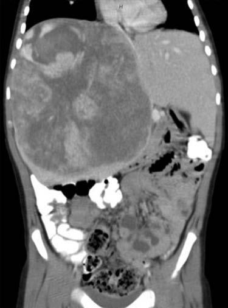

# Chapter 555: Rare Tumors — Board-Style Self-Assessment MCQs
**Part XX: Cancer and Benign Tumors** | [📖 Read Wiki Chapter](../chapters/555.md) | [🃏 Chapter Flashcards](../flashcards/555_flashcards.md) | [🏠 Course Master Index](../../index.md)

Total questions: **5** *(Click "Show Answer & Rationale" beneath each question)*

### Question 1 (Clinical Pediatrics Vignette)
A pediatric patient is evaluated for the following clinical and diagnostic profile: Neck irradiation during childhood or adolescence; Rapid growth; Recent, persistent changes in speaking, breathing, or swallowing; Family history of multiple endocrine neoplasia type 2. Which of the following conditions or syndromes is the most likely diagnosis?

- **A.** HISTORIC FEATURES (Rare Tumors)
- **B.** CARDIOVASCULAR CAUSES
- **C.** PHYSICAL EXAMINATION
- **D.** PHARMACOLOGIC CAUSES

<b>Show Answer & Rationale</b>

**Correct Answer: A** — HISTORIC FEATURES (Rare Tumors)

**Rationale:** **HISTORIC FEATURES (Rare Tumors)** is characterized by: Neck irradiation during childhood or adolescence; Rapid growth; Recent, persistent changes in speaking, breathing, or swallowing; Family history of multiple endocrine neoplasia type 2.

**Why Other Options Are Incorrect:** **CARDIOVASCULAR CAUSES** is incorrect (characterized by Orthostatic hypotension; Paroxysmal cardiac arrhythmia; Pulmonary edema; Renovascular disease; Synco). **PHYSICAL EXAMINATION** is incorrect (characterized by Child or parent reports; persistent neck pain,; abnormal head posture,; or difficulty with neck; mov). **PHARMACOLOGIC CAUSES** is incorrect (characterized by Chlorpropamide-alcohol flush; Combination of a monoamine oxidase inhibitor and a decongestant; Illeg).

### Question 2 (Clinical Pediatrics Vignette)
A pediatric patient is evaluated for the following clinical and diagnostic profile: Firm, fixed, and irregular consistency of nodule; Vocal cord paralysis or hoarseness; Persistent regional lymph adenopathy; Modified from Melmed S, Auchus RJ, Goldfine AB, et al., eds. Williams Textbook of; Endocrinology. 14th ed. Philadelphia: Elsev. Which of the following conditions or syndromes is the most likely diagnosis?

- **A.** ENDOCRINE CAUSES (Rare Tumors)
- **B.** PSYCHOLOGIC CAUSES
- **C.** HISTORIC FEATURES (Rare Tumors)
- **D.** PHYSICAL EXAMINATION

<b>Show Answer & Rationale</b>

**Correct Answer: D** — PHYSICAL EXAMINATION

**Rationale:** **PHYSICAL EXAMINATION** is characterized by: Firm, fixed, and irregular consistency of nodule; Vocal cord paralysis or hoarseness; Persistent regional lymph adenopathy; Modified from Melmed S, Auchus RJ, Goldfine AB, et al., eds. Williams Textbook of; Endocrinology. 14th ed. Philadelphia: Elsevier; 2020: Table 14.3, p. 439..

**Why Other Options Are Incorrect:** **ENDOCRINE CAUSES (Rare Tumors)** is incorrect (characterized by Carbohydrate intolerance; Hyperadrenergic spells; Hypoglycemia; Pancreatic tumors (e.g., insulinoma)). **PSYCHOLOGIC CAUSES** is incorrect (characterized by Factitious (e.g., drugs, Valsalva maneuver); Hyperventilation; Severe anxiety and panic disorders; S). **HISTORIC FEATURES (Rare Tumors)** is incorrect (characterized by Neck irradiation during childhood or adolescence; Rapid growth; Recent, persistent changes in speaki).

### Question 3 (Visual Diagnosis & Clinical Spotter)

A pediatric patient undergoes evaluation for **Rare Tumors**, yielding the clinical or diagnostic finding shown below. Which of the following best characterizes the illustrated finding?

- **A.** Risk of local invasion and metastasis is quite high, so rapid diagnosis, surgical resection, and initiation of sarcoma-based chemo therapy is important.
- **B.** Similar to the “hemangiosarcoma” form of angiosarcoma, lymphangiosarcomas are managed similarly and have similar overall poor prognosis.
- **C.** Angiosarcoma of the liver. (From Potanos KM, Hodgkin son N, Fullington NM, et al. Long-term survival in pediatric hepatic an giosarcoma (PHAS): a case report and review of the literature. J Pedia
- **D.** With few exceptions, children with PTC have a highly favorable prognosis, with anticipated survival over decades, even in the presence of distally metastatic disease at diagnosis.

<b>Show Answer & Rationale</b>

**Correct Answer: C** — Angiosarcoma of the liver. (From Potanos KM, Hodgkin son N, Fullington NM, et al. Long-term survival in pediatric hepatic an giosarcoma (PHAS): a case report and review of the literature. J Pedia

**Rationale:** **Fig. 554.13**: Angiosarcoma of the liver. (From Potanos KM, Hodgkin son N, Fullington NM, et al. Long-term survival in pediatric hepatic an giosarcoma (PHAS): a case report and review of the literature. J Pediatr Surg Case Rep. 2015;3:410–413. Fig. 1.)

### Question 4 (Differential Diagnosis (Rare Tumors))
During a pediatric consultation regarding **Rare Tumors**, which clinical entity or concept is described by the following profile? "this pediatric conditions account for ∼2% of all soft tissue sarcomas, occur mostly in adults, and very rarely affect children."

- **A.** BENIGN THYROID TUMORS
- **B.** Treatment
- **C.** Angiosarcoma
- **D.** Hepatic angiosarcomas

<b>Show Answer & Rationale</b>

**Correct Answer: C** — Angiosarcoma

**Rationale:** Angiosarcoma Angiosarcomas account for ∼2% of all soft tissue sarcomas, occur mostly in adults, and very rarely affect children.

### Question 5 (Pediatric Board Mastery (Rare Tumors))
When formulating an evidence-based diagnostic and management plan for **Rare Tumors** (*Part XX: Cancer and Benign Tumors*), which of the following pediatric clinical statements is **ACCURATE**? (Item 1)

- **A.** The condition is an entirely benign physiologic variant that never warrants laboratory or clinical evaluation.
- **B.** First-line management relies on immediate high-dose aspirin therapy in febrile infants.
- **C.** Risk of local invasion and metastasis is quite high, so rapid diagnosis, surgical resection, and initiation of sarcoma-based chemo therapy is important.
- **D.** Systemic tetracyclines and fluoroquinolones are universally required as routine prophylaxis in all healthy newborns.

<b>Show Answer & Rationale</b>

**Correct Answer: C** — Risk of local invasion and metastasis is quite high, so rapid diagnosis, surgical resection, and initiation of sarcoma-based chemo therapy is important.

**Rationale:** **Pediatric Clinical Principle (Rare Tumors):** Risk of local invasion and metastasis is quite high, so rapid diagnosis, surgical resection, and initiation of sarcoma-based chemo therapy is important.

