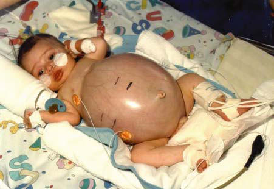

# Chapter 563: Anatomic Abnormalities Associated with Hematuria — Board-Style Self-Assessment MCQs
**Part XXI: Nephrology** | [📖 Read Wiki Chapter](../chapters/563.md) | [🃏 Chapter Flashcards](../flashcards/563_flashcards.md) | [🏠 Course Master Index](../../index.md)

Total questions: **5** *(Click "Show Answer & Rationale" beneath each question)*

### Question 1 (Clinical Pediatrics Vignette)
A pediatric patient is evaluated for the following clinical and diagnostic profile: the causative gene, possibly DZIP1L; Bilateral nephromegaly, heterogenous; parenchymal echogenicity with salt and; pepper pattern; Prenatal onset: bilateral nephromegaly,; oligohydramnios, Potter-like syndrome; Progressive hepatic fibrosis,; Caroli s. Which of the following conditions or syndromes is the most likely diagnosis?

- **A.** CLASSIC ARPKD (Anatomic Abnormalities Associated with Hematuria)
- **B.** PKD1 (Anatomic Abnormalities Associated with Hematuria)
- **C.** ADPKD-GANAB (Anatomic Abnormalities Associated with Hematuria)
- **D.** ADPKD-PKD2 (Anatomic Abnormalities Associated with Hematuria)

<b>Show Answer & Rationale</b>

**Correct Answer: A** — CLASSIC ARPKD (Anatomic Abnormalities Associated with Hematuria)

**Rationale:** **CLASSIC ARPKD (Anatomic Abnormalities Associated with Hematuria)** (associated with **`PKHD1`**) is characterized by: PKHD1, possibly DZIP1L; Bilateral nephromegaly, heterogenous; parenchymal echogenicity with salt and; pepper pattern; Prenatal onset: bilateral nephromegaly,; oligohydramnios, Potter-like syndrome; Progressive hepatic fibrosis,; Caroli syndrome, portal; hypertension.

**Why Other Options Are Incorrect:** **PKD1 (Anatomic Abnormalities Associated with Hematuria)** is incorrect (characterized by ADPKD-PKD1 with truncating; variant; Innumerable bilateral kidney cysts causing; progressive kidney ). **ADPKD-GANAB (Anatomic Abnormalities Associated with Hematuria)** is incorrect (characterized by Bilateral renal cysts, preserved kidney function; Polycystic liver disease, mild to; severe). **ADPKD-PKD2 (Anatomic Abnormalities Associated with Hematuria)** is incorrect (characterized by Innumerable bilateral kidney cysts causing; progressive kidney enlargement and; reduction in eGFR; m).

### Question 2 (Clinical Pediatrics Vignette)
A pediatric patient is evaluated for the following clinical and diagnostic profile: ADPKD-this pediatric condition with truncating; variant; Innumerable bilateral kidney cysts causing; progressive kidney enlargement and reduction; in eGFR; median age at ESKD about 55 years; Polycystic liver disease, mild to; severe, SAH-CNS aneurysm. Which of the following conditions or syndromes is the most likely diagnosis?

- **A.** PKD1 (Anatomic Abnormalities Associated with Hematuria)
- **B.** CLASSIC ARPKD (Anatomic Abnormalities Associated with Hematuria)
- **C.** ADPKD-PKD2 (Anatomic Abnormalities Associated with Hematuria)
- **D.** ADTKD-HNF1B (Anatomic Abnormalities Associated with Hematuria)

<b>Show Answer & Rationale</b>

**Correct Answer: A** — PKD1 (Anatomic Abnormalities Associated with Hematuria)

**Rationale:** **PKD1 (Anatomic Abnormalities Associated with Hematuria)** (associated with **`PKD1`**) is characterized by: ADPKD-PKD1 with truncating; variant; Innumerable bilateral kidney cysts causing; progressive kidney enlargement and reduction; in eGFR; median age at ESKD about 55 years; Polycystic liver disease, mild to; severe, SAH-CNS aneurysms*.

**Why Other Options Are Incorrect:** **CLASSIC ARPKD (Anatomic Abnormalities Associated with Hematuria)** is incorrect (characterized by PKHD1, possibly DZIP1L; Bilateral nephromegaly, heterogenous; parenchymal echogenicity with salt and). **ADPKD-PKD2 (Anatomic Abnormalities Associated with Hematuria)** is incorrect (characterized by Innumerable bilateral kidney cysts causing; progressive kidney enlargement and; reduction in eGFR; m). **ADTKD-HNF1B (Anatomic Abnormalities Associated with Hematuria)** is incorrect (characterized by Bilateral renal cysts in about 45% of affected; individuals, occasionally mimics ADPKD; imaging pres).

### Question 3 (Pediatric Genetics & Molecular Etiology)
A child is diagnosed with **CLASSIC ARPKD (Anatomic Abnormalities Associated with Hematuria)** after presenting with the causative gene, possibly DZIP1L; Bilateral nephromegaly, heterogenous; parenchymal echogenicity with salt and; pepper pattern; Prenatal onset: bilateral nephromegaly,; oligohydramnios, Potter-like syndrome;. Pathogenic variants in which of the following genes are most classically implicated?

- **A.** CASQ2
- **B.** MYBPC3
- **C.** PKHD1
- **D.** COL4A4

<b>Show Answer & Rationale</b>

**Correct Answer: C** — PKHD1

**Rationale:** Pathogenic variants in **`PKHD1`** (Nephrology) are associated with **CLASSIC ARPKD (Anatomic Abnormalities Associated with Hematuria)** (PKHD1, possibly DZIP1L; Bilateral nephromegaly, heterogenous; parenchymal echogenicity with salt and; pepper pattern; Prenatal onset: bilateral nephromegaly,; oligohydramnios, Potter-like syndrome; Progressive hepatic fibrosis,; Caroli syndrome, portal; hypertension).

### Question 4 (Visual Diagnosis & Clinical Spotter)

A pediatric patient undergoes evaluation for **Anatomic Abnormalities Associated with Hematuria**, yielding the clinical or diagnostic finding shown below. Which of the following best characterizes the illustrated finding?

- **A.** Liver involvement is characterized by a basic ductal plate abnor mality that leads to bile duct proliferation and ectasia, as well as progressive hepatic fibrosis.
- **B.** A, Severe nephromegaly in a 3-mo-old infant with autoso mal recessive polycystic kidney disease, with x-rays (B). (From Bakkalo glu SA, Schaefer F. Disease of the kidney and urinary tract in chil
- **C.** Autosomal recessive polycystic kidney disease (ARPKD) (also known as ARPKD-congenital hepatic fibrosis [CHF]) is an autosomal reces sive disorder occurring with an incidence of 1:20,000 and
- **D.** The false-negative rate for genetic diagnosis is approximately 10%.

<b>Show Answer & Rationale</b>

**Correct Answer: B** — A, Severe nephromegaly in a 3-mo-old infant with autoso mal recessive polycystic kidney disease, with x-rays (B). (From Bakkalo glu SA, Schaefer F. Disease of the kidney and urinary tract in chil

**Rationale:** **Fig. 563.1**: A, Severe nephromegaly in a 3-mo-old infant with autoso mal recessive polycystic kidney disease, with x-rays (B). (From Bakkalo glu SA, Schaefer F. Disease of the kidney and urinary tract in children. In: Skorecki K, Chertow GM, Marsden PA, et al., eds. Brenner & Rector’s The Kidney. 10th ed. Philadelphia: Elsevier; 2016: Fig. 74-6, p. 2320.)

### Question 5 (Pediatric Board Mastery (Anatomic Abnormalities Associated with Hematuria))
When formulating an evidence-based diagnostic and management plan for **Anatomic Abnormalities Associated with Hematuria** (*Part XXI: Nephrology*), which of the following pediatric clinical statements is **ACCURATE**? (Item 1)

- **A.** Systemic tetracyclines and fluoroquinolones are universally required as routine prophylaxis in all healthy newborns.
- **B.** Diagnostic confirmation relies solely on plain skull radiographs without biochemical, microbiologic, or clinical correlation.
- **C.** Autosomal recessive polycystic kidney disease (ARPKD) (also known as ARPKD-congenital hepatic fibrosis [CHF]) is an autosomal reces sive disorder occurring with an incidence of 1:20,000 and a gene carrier
- **D.** First-line management relies on immediate high-dose aspirin therapy in febrile infants.

<b>Show Answer & Rationale</b>

**Correct Answer: C** — Autosomal recessive polycystic kidney disease (ARPKD) (also known as ARPKD-congenital hepatic fibrosis [CHF]) is an autosomal reces sive disorder occurring with an incidence of 1:20,000 and a gene carrier

**Rationale:** **Pediatric Clinical Principle (Anatomic Abnormalities Associated with Hematuria):** Autosomal recessive polycystic kidney disease (ARPKD) (also known as ARPKD-congenital hepatic fibrosis [CHF]) is an autosomal reces sive disorder occurring with an incidence of 1:20,000 and a gene carrier rate in the general population of 1/70.

