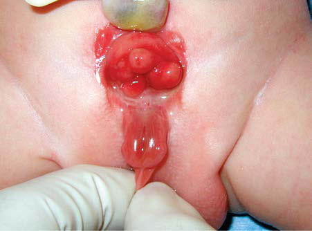

# Chapter 578: Anomalies of the Bladder — Board-Style Self-Assessment MCQs
**Part XXII: Urologic Disorders in Infants and Children** | [📖 Read Wiki Chapter](../chapters/578.md) | [🃏 Chapter Flashcards](../flashcards/578_flashcards.md) | [🏠 Course Master Index](../../index.md)

Total questions: **5** *(Click "Show Answer & Rationale" beneath each question)*

### Question 1 (Clinical Pediatrics Vignette)
A pediatric patient is evaluated for the following clinical and diagnostic profile: The diagnosis is made by a retrograde urethrogram, in which contrast is injected toward the bladder through a catheter inserted into the distal urethra.. Which of the following conditions or syndromes is the most likely diagnosis?

- **A.** CENTRAL OR PERIPHERAL NERVOUS SYSTEM HYPOVENTILATION
- **B.** CORTICAL (Disorders of the Sweat Glands)
- **C.** Associated general history
- **D.** Anomalies of the Bladder

<b>Show Answer & Rationale</b>

**Correct Answer: D** — Anomalies of the Bladder

**Rationale:** **Anomalies of the Bladder** is characterized by: The diagnosis is made by a retrograde urethrogram, in which contrast is injected toward the bladder through a catheter inserted into the distal urethra..

**Why Other Options Are Incorrect:** **CENTRAL OR PERIPHERAL NERVOUS SYSTEM HYPOVENTILATION** is incorrect (characterized by Birth asphyxia; Intracranial hypertension, hemorrhage; Oversedation (direct or through maternal rout). **CORTICAL (Disorders of the Sweat Glands)** is incorrect (characterized by Emotional; Familial dysautonomia; Congenital ichthyosiform; erythroderma; Epidermolysis bullosa; Nai). **Associated general history** is incorrect (characterized by Vomiting without nausea and morning/fasting nausea or vomiting; Polyuria or polydipsia; Preschool or).

### Question 2 (Visual Diagnosis & Clinical Spotter)

A pediatric patient undergoes evaluation for **Anomalies of the Bladder**, yielding the clinical or diagnostic finding shown below. Which of the following best characterizes the illustrated finding?

- **A.** Considering the range of defects associated with exstrophy, prenatal diagnosis is challenging.
- **B.** The diagnosis is suspected on physical examination and is confirmed by VCUG.
- **C.** Classic bladder exstrophy in a newborn male. The bladder is exposed in the midline, the umbilical cord is displaced caudad, the penis is epispadiac, and the scrotum is broad.
- **D.** The diagnosis is made by a retrograde urethrogram, in which contrast is injected toward the bladder through a catheter inserted into the distal urethra.

<b>Show Answer & Rationale</b>

**Correct Answer: C** — Classic bladder exstrophy in a newborn male. The bladder is exposed in the midline, the umbilical cord is displaced caudad, the penis is epispadiac, and the scrotum is broad.

**Rationale:** **Fig. 578.1**: Classic bladder exstrophy in a newborn male. The bladder is exposed in the midline, the umbilical cord is displaced caudad, the penis is epispadiac, and the scrotum is broad.

### Question 3 (Differential Diagnosis (Anomalies of the Bladder))
During a pediatric consultation regarding **Anomalies of the Bladder**, which clinical entity or concept is described by the following profile? "this pediatric condition is a rare form of obstructive uropathy in males that is less severe than urethral atresia."

- **A.** Urethral Hypoplasia
- **B.** URACHAL ANOMALIES
- **C.** BLADDER EXSTROPHY
- **D.** Clinical Manifestations

<b>Show Answer & Rationale</b>

**Correct Answer: A** — Urethral Hypoplasia

**Rationale:** Urethral Hypoplasia Urethral hypoplasia is a rare form of obstructive uropathy in males that is less severe than urethral atresia.

### Question 4 (Differential Diagnosis (Anomalies of the Bladder))
During a pediatric consultation regarding **Anomalies of the Bladder**, which clinical entity or concept is described by the following profile? "this pediatric conditions in males usually result from urethral trauma, either iatrogenic (catheterization, endoscopic procedures, previous urethral reconstruction) or accidental (straddle injuries, pelvic fractures)."

- **A.** BLADDER DIVERTICULA
- **B.** Urethral Stricture
- **C.** COL11A2 (Disorders Involving Cartilage Matrix Proteins)
- **D.** Long-Term Prognosis

<b>Show Answer & Rationale</b>

**Correct Answer: B** — Urethral Stricture

**Rationale:** Urethral Stricture Urethral strictures in males usually result from urethral trauma, either iatrogenic (catheterization, endoscopic procedures, previous urethral reconstruction) or accidental (straddle injuries, pelvic fractures).

### Question 5 (Pediatric Board Mastery (Anomalies of the Bladder))
When formulating an evidence-based diagnostic and management plan for **Anomalies of the Bladder** (*Part XXII: Urologic Disorders in Infants and Children*), which of the following pediatric clinical statements is **ACCURATE**? (Item 1)

- **A.** Diagnostic confirmation relies solely on plain skull radiographs without biochemical, microbiologic, or clinical correlation.
- **B.** The diagnosis is made by a retrograde urethrogram, in which contrast is injected toward the bladder through a catheter inserted into the distal urethra.
- **C.** Inheritance is exclusively holandric (Y-linked) with 100% penetrance restricted to male neonates.
- **D.** Systemic tetracyclines and fluoroquinolones are universally required as routine prophylaxis in all healthy newborns.

<b>Show Answer & Rationale</b>

**Correct Answer: B** — The diagnosis is made by a retrograde urethrogram, in which contrast is injected toward the bladder through a catheter inserted into the distal urethra.

**Rationale:** **Pediatric Clinical Principle (Anomalies of the Bladder):** The diagnosis is made by a retrograde urethrogram, in which contrast is injected toward the bladder through a catheter inserted into the distal urethra.

