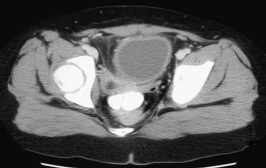

# Chapter 579: Neuropathic Bladder — Board-Style Self-Assessment MCQs
**Part XXII: Urologic Disorders in Infants and Children** | [📖 Read Wiki Chapter](../chapters/579.md) | [🃏 Chapter Flashcards](../flashcards/579_flashcards.md) | [🏠 Course Master Index](../../index.md)

Total questions: **5** *(Click "Show Answer & Rationale" beneath each question)*

### Question 1 (Clinical Pediatrics Vignette)
A pediatric patient is evaluated for the following clinical and diagnostic profile: Neural tube defect; Occult forms of neural tube defect (lipomeningocele and other; spinal dysraphisms); Sacral agenesis; Anorectal malformations. Which of the following conditions or syndromes is the most likely diagnosis?

- **A.** EAR (Vitamin B Complex Deficiencies and Excess)
- **B.** CONGENITAL (Neuropathic Bladder)
- **C.** ACQUIRED (Neuropathic Bladder)
- **D.** INTEGUMENTARY SYSTEM

<b>Show Answer & Rationale</b>

**Correct Answer: B** — CONGENITAL (Neuropathic Bladder)

**Rationale:** **CONGENITAL (Neuropathic Bladder)** is characterized by: Neural tube defect; Occult forms of neural tube defect (lipomeningocele and other; spinal dysraphisms); Sacral agenesis; Anorectal malformations.

**Why Other Options Are Incorrect:** **EAR (Vitamin B Complex Deficiencies and Excess)** is incorrect (characterized by Thiamine; (vitamin B1); Coenzyme in carbohydrate; metabolism; Nucleic acid; synthesis; Neurotransmit). **ACQUIRED (Neuropathic Bladder)** is incorrect (characterized by Extensive pelvic surgery; Central nervous system disorders; Cerebral palsy; Conditions of the brain ). **INTEGUMENTARY SYSTEM** is incorrect (characterized by • Constrictive clothing, shoes, or orthotics; • Blisters; • Burns, sunburn, or frostbite; • Ingrown ).

### Question 2 (Clinical Pediatrics Vignette)
A pediatric patient is evaluated for the following clinical and diagnostic profile: Extensive pelvic surgery; Central nervous system disorders; Cerebral palsy; Conditions of the brain (tumors, infarcts, encephalopathies); Spinal cord insults; Trauma; Transverse myelitis; From Partin AW, Dmochowski RR, Kavoussi LR, Peters CW, eds. Ca. Which of the following conditions or syndromes is the most likely diagnosis?

- **A.** ACQUIRED (Neuropathic Bladder)
- **B.** GENOTYPIC FEATURES
- **C.** CONGENITAL (Neuropathic Bladder)
- **D.** Cardiovascular System

<b>Show Answer & Rationale</b>

**Correct Answer: A** — ACQUIRED (Neuropathic Bladder)

**Rationale:** **ACQUIRED (Neuropathic Bladder)** is characterized by: Extensive pelvic surgery; Central nervous system disorders; Cerebral palsy; Conditions of the brain (tumors, infarcts, encephalopathies); Spinal cord insults; Trauma; Transverse myelitis; From Partin AW, Dmochowski RR, Kavoussi LR, Peters CW, eds. Campbell-Walsh; Urology, 12th ed. Philadelphia: Elsevier; 2021: Box 34-1.

**Why Other Options Are Incorrect:** **GENOTYPIC FEATURES** is incorrect (characterized by Adenosine deaminase; deficiency; Autoimmune hemolytic anemia, reduced erythrocyte adenosine; deamina). **CONGENITAL (Neuropathic Bladder)** is incorrect (characterized by Neural tube defect; Occult forms of neural tube defect (lipomeningocele and other; spinal dysraphism). **Cardiovascular System** is incorrect (characterized by Myocarditis, pericarditis, valvular regurgitation, cardiogenic; shock; Coronary artery abnormalities).

### Question 3 (Visual Diagnosis & Clinical Spotter)

A pediatric patient undergoes evaluation for **Neuropathic Bladder**, yielding the clinical or diagnostic finding shown below. Which of the following best characterizes the illustrated finding?

- **A.** A, CT scan demonstrating infected urachal abscess in an 8-yr-old child. The condition was managed by drainage and excision. B, Cystoscopic view of 10-yr-old child with new-onset daytime frequency
- **B.** Patients with this complication typically present with severe abdominal pain and signs of peritonitis.
- **C.** Long-term results from one large clinical trial of in utero closure have not shown a definite improvement in lower urinary tract function, although some children have demonstrated nearly nor
- **D.** Renal Damage Renal damage usually results from detrusor-sphincter dyssynergia.

<b>Show Answer & Rationale</b>

**Correct Answer: A** — A, CT scan demonstrating infected urachal abscess in an 8-yr-old child. The condition was managed by drainage and excision. B, Cystoscopic view of 10-yr-old child with new-onset daytime frequency

**Rationale:** **Fig. 578.6**: A, CT scan demonstrating infected urachal abscess in an 8-yr-old child. The condition was managed by drainage and excision. B, Cystoscopic view of 10-yr-old child with new-onset daytime frequency and incontinence secondary to infected urachal cyst.

### Question 4 (Differential Diagnosis (Neuropathic Bladder))
During a pediatric consultation regarding **Neuropathic Bladder**, which clinical entity or concept is described by the following profile? "have not shown a definite improvement in lower urinary tract function, although some children have demonstrated nearly normal bladder function."

- **A.** disease), myopathy
- **B.** DETERMINING TYPE BASED ON CLINICAL FINDINGS
- **C.** in utero closure
- **D.** Bladder Calculi

<b>Show Answer & Rationale</b>

**Correct Answer: C** — in utero closure

**Rationale:** in utero closure have not shown a definite improvement in lower urinary tract function, although some children have demonstrated nearly normal bladder function.

### Question 5 (Pediatric Board Mastery (Neuropathic Bladder))
When formulating an evidence-based diagnostic and management plan for **Neuropathic Bladder** (*Part XXII: Urologic Disorders in Infants and Children*), which of the following pediatric clinical statements is **ACCURATE**? (Item 1)

- **A.** First-line management relies on immediate high-dose aspirin therapy in febrile infants.
- **B.** Clinical manifestations are permanently restricted to late adulthood and never present during infancy, childhood, or adolescence.
- **C.** The condition is an entirely benign physiologic variant that never warrants laboratory or clinical evaluation.
- **D.** Long-term results from one large clinical trial of in utero closure have not shown a definite improvement in lower urinary tract function, although some children have demonstrated nearly normal bladder fun

<b>Show Answer & Rationale</b>

**Correct Answer: D** — Long-term results from one large clinical trial of in utero closure have not shown a definite improvement in lower urinary tract function, although some children have demonstrated nearly normal bladder fun

**Rationale:** **Pediatric Clinical Principle (Neuropathic Bladder):** Long-term results from one large clinical trial of in utero closure have not shown a definite improvement in lower urinary tract function, although some children have demonstrated nearly normal bladder function.

