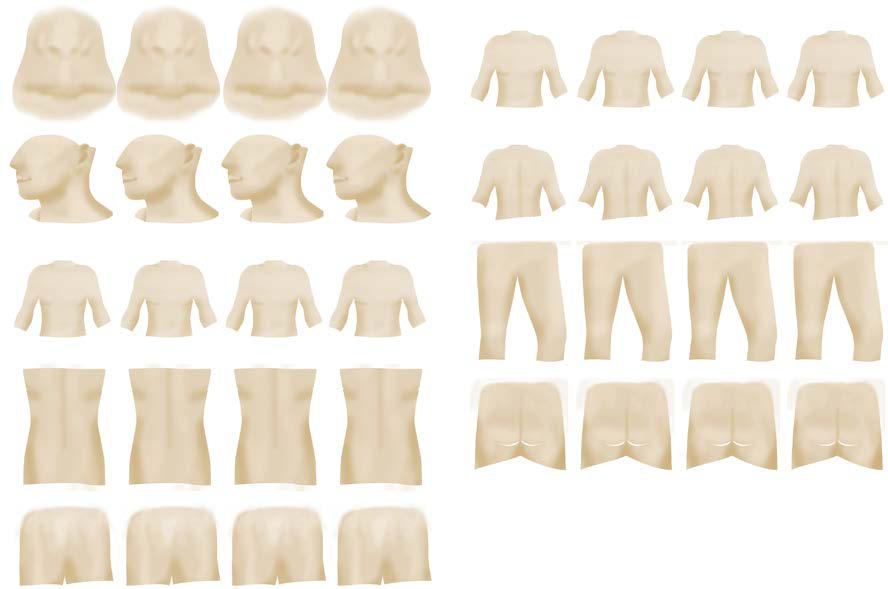

# Chapter 589: Polycystic Ovary Syndrome and Hirsutism — Board-Style Self-Assessment MCQs
**Part XXIII: Gynecologic Problems of Childhood** | [📖 Read Wiki Chapter](../chapters/589.md) | [🃏 Chapter Flashcards](../flashcards/589_flashcards.md) | [🏠 Course Master Index](../../index.md)

Total questions: **5** *(Click "Show Answer & Rationale" beneath each question)*

### Question 1 (Clinical Pediatrics Vignette)
A pediatric patient is evaluated for the following clinical and diagnostic profile: Oligoovulation or anovulation; and; Clinical or biochemical hyperandrogenism; Two of three of the following:; • Oligoovulation or anovulation; • Polycystic ovaries on ultrasonography (20 or more; follicles in a single ovary or ovarian volume; of > 10. Which of the following conditions or syndromes is the most likely diagnosis?

- **A.** ANDROGEN EXCESS SOCIETY
- **B.** REPRODUCTIVE (Polycystic Ovary Syndrome and Hirsutism)
- **C.** MILD PCOS (Polycystic Ovary Syndrome and Hirsutism)
- **D.** METABOLIC (Polycystic Ovary Syndrome and Hirsutism)

<b>Show Answer & Rationale</b>

**Correct Answer: A** — ANDROGEN EXCESS SOCIETY

**Rationale:** **ANDROGEN EXCESS SOCIETY** is characterized by: Oligoovulation or anovulation; and; Clinical or biochemical hyperandrogenism; Two of three of the following:; • Oligoovulation or anovulation; • Polycystic ovaries on ultrasonography (20 or more; follicles in a single ovary or ovarian volume; of > 10 mm3 in one ovary); • Clinical and/or biochemical hyperandrogenism; Cl.

**Why Other Options Are Incorrect:** **REPRODUCTIVE (Polycystic Ovary Syndrome and Hirsutism)** is incorrect (characterized by Premature; adrenarche; Early menarche; Menstrual irregularity; Hirsutism; Acne; Infertility; Endomet). **MILD PCOS (Polycystic Ovary Syndrome and Hirsutism)** is incorrect (characterized by Periods; Irregular; Irregular; Normal; Irregular; Ovaries on ultrasonography; Polycystic; Normal; Po). **METABOLIC (Polycystic Ovary Syndrome and Hirsutism)** is incorrect (characterized by Abnormal fetal; growth; Obesity; Impaired glucose; tolerance; Insulin resistance; Dyslipidemia; Type).

### Question 2 (Clinical Pediatrics Vignette)
A pediatric patient is evaluated for the following clinical and diagnostic profile: Periods; Irregular; Irregular; Normal; Irregular; Ovaries on ultrasonography; Polycystic; Normal; Polycystic; Polycystic; Androgen concentrations; High; High; High; Mildly raised; Insulin concentrations; Increased; Increased; Increased; Normal; Risks. Which of the following conditions or syndromes is the most likely diagnosis?

- **A.** METABOLIC (Polycystic Ovary Syndrome and Hirsutism)
- **B.** REPRODUCTIVE (Polycystic Ovary Syndrome and Hirsutism)
- **C.** ANDROGEN EXCESS SOCIETY
- **D.** MILD PCOS (Polycystic Ovary Syndrome and Hirsutism)

<b>Show Answer & Rationale</b>

**Correct Answer: D** — MILD PCOS (Polycystic Ovary Syndrome and Hirsutism)

**Rationale:** **MILD PCOS (Polycystic Ovary Syndrome and Hirsutism)** is characterized by: Periods; Irregular; Irregular; Normal; Irregular; Ovaries on ultrasonography; Polycystic; Normal; Polycystic; Polycystic; Androgen concentrations; High; High; High; Mildly raised; Insulin concentrations; Increased; Increased; Increased; Normal; Risks; Potential long term; Potential long term; Unknown; Unknown; Prevalen.

**Why Other Options Are Incorrect:** **METABOLIC (Polycystic Ovary Syndrome and Hirsutism)** is incorrect (characterized by Abnormal fetal; growth; Obesity; Impaired glucose; tolerance; Insulin resistance; Dyslipidemia; Type). **REPRODUCTIVE (Polycystic Ovary Syndrome and Hirsutism)** is incorrect (characterized by Premature; adrenarche; Early menarche; Menstrual irregularity; Hirsutism; Acne; Infertility; Endomet). **ANDROGEN EXCESS SOCIETY** is incorrect (characterized by Oligoovulation or anovulation; and; Clinical or biochemical hyperandrogenism; Two of three of the fo).

### Question 3 (Visual Diagnosis & Clinical Spotter)

A pediatric patient undergoes evaluation for **Polycystic Ovary Syndrome and Hirsutism**, yielding the clinical or diagnostic finding shown below. Which of the following best characterizes the illustrated finding?

- **A.** Complications and Long-Term Outlook Management of the features of hyperandrogenism, assistance with fer tility, prevention of endometrial cancer, and reduction in the likelihood and severity
- **B.** Gender-neutral modified Ferriman-Gallwey (mFG) diagram. (From Grimstad F, Moyer Q, Williams CR, Kremen J. A body-neutral and gender-neutral modified Ferriman-Gallwey diagram. J Pediatr Adolesc Gy
- **C.** Insulin resistance is common among females with PCOS, and although not requisite for diagnosis, it should be considered when PCOS is identified.
- **D.** Laboratory Findings, Diagnosis, and Differential Diagnosis The diagnosis of PCOS requires exclusion of disorders that would otherwise account for hyperandrogenism and anovulation.

<b>Show Answer & Rationale</b>

**Correct Answer: B** — Gender-neutral modified Ferriman-Gallwey (mFG) diagram. (From Grimstad F, Moyer Q, Williams CR, Kremen J. A body-neutral and gender-neutral modified Ferriman-Gallwey diagram. J Pediatr Adolesc Gy

**Rationale:** **Fig. 589.2**: Gender-neutral modified Ferriman-Gallwey (mFG) diagram. (From Grimstad F, Moyer Q, Williams CR, Kremen J. A body-neutral and gender-neutral modified Ferriman-Gallwey diagram. J Pediatr Adolesc Gynecol. 2021;S1083-318800334-X. Fig 2.)

### Question 4 (Differential Diagnosis (Polycystic Ovary Syndrome and Hirsutism))
During a pediatric consultation regarding **Polycystic Ovary Syndrome and Hirsutism**, which clinical entity or concept is described by the following profile? "greater and more prevalent among females with PCOS than controls even when accounting for body mass index (BMI)."

- **A.** Clinical Manifestations
- **B.** TYPE 2N (Von Willebrand Disease)
- **C.** insulin resistance
- **D.** ANDROGEN EXCESS SOCIETY

<b>Show Answer & Rationale</b>

**Correct Answer: C** — insulin resistance

**Rationale:** insulin resistance are greater and more prevalent among females with PCOS than controls even when accounting for body mass index (BMI).

### Question 5 (Pediatric Board Mastery (Polycystic Ovary Syndrome and Hirsutism))
When formulating an evidence-based diagnostic and management plan for **Polycystic Ovary Syndrome and Hirsutism** (*Part XXIII: Gynecologic Problems of Childhood*), which of the following pediatric clinical statements is **ACCURATE**? (Item 1)

- **A.** Systemic tetracyclines and fluoroquinolones are universally required as routine prophylaxis in all healthy newborns.
- **B.** First-line management relies on immediate high-dose aspirin therapy in febrile infants.
- **C.** Laboratory Findings, Diagnosis, and Differential Diagnosis The diagnosis of PCOS requires exclusion of disorders that would otherwise account for hyperandrogenism and anovulation.
- **D.** Diagnostic confirmation relies solely on plain skull radiographs without biochemical, microbiologic, or clinical correlation.

<b>Show Answer & Rationale</b>

**Correct Answer: C** — Laboratory Findings, Diagnosis, and Differential Diagnosis The diagnosis of PCOS requires exclusion of disorders that would otherwise account for hyperandrogenism and anovulation.

**Rationale:** **Pediatric Clinical Principle (Polycystic Ovary Syndrome and Hirsutism):** Laboratory Findings, Diagnosis, and Differential Diagnosis The diagnosis of PCOS requires exclusion of disorders that would otherwise account for hyperandrogenism and anovulation.

