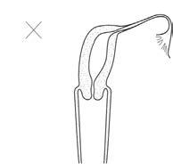

# Chapter 591: Vulvovaginal and Müllerian Anomalies — Board-Style Self-Assessment MCQs
**Part XXIII: Gynecologic Problems of Childhood** | [📖 Read Wiki Chapter](../chapters/591.md) | [🃏 Chapter Flashcards](../flashcards/591_flashcards.md) | [🏠 Course Master Index](../../index.md)

Total questions: **5** *(Click "Show Answer & Rationale" beneath each question)*

### Question 1 (Clinical Pediatrics Vignette)
A pediatric patient is evaluated for the following clinical and diagnostic profile: Agenesis; Absence of uterus, cervix, and upper; portion of vagina; Hypoplasia; Incomplete development of uterus,; cervix, and upper portion of vagina; Unicornuate uterus; One cervix and one uterine horn, the; result of failure of one Müllerian; duct . Which of the following conditions or syndromes is the most likely diagnosis?

- **A.** DESCRIPTION (Vulvovaginal and Müllerian Anomalies)
- **B.** TENDERNESS (Acute Mastoiditis)
- **C.** Infection (Disorders of the Sweat Glands)
- **D.** COVID-19 (Feeding Healthy Infants, Children, and Adolescents)

<b>Show Answer & Rationale</b>

**Correct Answer: A** — DESCRIPTION (Vulvovaginal and Müllerian Anomalies)

**Rationale:** **DESCRIPTION (Vulvovaginal and Müllerian Anomalies)** is characterized by: Agenesis; Absence of uterus, cervix, and upper; portion of vagina; Hypoplasia; Incomplete development of uterus,; cervix, and upper portion of vagina; Unicornuate uterus; One cervix and one uterine horn, the; result of failure of one Müllerian; duct to descend; Septate uterus; Septum dividing the uterus, partially; or .

**Why Other Options Are Incorrect:** **TENDERNESS (Acute Mastoiditis)** is incorrect (characterized by Acute mastoiditis; with periostitis; May be absent; Yes; No; Usually; No; Usually; Acute; mastoiditi). **Infection (Disorders of the Sweat Glands)** is incorrect (characterized by Defervescence; Chronic illness). **COVID-19 (Feeding Healthy Infants, Children, and Adolescents)** is incorrect (characterized by Maternal infection is not a contraindication for; breastfeeding or feeding expressed milk.; Ebola; C).

### Question 2 (Clinical Pediatrics Vignette)
A pediatric patient is evaluated for the following clinical and diagnostic profile: Autosomal; dominant; Camptobrachydactyly; Longitudinal vaginal; septum; Hand-foot-genital; Incomplete Müllerian; fusion; Denys-Drash; Persistent Müllerian duct; derivatives; Autosomal; recessive; McKusick-Kaufman; Vaginal atresia,; transverse vaginal. Which of the following conditions or syndromes is the most likely diagnosis?

- **A.** GUIDANCE FOR PEDIATRICIANS
- **B.** MÜLLERIAN DEFECT (Vulvovaginal and Müllerian Anomalies)
- **C.** CSF. (Central Nervous System Infections)
- **D.** CONNECTIVE TISSUE DISEASES

<b>Show Answer & Rationale</b>

**Correct Answer: B** — MÜLLERIAN DEFECT (Vulvovaginal and Müllerian Anomalies)

**Rationale:** **MÜLLERIAN DEFECT (Vulvovaginal and Müllerian Anomalies)** is characterized by: Autosomal; dominant; Camptobrachydactyly; Longitudinal vaginal; septum; Hand-foot-genital; Incomplete Müllerian; fusion; Denys-Drash; Persistent Müllerian duct; derivatives; Autosomal; recessive; McKusick-Kaufman; Vaginal atresia,; transverse vaginal; septum; Johanson-Blizzard; Longitudinal vaginal; septum; Renal-genit.

**Why Other Options Are Incorrect:** **GUIDANCE FOR PEDIATRICIANS** is incorrect (characterized by Health supervision; Physical health and; growth; Nutrition; Vision/hearing; Immunizations; Anticipat). **CSF. (Central Nervous System Infections)** is incorrect (characterized by Fungal meningitis; Usually elevated; 5-500; PMNs early,; but mononuclear; cells predominate; for mos). **CONNECTIVE TISSUE DISEASES** is incorrect (characterized by Systemic lupus erythematosus, rheumatoid arthritis, Sjögren; syndrome, dermatomyositis, mixed connec).

### Question 3 (Visual Diagnosis & Clinical Spotter)

A pediatric patient undergoes evaluation for **Vulvovaginal and Müllerian Anomalies**, yielding the clinical or diagnostic finding shown below. Which of the following best characterizes the illustrated finding?

- **A.** Overall, data shows that prevention strate gies such as widespread implementation of HPV vaccine translates into reduced incidence of cervical cancer in the future.
- **B.** Other conditions featuring the presence of Mül lerian derivatives in males are Denys-Drash syndrome (characterized by gonadal dysgenesis), nephropathy, and Wilms tumor, each caused by pathog
- **C.** One example is persistent Müllerian duct syndrome (PMDS), which is characterized by the presence of Mülle rian structures usually associated with undescended testes.
- **D.** Classification system of Müllerian duct anomalies developed by the American Society of Reproductive Medicine. (From Pfeifer SM, At taran M, Goldstein J, et al. ASRM Müllerian anomalies classifica

<b>Show Answer & Rationale</b>

**Correct Answer: D** — Classification system of Müllerian duct anomalies developed by the American Society of Reproductive Medicine. (From Pfeifer SM, At taran M, Goldstein J, et al. ASRM Müllerian anomalies classifica

**Rationale:** **Fig. 591.2**: Classification system of Müllerian duct anomalies developed by the American Society of Reproductive Medicine. (From Pfeifer SM, At taran M, Goldstein J, et al. ASRM Müllerian anomalies classification 2021. Fertil Steril. 2021;116:1238-1252; Fig 1.)

### Question 4 (Differential Diagnosis (Vulvovaginal and Müllerian Anomalies))
During a pediatric consultation regarding **Vulvovaginal and Müllerian Anomalies**, which clinical entity or concept is described by the following profile? "The formation of a normal reproductive system occurs in the developing embryo and early fetus and is regulated by several processes, including cel lular differentiation, duct elongation, fusion, resorption, canalization, and programmed cell death."

- **A.** Arcuate Uterus
- **B.** Unicornuate Uterus and Rudimentary Horns
- **C.** mucocolpos
- **D.** EMBRYOLOGY

<b>Show Answer & Rationale</b>

**Correct Answer: D** — EMBRYOLOGY

**Rationale:** EMBRYOLOGY The formation of a normal reproductive system occurs in the developing embryo and early fetus and is regulated by several processes, including cel lular differentiation, duct elongation, fusion, resorption, canalization, and programmed cell death.

### Question 5 (Pediatric Board Mastery (Vulvovaginal and Müllerian Anomalies))
When formulating an evidence-based diagnostic and management plan for **Vulvovaginal and Müllerian Anomalies** (*Part XXIII: Gynecologic Problems of Childhood*), which of the following pediatric clinical statements is **ACCURATE**? (Item 1)

- **A.** Clinical manifestations are permanently restricted to late adulthood and never present during infancy, childhood, or adolescence.
- **B.** First-line management relies on immediate high-dose aspirin therapy in febrile infants.
- **C.** Systemic tetracyclines and fluoroquinolones are universally required as routine prophylaxis in all healthy newborns.
- **D.** Overall, data shows that prevention strate gies such as widespread implementation of HPV vaccine translates into reduced incidence of cervical cancer in the future.

<b>Show Answer & Rationale</b>

**Correct Answer: D** — Overall, data shows that prevention strate gies such as widespread implementation of HPV vaccine translates into reduced incidence of cervical cancer in the future.

**Rationale:** **Pediatric Clinical Principle (Vulvovaginal and Müllerian Anomalies):** Overall, data shows that prevention strate gies such as widespread implementation of HPV vaccine translates into reduced incidence of cervical cancer in the future.

