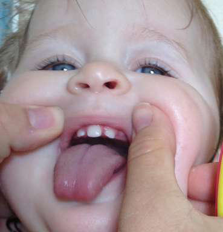

# Chapter 595: Hypopituitarism — Board-Style Self-Assessment MCQs
**Part XXIV: The Endocrine System** | [📖 Read Wiki Chapter](../chapters/595.md) | [🃏 Chapter Flashcards](../flashcards/595_flashcards.md) | [🏠 Course Master Index](../../index.md)

Total questions: **5** *(Click "Show Answer & Rationale" beneath each question)*

### Question 1 (Clinical Pediatrics Vignette)
A pediatric patient is evaluated for the following clinical and diagnostic profile: GH, PRL deficiencies, variable TSH deficiency. Which of the following conditions or syndromes is the most likely diagnosis?

- **A.** TPIT (Hypopituitarism)
- **B.** LHX3 (Hypopituitarism)
- **C.** HESX1 (Hypopituitarism)
- **D.** POU1F1 (PIT1) (Hypopituitarism)

<b>Show Answer & Rationale</b>

**Correct Answer: D** — POU1F1 (PIT1) (Hypopituitarism)

**Rationale:** **POU1F1 (PIT1) (Hypopituitarism)** (associated with **`POU1F1, PIT1`**) is characterized by: GH, PRL deficiencies, variable TSH deficiency.

**Why Other Options Are Incorrect:** **TPIT (Hypopituitarism)** is incorrect (characterized by ACTH deficiency, severe neonatal form). **LHX3 (Hypopituitarism)** is incorrect (characterized by GH, TSH, PRL, LH, FSH deficiencies, variable AP, ± short neck, limited neck rotation,; sensorineural). **HESX1 (Hypopituitarism)** is incorrect (characterized by GH deficiency, variable for others, small AP, EPP, optic nerve hypoplasia; septo-optic dysplasia).

### Question 2 (Clinical Pediatrics Vignette)
A pediatric patient is evaluated for the following clinical and diagnostic profile: GH, TSH, PRL, LH, FSH deficiencies, variable ACTH deficiency, variable AP. Which of the following conditions or syndromes is the most likely diagnosis?

- **A.** PROP1 (Hypopituitarism)
- **B.** LHX4 (Hypopituitarism)
- **C.** HESX1 (Hypopituitarism)
- **D.** POU1F1 (PIT1) (Hypopituitarism)

<b>Show Answer & Rationale</b>

**Correct Answer: A** — PROP1 (Hypopituitarism)

**Rationale:** **PROP1 (Hypopituitarism)** (associated with **`PROP1`**) is characterized by: GH, TSH, PRL, LH, FSH deficiencies, variable ACTH deficiency, variable AP.

**Why Other Options Are Incorrect:** **LHX4 (Hypopituitarism)** is incorrect (characterized by GH, TSH, ACTH deficiencies, small AP, EPP, variable Arnold-Chiari, cerebellar abnormalities). **HESX1 (Hypopituitarism)** is incorrect (characterized by GH deficiency, variable for others, small AP, EPP, optic nerve hypoplasia; septo-optic dysplasia). **POU1F1 (PIT1) (Hypopituitarism)** is incorrect (characterized by GH, PRL deficiencies, variable TSH deficiency).

### Question 3 (Pediatric Genetics & Molecular Etiology)
A child is diagnosed with **POU1F1 (PIT1) (Hypopituitarism)** after presenting with GH, PRL deficiencies, variable TSH deficiency. Pathogenic variants in which of the following genes are most classically implicated?

- **A.** PKD1
- **B.** POU1F1
- **C.** GATA2
- **D.** TRPC6

<b>Show Answer & Rationale</b>

**Correct Answer: B** — POU1F1

**Rationale:** Pathogenic variants in **`POU1F1`** (The Endocrine System) are associated with **POU1F1 (PIT1) (Hypopituitarism)** (GH, PRL deficiencies, variable TSH deficiency).

**Why Other Options Are Incorrect:** **PKD1** is incorrect (associated with PKD1 (Anatomic Abnormalities Associated with Hematuria)). **GATA2** is incorrect (associated with Natural Killer Cells). **TRPC6** is incorrect (associated with Nephrotic Syndrome (Typical)).

### Question 4 (Visual Diagnosis & Clinical Spotter)

A pediatric patient undergoes evaluation for **Hypopituitarism**, yielding the clinical or diagnostic finding shown below. Which of the following best characterizes the illustrated finding?

- **A.** Solitary median maxillary central incisor at age 16 mo. (From Giannopoulou EZ, Rohrer T, Hoffmann P, et al. Solitary median maxillary central incisor. J Pediatr. 2015;167:770, Fig. 2.)
- **B.** The median age at diagnosis of GHD is around 6 years.
- **C.** Deletions of one or two base pairs in exon 2 are most common, followed by missense, nonsense, and splice-site pathogenic mutations.
- **D.** Although no genetic alteration can be identified in most patients with MPHD, pathogenic variants of PROP1* are the most common explanation for recessive MPHD and are 10 times as common as th

<b>Show Answer & Rationale</b>

**Correct Answer: A** — Solitary median maxillary central incisor at age 16 mo. (From Giannopoulou EZ, Rohrer T, Hoffmann P, et al. Solitary median maxillary central incisor. J Pediatr. 2015;167:770, Fig. 2.)

**Rationale:** **Fig. 595.1**: Solitary median maxillary central incisor at age 16 mo. (From Giannopoulou EZ, Rohrer T, Hoffmann P, et al. Solitary median maxillary central incisor. J Pediatr. 2015;167:770, Fig. 2.)

### Question 5 (Pediatric Board Mastery (Hypopituitarism))
When formulating an evidence-based diagnostic and management plan for **Hypopituitarism** (*Part XXIV: The Endocrine System*), which of the following pediatric clinical statements is **ACCURATE**? (Item 1)

- **A.** Diagnostic confirmation relies solely on plain skull radiographs without biochemical, microbiologic, or clinical correlation.
- **B.** Although no genetic alteration can be identified in most patients with MPHD, pathogenic variants of PROP1* are the most common explanation for recessive MPHD and are 10 times as common as the combined tota
- **C.** Systemic tetracyclines and fluoroquinolones are universally required as routine prophylaxis in all healthy newborns.
- **D.** First-line management relies on immediate high-dose aspirin therapy in febrile infants.

<b>Show Answer & Rationale</b>

**Correct Answer: B** — Although no genetic alteration can be identified in most patients with MPHD, pathogenic variants of PROP1* are the most common explanation for recessive MPHD and are 10 times as common as the combined tota

**Rationale:** **Pediatric Clinical Principle (Hypopituitarism):** Although no genetic alteration can be identified in most patients with MPHD, pathogenic variants of PROP1* are the most common explanation for recessive MPHD and are 10 times as common as the combined total of alterations in other pituitary transcription factor genes.

