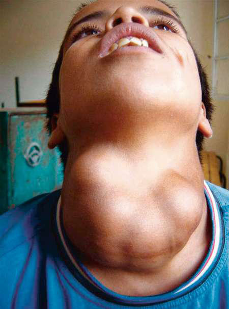

# Chapter 605: Goiter — Board-Style Self-Assessment MCQs
**Part XXIV: The Endocrine System** | [📖 Read Wiki Chapter](../chapters/605.md) | [🃏 Chapter Flashcards](../flashcards/605_flashcards.md) | [🏠 Course Master Index](../../index.md)

Total questions: **5** *(Click "Show Answer & Rationale" beneath each question)*

### Question 1 (Clinical Pediatrics Vignette)
A pediatric patient is evaluated for the following clinical and diagnostic profile: Cassava, lima beans,; linseed, sorghum, sweet; potato; Contain cyanogenic glucosides that; are metabolized to thiocyanates that; compete with iodine for uptake by; the thyroid; Cruciferous vegetables; (cabbage, kale, cauliflower,; broccoli, turnips);. Which of the following conditions or syndromes is the most likely diagnosis?

- **A.** INDUSTRIAL POLLUTANTS
- **B.** BPT (Psychotherapy)
- **C.** POSSIBLE CONDITIONS
- **D.** FOODS (Goiter)

<b>Show Answer & Rationale</b>

**Correct Answer: D** — FOODS (Goiter)

**Rationale:** **FOODS (Goiter)** is characterized by: Cassava, lima beans,; linseed, sorghum, sweet; potato; Contain cyanogenic glucosides that; are metabolized to thiocyanates that; compete with iodine for uptake by; the thyroid; Cruciferous vegetables; (cabbage, kale, cauliflower,; broccoli, turnips); Contain glucosinolates; metabolites; compete with iodine for uptake b.

**Why Other Options Are Incorrect:** **INDUSTRIAL POLLUTANTS** is incorrect (characterized by Perchlorate; Competitive inhibitor of the sodium-; iodide symporter, decreasing iodide; transport in). **BPT (Psychotherapy)** is incorrect (characterized by Behavioral classroom management; Behavioral peer interventions; Organization (executive function); t). **POSSIBLE CONDITIONS** is incorrect (characterized by Toxic inhalation; Sickle cell acute chest syndrome; Hypersecretory and near-fatal asthma (eosinophil).

### Question 2 (Clinical Pediatrics Vignette)
A pediatric patient is evaluated for the following clinical and diagnostic profile: Perchlorate; Competitive inhibitor of the sodium-; iodide symporter, decreasing iodide; transport into the thyroid; Others (e.g., disulfides; from coal processes); Reduce thyroidal iodine uptake; Smoking; Smoking during breastfeeding is; associated w. Which of the following conditions or syndromes is the most likely diagnosis?

- **A.** NOSE (Sleep Medicine)
- **B.** INDUSTRIAL POLLUTANTS
- **C.** Hepatitis B Virus (HBV) Perinatal Prophylaxis
- **D.** RIME (Common Lesions of the Oral Soft Tissues)

<b>Show Answer & Rationale</b>

**Correct Answer: B** — INDUSTRIAL POLLUTANTS

**Rationale:** **INDUSTRIAL POLLUTANTS** is characterized by: Perchlorate; Competitive inhibitor of the sodium-; iodide symporter, decreasing iodide; transport into the thyroid; Others (e.g., disulfides; from coal processes); Reduce thyroidal iodine uptake; Smoking; Smoking during breastfeeding is; associated with reduced iodine; concentrations in breast milk; high; serum concent.

**Why Other Options Are Incorrect:** **NOSE (Sleep Medicine)** is incorrect (characterized by Anterior nasal stenosis; Choanal stenosis/atresia; Deviated nasal septum; Seasonal or perennial rhin). **Hepatitis B Virus (HBV) Perinatal Prophylaxis** is incorrect (characterized by 90% neonatal chronicity without prophylaxis; give HBV vaccine + HBIG 0.5 mL IM within 12 hr of birth). **RIME (Common Lesions of the Oral Soft Tissues)** is incorrect (characterized by Mycoplasma and other agents;; predominant oral ulcerations; with scattered cutaneous lesions).

### Question 3 (Visual Diagnosis & Clinical Spotter)

A pediatric patient undergoes evaluation for **Goiter**, yielding the clinical or diagnostic finding shown below. Which of the following best characterizes the illustrated finding?

- **A.** Goiter often results from increased pituitary secretion of thyroid-stimulating hormone (TSH) in response to decreased circulating levels of thyroid hormone.
- **B.** Congenital goiter usually results from a defect in fetal thyroxine (T4) synthesis that leads to neonatal hypothyroidism.
- **C.** A 14-yr-old male with a large nodular goiter was seen in 2004, in an area of severe iodine-deficiency disorders in northern Mo- rocco. He had tracheal and esophageal compression and hoarseness, p
- **D.** The most common causes of pediatric goiter are inflammation (autoimmune thyroiditis) and, in endemic areas, iodine deficiency (endemic goiter).

<b>Show Answer & Rationale</b>

**Correct Answer: C** — A 14-yr-old male with a large nodular goiter was seen in 2004, in an area of severe iodine-deficiency disorders in northern Mo- rocco. He had tracheal and esophageal compression and hoarseness, p

**Rationale:** **Fig. 605.2**: A 14-yr-old male with a large nodular goiter was seen in 2004, in an area of severe iodine-deficiency disorders in northern Mo- rocco. He had tracheal and esophageal compression and hoarseness, probably as a result of damage to the recurrent laryngeal nerves. (From Zimmermann MB, Jooste PL, Pandav CS. Iodine-deficiency disorders. Lancet. 2008;372:1251–1262, Fig. 2.)

### Question 4 (Differential Diagnosis (605.3 Endemic Goiter and Cretinism Ari J. Wassner and Jessica R. Smith))
During a pediatric consultation regarding **Goiter**, which clinical entity or concept is described by the following profile? "Goiter caused by iodine deficiency is termed endemic goiter, whereas cre- tinism refers to the clinical manifestations of severe hypothyroidism in early life."

- **A.** ETIOLOGY
- **B.** NON-NEONATAL/NONGENITOURINARY INFECTIONS
- **C.** IODIDE GOITER
- **D.** McCune-Albright syndrome

<b>Show Answer & Rationale</b>

**Correct Answer: A** — ETIOLOGY

**Rationale:** ETIOLOGY Goiter caused by iodine deficiency is termed endemic goiter, whereas cre- tinism refers to the clinical manifestations of severe hypothyroidism in early life.

### Question 5 (Pediatric Board Mastery (Goiter))
When formulating an evidence-based diagnostic and management plan for **Goiter** (*Part XXIV: The Endocrine System*), which of the following pediatric clinical statements is **ACCURATE**? (Item 1)

- **A.** Systemic tetracyclines and fluoroquinolones are universally required as routine prophylaxis in all healthy newborns.
- **B.** First-line management relies on immediate high-dose aspirin therapy in febrile infants.
- **C.** Goiter often results from increased pituitary secretion of thyroid-stimulating hormone (TSH) in response to decreased circulating levels of thyroid hormone.
- **D.** Inheritance is exclusively holandric (Y-linked) with 100% penetrance restricted to male neonates.

<b>Show Answer & Rationale</b>

**Correct Answer: C** — Goiter often results from increased pituitary secretion of thyroid-stimulating hormone (TSH) in response to decreased circulating levels of thyroid hormone.

**Rationale:** **Pediatric Clinical Principle (Goiter):** Goiter often results from increased pituitary secretion of thyroid-stimulating hormone (TSH) in response to decreased circulating levels of thyroid hormone.

