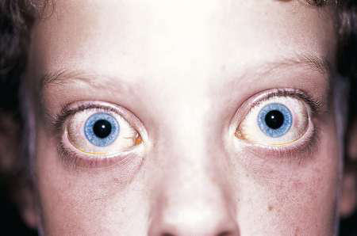

# Chapter 606: Thyrotoxicosis — Board-Style Self-Assessment MCQs
**Part XXIV: The Endocrine System** | [📖 Read Wiki Chapter](../chapters/606.md) | [🃏 Chapter Flashcards](../flashcards/606_flashcards.md) | [🏠 Course Master Index](../../index.md)

Total questions: **5** *(Click "Show Answer & Rationale" beneath each question)*

### Question 1 (Clinical Pediatrics Vignette)
A pediatric patient is evaluated for the following clinical and diagnostic profile: TSH-receptor antibody; Graves disease; Inappropriate TSH secretion; TSH-secreting pituitary adenoma;; resistance to thyroid hormone β; Excess hCG secretion; Trophoblastic tumors; (choriocarcinoma or hydatidiform; mole); hyperemesis gravidarum. Which of the following conditions or syndromes is the most likely diagnosis?

- **A.** EFFECT OF INCREASED THYROID STIMULATORS
- **B.** SIGNS (Thyrotoxicosis)
- **C.** EXPOSURE TO EXCESSIVE IODINE
- **D.** EXTRATHYROIDAL SOURCE OF HORMONE

<b>Show Answer & Rationale</b>

**Correct Answer: A** — EFFECT OF INCREASED THYROID STIMULATORS

**Rationale:** **EFFECT OF INCREASED THYROID STIMULATORS** is characterized by: TSH-receptor antibody; Graves disease; Inappropriate TSH secretion; TSH-secreting pituitary adenoma;; resistance to thyroid hormone β; Excess hCG secretion; Trophoblastic tumors; (choriocarcinoma or hydatidiform; mole); hyperemesis gravidarum.

**Why Other Options Are Incorrect:** **SIGNS (Thyrotoxicosis)** is incorrect (characterized by Constitutional; Weight loss despite increased appetite; heat-related; symptoms (heat intolerance, sw). **EXPOSURE TO EXCESSIVE IODINE** is incorrect (characterized by Jod-Basedow effect; Iodine-induced hyperthyroidism; (radiocontrast agents or iodine in; medications)). **EXTRATHYROIDAL SOURCE OF HORMONE** is incorrect (characterized by Excess intake of thyroid; hormone; Excess exogenous thyroid hormone; (iatrogenic or factitious); Ect).

### Question 2 (Clinical Pediatrics Vignette)
A pediatric patient is evaluated for the following clinical and diagnostic profile: Activating pathogenic variant; in TSH receptor or Gsα; protein; Solitary hyperfunctioning adenoma;; multinodular goiter; familial; nonautoimmune hyperthyroidism. Which of the following conditions or syndromes is the most likely diagnosis?

- **A.** EFFECT OF INCREASED THYROID STIMULATORS
- **B.** AUTONOMOUS THYROID FUNCTION
- **C.** INFLAMMATION AND RELEASE OF STORED HORMONE
- **D.** EXTRATHYROIDAL SOURCE OF HORMONE

<b>Show Answer & Rationale</b>

**Correct Answer: B** — AUTONOMOUS THYROID FUNCTION

**Rationale:** **AUTONOMOUS THYROID FUNCTION** is characterized by: Activating pathogenic variant; in TSH receptor or Gsα; protein; Solitary hyperfunctioning adenoma;; multinodular goiter; familial; nonautoimmune hyperthyroidism.

**Why Other Options Are Incorrect:** **EFFECT OF INCREASED THYROID STIMULATORS** is incorrect (characterized by TSH-receptor antibody; Graves disease; Inappropriate TSH secretion; TSH-secreting pituitary adenoma;). **INFLAMMATION AND RELEASE OF STORED HORMONE** is incorrect (characterized by Autoimmune destruction of; thyroid gland; Autoimmune thyroiditis;; postpartum thyroiditis; Viral inf). **EXTRATHYROIDAL SOURCE OF HORMONE** is incorrect (characterized by Excess intake of thyroid; hormone; Excess exogenous thyroid hormone; (iatrogenic or factitious); Ect).

### Question 3 (Visual Diagnosis & Clinical Spotter)

A pediatric patient undergoes evaluation for **Thyrotoxicosis**, yielding the clinical or diagnostic finding shown below. Which of the following best characterizes the illustrated finding?

- **A.** Etiologies of nonautoimmune hyperthyroidism include hyperfunctioning thyroid nodules and germline gain-of-function pathogenic variants in the TSHR (either autosomal dominant or sporadic).
- **B.** Retraction of upper eyelids in the primary gaze (Dalrymple sign). (From Kanski JJ. Systemic Diseases and the Eye: Signs and Dif- ferential Diagnosis. London: Mosby; 2001.)
- **C.** Graves disease is the most common cause of hyperthyroidism in children.
- **D.** In infants born to mothers with Graves disease, hyperthyroidism can be caused by transplacental passage of TRSAbs, but this is transitory and resolves when TRSBAbs are cleared from the neona

<b>Show Answer & Rationale</b>

**Correct Answer: B** — Retraction of upper eyelids in the primary gaze (Dalrymple sign). (From Kanski JJ. Systemic Diseases and the Eye: Signs and Dif- ferential Diagnosis. London: Mosby; 2001.)

**Rationale:** **Fig. 606.2**: Retraction of upper eyelids in the primary gaze (Dalrymple sign). (From Kanski JJ. Systemic Diseases and the Eye: Signs and Dif- ferential Diagnosis. London: Mosby; 2001.)

### Question 4 (Differential Diagnosis (Thyrotoxicosis))
During a pediatric consultation regarding **Thyrotoxicosis**, which clinical entity or concept is described by the following profile? "the most common cause of hyperthyroidism in children (Table 606."

- **A.** ETIOLOGY
- **B.** Graves disease
- **C.** Definitive Therapy
- **D.** thyroxine-binding globulin

<b>Show Answer & Rationale</b>

**Correct Answer: B** — Graves disease

**Rationale:** Graves disease is the most common cause of hyperthyroidism in children (Table 606.

### Question 5 (Pediatric Board Mastery (Thyrotoxicosis))
When formulating an evidence-based diagnostic and management plan for **Thyrotoxicosis** (*Part XXIV: The Endocrine System*), which of the following pediatric clinical statements is **ACCURATE**? (Item 1)

- **A.** The condition is an entirely benign physiologic variant that never warrants laboratory or clinical evaluation.
- **B.** Systemic tetracyclines and fluoroquinolones are universally required as routine prophylaxis in all healthy newborns.
- **C.** Graves disease is the most common cause of hyperthyroidism in children.
- **D.** First-line management relies on immediate high-dose aspirin therapy in febrile infants.

<b>Show Answer & Rationale</b>

**Correct Answer: C** — Graves disease is the most common cause of hyperthyroidism in children.

**Rationale:** **Pediatric Clinical Principle (Thyrotoxicosis):** Graves disease is the most common cause of hyperthyroidism in children.

