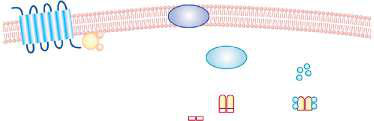

# Chapter 619: Cushing Syndrome — Board-Style Self-Assessment MCQs
**Part XXIV: The Endocrine System** | [📖 Read Wiki Chapter](../chapters/619.md) | [🃏 Chapter Flashcards](../flashcards/619_flashcards.md) | [🏠 Course Master Index](../../index.md)

Total questions: **5** *(Click "Show Answer & Rationale" beneath each question)*

### Question 1 (Clinical Pediatrics Vignette)
A pediatric patient is evaluated for the following clinical and diagnostic profile: Congenital adrenal hyperplasia; 21-Hydroxylase (the causative gene) deficiency; 11β-Hydroxylase (the causative gene) deficiency; 3β-Hydroxysteroid dehydrogenase (the causative gene) defect (deficiency or; dysregulation); Tumor. Which of the following conditions or syndromes is the most likely diagnosis?

- **A.** PELD Score (<12 Years Old)
- **B.** PAX6 (Dysmorphology, Phenotyping, and Sequences)
- **C.** EXCESS ANDROGEN (Cushing Syndrome)
- **D.** Choose safer foods

<b>Show Answer & Rationale</b>

**Correct Answer: C** — EXCESS ANDROGEN (Cushing Syndrome)

**Rationale:** **EXCESS ANDROGEN (Cushing Syndrome)** (associated with **`CYP11B1, CYP21A2, HSD3B2`**) is characterized by: Congenital adrenal hyperplasia; 21-Hydroxylase (CYP21A2) deficiency; 11β-Hydroxylase (CYP11B1) deficiency; 3β-Hydroxysteroid dehydrogenase (HSD3B2) defect (deficiency or; dysregulation); Tumor.

**Why Other Options Are Incorrect:** **PELD Score (<12 Years Old)** is incorrect (characterized by Incorporates Total Bilirubin, INR, Serum Albumin, Age <1 yr, and Growth Failure (weight/height z-sco). **PAX6 (Dysmorphology, Phenotyping, and Sequences)** is incorrect (characterized by Waardenburg syndrome, type I; Autosomal dominant; Deafness; White forelock; Wide-spaced eyes; Iris h). **Choose safer foods** is incorrect (characterized by • Do not drink raw (unpasteurized) milk, and do not eat foods that; have unpasteurized milk in them.).

### Question 2 (Clinical Pediatrics Vignette)
A pediatric patient is evaluated for the following clinical and diagnostic profile: Bilateral adrenal hyperplasia; Adenoma; Hypersecretion of corticotropin (Cushing disease); Ectopic secretion of corticotropin; Exogenous corticotropin; Adrenocortical nodular dysplasia; Pigmented nodular adrenocortical disease (Carney complex); Tumor. Which of the following conditions or syndromes is the most likely diagnosis?

- **A.** PHYSICAL (Impact of Violence Exposure on Children)
- **B.** N, C, A (Inherited Tubular Transport Abnormalities)
- **C.** TENDERNESS (Acute Mastoiditis)
- **D.** EXCESS CORTISOL (CUSHING SYNDROME)

<b>Show Answer & Rationale</b>

**Correct Answer: D** — EXCESS CORTISOL (CUSHING SYNDROME)

**Rationale:** **EXCESS CORTISOL (CUSHING SYNDROME)** is characterized by: Bilateral adrenal hyperplasia; Adenoma; Hypersecretion of corticotropin (Cushing disease); Ectopic secretion of corticotropin; Exogenous corticotropin; Adrenocortical nodular dysplasia; Pigmented nodular adrenocortical disease (Carney complex); Tumor; McCune-Albright syndrome.

**Why Other Options Are Incorrect:** **PHYSICAL (Impact of Violence Exposure on Children)** is incorrect (characterized by Death; Sexual violence (pregnancy, genital trauma, STIs); Amputations and fractures; Head trauma; Ba). **N, C, A (Inherited Tubular Transport Abnormalities)** is incorrect (characterized by Low; Very low; Normal; High, high; Low, normal, or high; —; BS IVa, IVb). **TENDERNESS (Acute Mastoiditis)** is incorrect (characterized by Acute mastoiditis; with periostitis; May be absent; Yes; No; Usually; No; Usually; Acute; mastoiditi).

### Question 3 (Pediatric Genetics & Molecular Etiology)
A child is diagnosed with **EXCESS ANDROGEN (Cushing Syndrome)** after presenting with Congenital adrenal hyperplasia; 21-Hydroxylase (the causative gene) deficiency; 11β-Hydroxylase (the causative gene) deficiency; 3β-Hydroxysteroid dehydrogenase (the causative gene) defect (deficiency or; dysre. Pathogenic variants in which of the following genes are most classically implicated?

- **A.** CYP11B1
- **B.** INF2
- **C.** CDKL5
- **D.** TWIST1

<b>Show Answer & Rationale</b>

**Correct Answer: A** — CYP11B1

**Rationale:** Pathogenic variants in **`CYP11B1`** (The Endocrine System) are associated with **EXCESS ANDROGEN (Cushing Syndrome)** (Congenital adrenal hyperplasia; 21-Hydroxylase (CYP21A2) deficiency; 11β-Hydroxylase (CYP11B1) deficiency; 3β-Hydroxysteroid dehydrogenase (HSD3B2) defect (deficiency or; dysregulation); Tumor).

### Question 4 (Visual Diagnosis & Clinical Spotter)

A pediatric patient undergoes evaluation for **Cushing Syndrome**, yielding the clinical or diagnostic finding shown below. Which of the following best characterizes the illustrated finding?

- **A.** Summary of genetic and molecular mecha- nisms implicated in Cushing syndrome. For each cause, the various pathogenic variants or abnormal protein ex- pression believed to play a part in the patho
- **B.** Gynecomastia in males or premature thelarche in females is often the initial manifestation.
- **C.** DIFFERENTIAL DIAGNOSIS For virilizing signs, the differential includes virilizing forms of adrenal hyperplasia and factitious exposure to androgens, such as topical testosterone preparations
- **D.** Many adrenocortical tumors have a relative deficiency of 11βhydroxylase activity and secrete increased amounts of deoxycorticosterone; these patients are hypertensive, and their tumors are o

<b>Show Answer & Rationale</b>

**Correct Answer: A** — Summary of genetic and molecular mecha- nisms implicated in Cushing syndrome. For each cause, the various pathogenic variants or abnormal protein ex- pression believed to play a part in the patho

**Rationale:** **Fig. 619.1**: Summary of genetic and molecular mecha- nisms implicated in Cushing syndrome. For each cause, the various pathogenic variants or abnormal protein ex- pression believed to play a part in the pathophysiology is shown. The most frequent mechanisms are highlighted in red; the well-characterized mechanisms are highlight- ed in bold characters, and other potential mechanisms are in normal characters; a question mark shows an un- confirmed association or genetic predisposition. Please refer to the text for explanation of the various genetic defects under each diagnostic category. AC, Adenylate cyclase; ACTH, adrenocorticotropic hormone; BMAH, bilateral macronodular adrenal hyperplasia; Cα, catalytic subunit of PKA; GEP-NETs, gastroenteropancreatic neu- roendocrine tumors; GPCR, G protein–coupled receptor; PDEs, phosphodiesterases; PKA, protein kinase A; PP- NAD, primary pigmented nodular adrenocortical disease; R1α, type 1α regulatory subunit of PKA. (From Lacroix A, Feelders RA, Stratakis CA, et al. Cushing’s syndrome. Lancet. 2015;386:913–927. Fig. 1.)

### Question 5 (Pediatric Board Mastery (Cushing Syndrome))
When formulating an evidence-based diagnostic and management plan for **Cushing Syndrome** (*Part XXIV: The Endocrine System*), which of the following pediatric clinical statements is **ACCURATE**? (Item 1)

- **A.** Inheritance is exclusively holandric (Y-linked) with 100% penetrance restricted to male neonates.
- **B.** First-line management relies on immediate high-dose aspirin therapy in febrile infants.
- **C.** Gynecomastia in males or premature thelarche in females is often the initial manifestation.
- **D.** Systemic tetracyclines and fluoroquinolones are universally required as routine prophylaxis in all healthy newborns.

<b>Show Answer & Rationale</b>

**Correct Answer: C** — Gynecomastia in males or premature thelarche in females is often the initial manifestation.

**Rationale:** **Pediatric Clinical Principle (Cushing Syndrome):** Gynecomastia in males or premature thelarche in females is often the initial manifestation.

